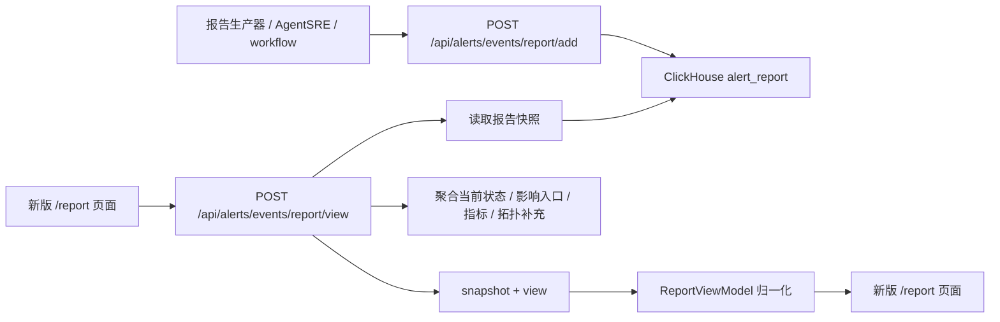

# /report 页面需求设计文档

## 1. 背景和目标

`/report` 是告警事件诊断完成后的事故处置简报页。它不负责重新做根因分析，而是消费已经生成的报告快照，帮助值班、研发和业务负责人快速回答四个问题：

1. 这次是什么类型的故障。
2. 根因定位到哪里，判断依据是什么。
3. 哪些入口、服务或业务面受到影响。
4. 下一步应该先做什么，后续如何验证。

新版页面保持“统一报告页”的设计，不为不同报告类型拆成三套页面。报告类型只影响标题、图标、重点指标、故障位置标签和证据优先级。

本文档基于原 `/report` 的代码契约和当前页面改版讨论结果编写，用于约束后续前后端实现。已有字段可达性细节可参考 `docs/requirements/2026-05-20-report-page-field-reachability.md`。

## 2. 原 /report 分成哪几种报告

原始类型定义位于 `frontend/src/pro/views/report/type.ts`：

```ts
export type ReportType = 'slow' | 'error' | 'infra'
```

因此，原 `/report` 已实现的报告类型只有三类：

| `reportType` | 中文名称 | 主要场景 | 页面要回答的问题 | 故障位置标签 |
|---|---|---|---|---|
| `slow` | 慢延时报告 | P95/P99 升高、请求超时、调用链耗时异常、慢 SQL、下游耗时增加 | 慢在哪里，哪个调用段或资源导致入口变慢 | 慢点位置 |
| `error` | 错误报告 | 错误率升高、异常类型集中、5xx、下游失败、业务调用失败 | 错在哪里，错误是否来自本服务、下游、第三方或运行时 | 错误位置 |
| `infra` | 基础设施报告 | CPU、内存、磁盘、网络、Pod、Node、容器等基础设施异常 | 哪个基础设施对象异常，如何影响服务或入口 | 异常位置 |

`RootCauseTyoe = 'cpu' | 'code' | 'net' | 'storage' | 'downstream'` 是根因方向，不是报告类型。它用于 `rootCauseAnalysis.other` 中的排查方向排序。

当前新版 view model 中预留了 `thirdParty`，但它不是原 `/report` 已实现类型。它可以作为未来扩展类型，前提是报告生产器明确输出 `reportType = thirdParty`，并且后端、前端、文案和验收用例同步补齐。

## 3. 页面入口和查询方式

### 3.1 入口

`/report` 通常由告警事件、Agent 诊断或外部报告链接进入。目标 URL 应包含：

| 参数 | 用途 |
|---|---|
| `startTime` | 查询窗口开始时间，微秒时间戳。 |
| `endTime` | 查询窗口结束时间，微秒时间戳。 |
| `alertEventId` | 告警事件报告主标识，推荐优先使用。 |
| `agentChatId` | Agent 会话报告标识，可作为另一种 tags 查询条件。 |

### 3.2 前端请求

前端已有 `getReportApi` 保持为旧快照接口 wrapper，不作为新版页面数据入口：

```ts
getReportApi(params) -> POST api/alerts/events/report/get
```

新版 `/report` 应新增 API wrapper：

```ts
getReportViewApi(params) -> POST /api/alerts/events/report/view
```

新旧接口请求体保持一致：

```ts
interface GetAlertEventReportViewRequest {
  startTime: number
  endTime: number
  tags: Record<string, string>
}
```

`tags` 应至少包含一个稳定定位键，例如：

```ts
{ "alertEventId": "INC-2026-0520-021" }
```

或：

```ts
{ "agentChatId": "thread_xxx" }
```

## 4. 数据怎么来的

### 4.1 总体链路

原有 `/api/alerts/events/report/get` 保持为报告快照读取接口，不承载新版页面聚合逻辑。新版 `/report` 使用新的视图接口读取页面模型：

```text
POST /api/alerts/events/report/view
```

新接口内部可以复用原快照读取能力，但响应结构面向新版页面。这样可以保持旧接口兼容，也能明确区分“生成时报告快照”和“查看时补充的视图字段”。



### 4.2 写入链路

报告生产侧调用 `/api/alerts/events/report/add` 写入报告快照。后端接收 `AddAlertEventReportRequest`：

| 请求字段 | 落库字段 | 含义 |
|---|---|---|
| `reportType` | `alert_report.report_type` | 报告类型：`slow`、`error`、`infra`。 |
| `overview.timestamp` | `overview_timestamp` | 报告生成时间。 |
| `overview.detail` | `overview_detail` | 事故现象、影响和摘要。 |
| `overview.reason` | `overview_reason` | 分析原因或分析过程文本。 |
| `overview.tags` | `overview_tags` | 报告展示标签，如 `alertEventId`、`service`、`endpoint`。 |
| `tags` | `tags` | 查询标签，用于读取报告。 |
| `topology` | `topology` | 拓扑快照。 |
| `rootCauseAnalysis.cause` | `rootcause` | 根因结论。 |
| `rootCauseAnalysis.other` | `rootcause_other` | 排查方向、候选根因和已排除项。 |
| `suggest` | `suggest` | 处置建议。 |
| `evidence` | `data` | 证据明细。 |

写入前后端会用 `overview.timestamp ± 1h` 和 `tags` 查重，同一标签同一时间段只允许写入一份报告。

报告身份要求：

1. 新生成的告警事件报告必须把 `alertEventId` 同时写入 `tags.alertEventId` 和 `overview.tags.alertEventId`。
2. `tags.alertEventId` 是后端查询报告的稳定主键；`overview.tags.alertEventId` 是页面展示和兜底显示用字段。
3. 生产侧仍应保留 `service`、`endpoint`、`pod`、`nodeName`、`pid`、`containerId` 等事实标签，供影响面、定位和历史兼容使用。

### 4.3 读取链路

原有 `/api/alerts/events/report/get` 接收 `startTime`、`endTime`、`tags`。服务层会把查询窗口扩展为：

```text
startTime - 1h  到  endTime + 1h
```

然后在 ClickHouse `alert_report` 中按 `overview_timestamp` 和 `tags[...]` 查询，当前 DAO 使用 `LIMIT 1` 返回一份快照。

新版页面不直接消费该旧接口，而是调用 `/api/alerts/events/report/view`。新接口先读取同一份 `alert_report` 快照，再按需聚合视图字段：

```ts
interface GetAlertEventReportViewResponse {
  snapshot: GetAlertEventReportResponse
  view: {
    runtimeStatus?: ReportRuntimeStatus
    businessImpact?: BusinessImpact
    metricDeltas?: MetricDelta[]
    topology?: ReportTopology
    faultLocation?: FaultLocation
    timeline?: TimelineItem[]
    dataSources: {
      snapshot: 'alert_report'
      runtimeStatus?: 'alert_event' | 'redcharts'
      businessImpact?: 'snapshot' | 'alert_event' | 'impact_api' | 'service_topology' | 'snapshot+alert_event' | 'snapshot+impact_api' | 'snapshot+service_topology' | 'snapshot+alert_event+impact_api'
      metricDeltas?: 'snapshot' | 'redcharts'
      topology?: 'snapshot' | 'service_topology' | 'dataplane_topology'
      timeline?: 'snapshot' | 'analyzeProcess'
    }
  }
}
```

实现要求：

1. 如果同一窗口可能命中多份报告，后端应定义稳定排序规则，例如按 `overview_timestamp DESC` 取最新一份。
2. `tags` 必须避免字符串拼接注入风险，后续应参数化或白名单化 tag key。
3. 读取响应的字段语义必须和写入字段保持一致。
4. 新版页面只调用 `/api/alerts/events/report/view`；旧 `/api/alerts/events/report/get` 保持原快照语义和兼容性。

历史兼容策略：

1. `/api/alerts/events/report/view` 先按请求 `tags` 做精确读取。
2. 如果精确读取失败，且请求中存在 `tags.alertEventId`，新接口会把该值作为 `alert_event.event_id` 查询告警事件。
3. 查到告警事件后，后端从事件标签中归一化出身份标签：`service/serviceName/svc_name`、`endpoint/content_key`、`pod/podName/pod_name/src_pod`、`namespace/src_namespace`、`nodeName/node/node_name/instance_name`、`pid`、`containerId/container_id`、`group`、`alertName`。
4. 后端再读取同一扩展窗口内最近的报告候选，按候选报告的 `tags` 和 `overview.tags` 与事件身份标签做匹配打分。
5. 只有高置信候选才会返回；当窗口内有多份候选且最高分低于 2 时，不做兜底返回。
6. 如果最高分并列，只有这些候选的故障对象身份标签完全相同，例如 `pod + nodeName + pid + containerId` 相同，才按 `overview_timestamp DESC` 的稳定排序取第一份；否则不做兜底返回，避免拿错报告。
7. 该兼容逻辑只存在于新的 `/report/view`，不会改变旧 `/report/get` 的精确 tags 查询行为。

这意味着历史报告即使没有写入 `tags.alertEventId`，只要它保留了足够的 pod、node、pid、container 或 service/endpoint 标签，新版页面仍可从 `/report?alertEventId=...` 打通到报告。长期方案仍然是生成侧写入 `alertEventId`，兼容匹配只用于老数据。

### 4.4 当前响应结构

目标响应结构：

```ts
interface GetAlertEventReportResponse {
  reportType: 'slow' | 'error' | 'infra' | string
  reportData: {
    overview: {
      timestamp: number
      detail: string
      reason: string
      tags: Record<string, string>
    }
    topology?: ReportTopology
    rootCauseAnalysis: {
      cause: string
      other: Array<{
        level: 'major' | 'minor' | 'normal' | string
        type: string
        reason: string
      }>
    }
    suggest: Array<{
      action: string
      level?: 'high' | 'medium' | 'low' | string
      category?: string
      verification?: string
      trigger?: string
      risk?: string
    }>
    analyzeProcess?: string
    evidence: ReportEvidence[]
  }
}
```

当前后端转换需要校准：写入时 `overview.detail` 落到 `overview_detail`，`overview.reason` 落到 `overview_reason`；读取转换中 `overview_detail` 被赋给了 `overview.reason`，`overview_reason` 被赋给了 `analyzeProcess`，`overview.detail` 没有显式回填。新版 `/report` 上线真实 API 前必须修正这个映射，否则首屏摘要和事件时间线会读错字段。

### 4.5 数据时态原则

原 `/report` 的核心机制是“生成报告时写入快照，查看报告时读取快照”，不是用户打开页面时实时重新生成诊断报告。

原页面打开时确实会实时调用 `/api/alerts/events/report/get`，但这个请求只是在 `alert_report` 中查找已经生成的报告记录。报告正文中的 `overview`、`topology`、`rootCauseAnalysis`、`suggest`、`analyzeProcess`、`evidence` 都是生成报告时写入的快照内容。

新版继续沿用这个原则，但通过新的 `/api/alerts/events/report/view` 接口返回页面视图模型。该接口可以补充当前状态和缺失事实字段，但不能改写 `snapshot` 中的报告正文。

| 数据类别 | 时态 | 处理原则 |
|---|---|---|
| 根因结论 | 生成时快照 | 来自 `rootCauseAnalysis.cause`，不因页面刷新而改写。 |
| 事故摘要和分析原因 | 生成时快照 | 来自 `overview.detail`、`overview.reason`、`analyzeProcess`。 |
| 排查方向排序 | 生成时快照 | 来自 `rootCauseAnalysis.other`，表示当次诊断时的判断。 |
| 处置建议 | 生成时快照 | 来自 `suggest`，表示当次报告给出的建议。 |
| 关键证据 | 生成时快照 | 来自 `evidence`，默认展示生成时证据；下钻查询只作为补充。 |
| 影响拓扑 | 优先生成时快照 | 优先来自 `alert_report.topology`；缺失时后端可按同一分析窗口补查拓扑。 |
| 受影响入口 / 业务影响 | 推荐生成时存储，缺失时后端补 | 最稳定方案是报告生成时写入结构化 `businessImpact`；短期可由后端在查看时按报告窗口调用 `/api/alerts/event/impact` 补齐。 |
| 当前状态、持续时长、状态更新时间 | 查看时实时补充 | 属于告警当前状态，不属于报告正文；应从 `alert_event` 和当前 RED 指标聚合。 |

因此，页面文案需要区分“报告生成时的诊断结论”和“当前状态”。不能用当前实时数据覆盖或改写报告正文，只能在独立的当前状态区域提示“现在是否仍异常 / 是否恢复”。

## 5. 新版页面信息架构

新版 `/report` 的页面结构按“先结论、再影响、再证据、最后复盘排查方向”组织。

### 5.1 第一屏

第一屏内容原则上不再改动，只保留决策最关键的信息：

| 区域 | 内容 | 数据来源 |
|---|---|---|
| 顶部元信息 | 报告 ID、数据来源、生成时间、分析窗口 | URL tags、`overview.timestamp`、查询窗口或生产侧 `analysisWindow`。 |
| 根因结论 | 当前根因结论、报告类型、当前状态 | `rootCauseAnalysis.cause`、`reportType`、告警事件状态或 runtime status。 |
| 摘要卡片 | 告警现象、快速判断根因、已排除方向、建议动作 | `overview.detail`、`rootCauseAnalysis.other`、`suggest`。 |
| 核心指标 | 最关键的 1 到 3 个指标变化 | `evidence` 中的 metrics/red 证据，缺失时可从 topology metrics 兜底。 |
| 故障位置 | 慢点位置、错误位置或异常位置 | `topology`、`rootCauseAnalysis.cause`、主根因候选。 |

第一屏不再单独展示“影响范围”。原因是“影响范围”与下方“受影响入口 / 业务影响”重复，而且首屏应该聚焦根因结论、核心指标和定位位置。影响相关信息放到第二屏后第一个模块中集中表达。

### 5.2 第二屏及后续

推荐顺序：

1. `受影响入口 / 业务影响` 与 `事件时间线` 放在左侧主列，`处置建议` 放在右侧。
2. `影响拓扑` 独立成一块，展示拓扑关系和异常路径。
3. `关键证据` 独立成一块，先展示关键证据摘要，再按需展开证据明细。
4. `排查方向排序` 保留，但弱化并放到最后，作为复盘和可信度解释，不抢占处置主流程。

## 6. 页面模块需求

### 6.1 受影响入口 / 业务影响

目标是明确列出：

| 字段 | 含义 | 当前状态 |
|---|---|---|
| `endpoints` | 受影响接口路径或入口名，例如 `/api/checkout/submit` | 当前只能从 `overview.tags.endpoint` 或文本推断，后端应补结构化列表。 |
| `entryServices` | 入口服务，例如 `checkout`、`web-bff` | 当前可从 tags 和 topology parents/current 粗略得到。 |
| `affectedServices` | 受影响服务，例如当前服务、下游服务、依赖服务 | 当前可从 topology current/children 粗略得到。 |
| `impactSummary` | 业务影响摘要 | 当前来自 `overview.detail`，后续应由生产侧输出更稳定摘要。 |
| `metricDeltas` | 错误率、延迟、QPS、吞吐等关键变化 | 当前可从 `evidence[].data.chartData` 提取，缺失时后端按时间窗查 RED。 |

现状问题：当前数据主要只有 topology summary 和 tags，缺少明确 endpoint、入口服务、影响面列表。后端可以从 `/api/alerts/event/impact`、RED endpoint 查询、dataplane/service RED 查询补齐。

### 6.2 事件时间线

把原“分析过程”改成“事件时间线”是合理的，但必须满足一个约束：不能为了视觉效果伪造时间线。

展示规则：

1. 如果 `analyzeProcess` 是带时间点的文本，例如 `14:03 checkout 错误率开始升高`，前端可解析成时间线。
2. 如果后端返回结构化 `timeline`，优先使用结构化时间线。
3. 如果只有无时间点的分析文本，页面应降级展示为“排查步骤”或普通步骤列表，不强行显示时间点。
4. 时间线应优先覆盖异常开始、告警触发、关键排查、根因确认、建议生成。

长期推荐生产侧直接输出：

```ts
timeline: Array<{
  time: string
  title: string
  detail?: string
  source?: 'alert' | 'metric' | 'trace' | 'log' | 'agent'
}>
```

### 6.3 处置建议

处置建议来自 `suggest`。建议分三类展示：

| 类型 | 示例 | 来源 |
|---|---|---|
| 立即缓解 | 切流、降级、扩容、限流、重启异常实例 | `suggest[level=high]`。 |
| 验证动作 | 观察错误率、P95、超时数、恢复状态 | `suggest.verification`。 |
| 后续跟进 | 联系第三方、补告警、修复代码、优化索引 | `suggest[level=medium|low]` 或 `category=followUp`。 |

如果生产侧没有 `category`、`verification`、`risk`，页面只展示 `action` 和 `level`，不补造风险说明。

### 6.4 影响拓扑

影响拓扑只在 `影响拓扑` 区域展示，不再作为“证据明细”里的拓扑证据重复展示。

数据来源：

1. 优先使用 `alert_report.topology`。
2. 如果报告快照没有 topology，后端可按 `service`、`endpoint`、`traceId/spanId`、报告时间窗从 dataplane topology 或 OriginX trace/flow 补齐。
3. 如果仍无法得到拓扑，页面显示明确空态，不影响其他模块展示。

### 6.5 关键证据

关键证据保留“关键证据摘要”，用于快速解释为什么根因结论可信。

展示规则：

1. 证据摘要优先展示 3 到 5 条，来源包括 metrics、RED、log、trace、runtime/infra。
2. `evidence.type = endpoints` 或拓扑类证据不进入证据明细，避免和 `影响拓扑` 重复。
3. 原始证据明细默认折叠，用户需要时再展开。
4. 证据应展示名称、类型、摘要值、说明；不要默认暴露内部 SQL/PQL。

### 6.6 排查方向排序

排查方向排序保留，但位置弱化到页面后段。

数据来源是 `rootCauseAnalysis.other`：

| `level` | 页面含义 |
|---|---|
| `major` | 首要根因或高嫌疑方向。 |
| `minor` | 次要嫌疑，需要继续验证。 |
| `normal` | 已排除方向。 |

该模块的作用是解释“查过哪些方向、为什么某些方向不是根因”，不是主处置入口。首屏可以摘取少量“已排除方向”，完整排序放到最后。

## 7. 字段来源矩阵

| 页面字段 | 来源 | 当前可达性 | 实现说明 |
|---|---|---|---|
| 报告类型 | `reportType` | 已可用 | 仅 `slow`、`error`、`infra` 是原已实现类型。 |
| 报告 ID | `overview.tags.alertEventId` 或请求 tags | 已可用 | 缺失时可回退到 URL query。 |
| 生成时间 | `overview.timestamp` | 已可用 | 前端格式化为本地时间。 |
| 分析窗口 | URL `startTime/endTime`，或生产侧 `analysisWindow` | 已可用 / 生产侧补充 | 短期用查询窗口，长期使用报告生成时的真实分析窗口。 |
| 当前状态 | 告警事件状态 + 当前 RED | 新接口后端聚合 | 由 `/api/alerts/events/report/view` 补充，这是实时状态，不应回写报告快照。 |
| 根因结论 | `rootCauseAnalysis.cause` | 已可用 | 第一屏主标题。 |
| 事故摘要 | `overview.detail` | 已可用但需修正映射 | 当前后端读取映射需校准。 |
| 分析原因 | `overview.reason` | 已可用但需修正映射 | 可用于摘要补充，不等同时间线。 |
| 故障位置 | `topology` + `rootCauseAnalysis.cause` | 已可用 / 后端可补 | 缺 topology 时只能显示文本定位。 |
| 核心指标 | `evidence` metrics/red，或 topology metrics | 已可用 / 后端可补 | 缺 chartData 时后端按时间窗补查 RED。 |
| Endpoint 列表 | `overview.tags.endpoint`、影响面接口、RED endpoint 查询 | 新接口后端聚合 | 当前结构不足，由 `/api/alerts/events/report/view` 聚合明确列表。 |
| 入口服务 | tags、topology parents/current、影响面接口 | 新接口后端聚合 | 需要去重并保留入口语义。 |
| 受影响服务 | topology current/children、影响面接口 | 新接口后端聚合 | 需要区分“入口服务”和“受影响服务”。 |
| 业务影响摘要 | `overview.detail` 或生产侧 `businessImpact.summary` | 已可用 / 生产侧补充 | 不再放第一屏重复展示。 |
| 事件时间线 | `analyzeProcess` 或生产侧 `timeline` | 已可用 / 生产侧补充 | 无时间点时降级为步骤列表。 |
| 处置建议 | `suggest` | 已可用 | `category/verification/risk` 建议生产侧结构化。 |
| 影响拓扑 | `topology` | 已可用 / 后端可补 | 独立展示，不放入证据明细。 |
| 关键证据摘要 | `evidence` | 已可用 | 过滤拓扑类证据。 |
| 排查方向排序 | `rootCauseAnalysis.other` | 已可用 | 放到页面后段。 |

## 8. 不同报告类型的展示差异

### 8.1 慢延时报告 `slow`

重点展示：

1. P95/P99、平均耗时、超时数、慢调用比例。
2. 慢 span、慢 SQL、下游依赖耗时、队列等待、资源争用。
3. 故障位置标签为“慢点位置”。
4. 处置建议优先包含降级、限流、索引修复、扩容、绕过慢依赖等。

### 8.2 错误报告 `error`

重点展示：

1. 错误率、错误数、5xx、异常类型、失败调用段。
2. 错误日志样本、错误 trace、下游失败、第三方失败。
3. 故障位置标签为“错误位置”。
4. 处置建议优先包含回滚、切流、降级、熔断、修复配置、联系依赖方等。

### 8.3 基础设施报告 `infra`

重点展示：

1. CPU、内存、磁盘 IO、网络、Pod 重启、Node 异常、容器状态。
2. 基础设施对象到服务入口的影响链路。
3. 故障位置标签为“异常位置”。
4. 处置建议优先包含迁移实例、扩容、重启、隔离节点、释放资源、调整调度等。

## 9. 新视图接口与生产侧补字段要求

为了让新版 `/report` 不依赖前端猜测，新增 `/api/alerts/events/report/view` 作为页面视图接口。该接口负责聚合 APO 已有数据源；报告生产器或 AgentSRE 只负责补充必须由诊断过程生成的结构化字段。

```ts
interface IncidentReportViewResponse {
  snapshot: GetAlertEventReportResponse
  view: {
    reportId?: string
    analysisWindow?: {
      startTime: number
      endTime: number
    }
    runtimeStatus?: {
      state: 'active' | 'recovering' | 'resolved' | 'snapshot' | 'unknown'
      label: string
      summary: string
      updatedAt?: number
    }
    severity?: 'critical' | 'major' | 'minor' | 'normal'
    durationMs?: number
    confidence?: number
    businessImpact?: {
      summary: string
      endpoints: string[]
      entryServices: string[]
      affectedServices: string[]
      metricDeltas?: Array<{
        name: string
        before?: number | string
        current?: number | string
        unit?: string
        description?: string
      }>
    }
    topology?: ReportTopology
    timeline?: Array<{
      time?: string
      title: string
      detail?: string
      source?: string
    }>
    dataSources: {
      snapshot: 'alert_report'
      runtimeStatus?: 'alert_event' | 'redcharts'
      businessImpact?: 'snapshot' | 'alert_event' | 'impact_api' | 'service_topology' | 'snapshot+alert_event' | 'snapshot+impact_api' | 'snapshot+service_topology' | 'snapshot+alert_event+impact_api'
      metricDeltas?: 'snapshot' | 'redcharts'
      topology?: 'snapshot' | 'service_topology' | 'dataplane_topology'
      timeline?: 'snapshot' | 'analyzeProcess'
    }
  }
}
```

`/api/alerts/events/report/view` 的请求结构沿用快照查询参数：

```ts
interface GetAlertEventReportViewRequest {
  startTime: number
  endTime: number
  tags: Record<string, string>
}
```

以下字段由新接口聚合：

```ts
interface ReportViewBackendSupplement {
  runtimeStatus?: {
    state: 'active' | 'recovering' | 'resolved' | 'snapshot' | 'unknown'
    label: string
    summary: string
    updatedAt?: number
  }
  businessImpact?: {
    summary: string
    endpoints: string[]
    entryServices: string[]
    affectedServices: string[]
    metricDeltas?: Array<{
      name: string
      before?: number | string
      current?: number | string
      unit?: string
      description?: string
    }>
  }
  metricDeltas?: MetricDelta[]
  faultLocation?: FaultLocation
}
```

以下字段优先由报告生产器或 AgentSRE 生成，APO 不应硬造：

| 字段 | 责任方 | 说明 |
|---|---|---|
| `rootCauseAnalysis.cause` | AgentSRE / 报告生产器 | 根因结论。 |
| `rootCauseAnalysis.other` | AgentSRE / 报告生产器 | 排查方向排序、已排除项。 |
| `suggest[].verification/risk/trigger` | AgentSRE / 报告生产器 | 处置建议的验证指标、风险和触发条件。 |
| `timeline[]` | AgentSRE / 报告生产器 | 结构化分析时间线；没有时只能从 `analyzeProcess` 降级转换。 |
| `evidence[].identifiers` | AgentSRE / 报告生产器 | traceId、spanId、service、timeRange、instance 等下钻标识。 |
| `confidence` | AgentSRE / 报告生产器 | 如果没有稳定评分口径，页面暂不展示。 |

短期可以继续由前端 view model 从现有快照中派生字段，但生产版本应避免以下推断成为长期契约：

1. 从 topology parents/current 推断入口服务。
2. 从 overview 文本解析 endpoint。
3. 从 evidence chartData 推断完整分析窗口。
4. 从根因文案匹配故障节点。

## 10. 明确移除或暂不展示的内容

| 内容 | 处理方式 | 原因 |
|---|---|---|
| 第一屏“影响范围” | 移除 | 与“受影响入口 / 业务影响”重复，且会让首屏过载。 |
| 证据明细里的拓扑证据展示 | 移除 | 拓扑已有独立模块，重复展示没有新增信息。 |
| 独立大块“原始分析过程” | 改为事件时间线或排查步骤 | 时间线更符合故障处置阅读习惯；无时间点时不伪造。 |
| 排查方向排序前置强展示 | 后移弱化 | 它更适合解释和复盘，不应抢占处置动作。 |
| 内部 SQL/PQL/查询语句 | 默认不展示 | 用户处置时不需要，且不同数据源实现不稳定。 |
| 所有指标曲线默认展开 | 默认折叠 | 页面需要先帮助决策，细节用于下钻。 |

## 11. 空态和异常态

| 场景 | 页面表现 |
|---|---|
| `/api/alerts/events/report/get` 无报告 | 显示报告未生成或未找到，保留返回入口。 |
| `/api/alerts/events/report/view` 无报告 | 显示报告未生成或未找到，保留返回入口；不要回退到 mock。 |
| 缺少 topology | `影响拓扑` 显示明确空态，其他模块继续展示。 |
| 缺少 affected endpoints | `受影响入口 / 业务影响` 显示“后端未返回明确入口”，不从长文本硬猜。 |
| 缺少 `suggest` | `处置建议` 显示无建议空态，不生成默认动作。 |
| 缺少 `evidence` | `关键证据` 显示无证据空态，但根因结论仍按快照展示。 |
| `reportType` 未知 | 使用通用“诊断报告”文案和默认图标，页面结构不崩溃。 |

## 12. 验收标准

1. 文档和实现都把原始报告类型限定为 `slow`、`error`、`infra`；`thirdParty` 只能标注为未来扩展。
2. 新版页面通过 `/api/alerts/events/report/view` 消费页面视图数据，前端不在生产环境长期依赖 mock 数据。
3. 原 `/api/alerts/events/report/get` 保持报告快照读取接口，不新增视图聚合字段，不破坏旧调用方。
4. 后端响应中 `overview.detail`、`overview.reason`、`analyzeProcess` 的映射与写入语义一致。
5. 第一屏不再展示重复的“影响范围”，受影响入口和业务影响集中到后续模块。
6. 证据明细不再展示拓扑证据，拓扑只在 `影响拓扑` 模块展示。
7. `分析过程` 改为 `事件时间线`；没有时间点的数据降级为步骤列表。
8. `排查方向排序` 保留但放到页面后段，视觉权重低于影响、建议、拓扑和关键证据。
9. `受影响入口 / 业务影响` 至少能展示 endpoint、入口服务、受影响服务三个列表；如果后端未返回，页面要明确标注缺失，不用装饰性内容填充。
10. 三种报告类型使用同一页面结构，但慢延时、错误、基础设施报告的指标重点和故障位置标签不同。
11. 页面空态、缺字段和未知类型都有可理解的降级表现，不影响已有报告快照展示。

## 13. 新版板块数据获取核查

结论：新版页面不是每个板块都能只靠当前 `/api/alerts/events/report/get` 直接拿到。因此新增 `/api/alerts/events/report/view` 作为新版页面唯一数据入口。页面应按三层数据来源处理：

1. 报告快照已返回：前端直接渲染，或在 view model 中做轻量归一化。
2. APO 已有相邻接口：后端聚合后返回给 `/report`，避免页面直接拼多条业务接口。
3. 当前没有稳定来源：要求报告生产器或 AgentSRE 生成结构化字段，前端不能从长文本硬猜。

| 新版板块 | 要展示的内容 | 旧 `/report/get` 是否直接有 | 以前没有的内容怎么获取 | 新 `/report/view` 必须补齐的改造 |
|---|---|---|---|---|
| 顶部元信息 | 报告 ID、生成时间、分析窗口、数据来源 | 部分有 | 报告 ID 从 `overview.tags.alertEventId` 或请求 tags；生成时间从 `overview.timestamp`；分析窗口短期用 URL `startTime/endTime`，长期由生产侧输出 `analysisWindow`。 | 修正 `overview.detail/reason/analyzeProcess` 映射；如果要真实分析窗口，生产侧写入 `analysisWindow`。 |
| 当前状态 | 当前是否仍异常、状态更新时间、持续时长、故障级别 | 没有 | 用 `/api/alerts/event/detail` 读取 `currentEvent.status/severity/createTime/updateTime/endTime/duration`；如果只有 `alertEventId`，后端需要支持按 event id 查询，或报告 tags 必须写入 `alertId + eventId`。当前 RED 状态可再按入口调用 `/api/service/redcharts` 或 `/api/dataplane/redcharts` 校验。 | 新增报告聚合逻辑：用 `alertEventId` 找回告警事件；不要让前端自行拼状态。 |
| 根因结论 | 报告类型、根因标题、摘要、已排除方向、首要建议 | 有 | `reportType`、`rootCauseAnalysis.cause`、`rootCauseAnalysis.other`、`suggest`、`overview.detail` 均来自报告快照。 | 后端读取时必须保证 `overview.detail` 仍返回到 `overview.detail`，否则首屏摘要不可用。 |
| 核心指标 | 1 到 3 个关键指标变化 | 部分有 | 优先从 `evidence[type=metrics|red].data.chartData` 取；缺失时用 `/api/service/redcharts`，请求 `startTime/endTime/step/serviceList/endpointList`；也可用 `/api/dataplane/redcharts?service=&endpoint=` 查询单服务或单 endpoint。 | 后端聚合出 `metricDeltas`，前端只消费整理后的核心指标，不自己决定查询哪些服务。 |
| 故障位置 | 慢点位置、错误位置、异常位置和判断依据 | 部分有 | 优先用 `topology.current/parents/children` + `rootCauseAnalysis.cause`；缺 topology 时用 `/api/service/topology`，参数为 `service/endpoint/entryService/entryEndpoint/startTime/endTime`；只有全局图时可用 `/api/dataplane/topology` 后端裁剪。 | 报告快照应优先写入定位节点；否则后端根据入口和根因节点补一个 `faultLocation`。 |
| 受影响入口 / 业务影响 | endpoint 列表、入口服务、受影响服务、影响摘要、关键 RED 变化 | 当前不足 | 用 `/api/alerts/event/impact`，请求 `startTime/endTime/services/endpoints/namespaces/groupId/analyzeSize`。响应 `data[]` 中已有 `serviceName`、`endpoint`、`relatedAlertRate`、`latency`、`errorRate`、`tps`、`namespaces`，可生成入口列表和指标变化。受影响服务可结合 `topology.current/children`。 | 当前 impact API 不按 `alertEventId` 精确过滤，只按窗口内 firing 告警和服务/endpoint 关联分析。报告聚合层应先从报告 tags/topology 得到根服务和入口，再调用 impact；如需严格绑定单个事件，impact API 需要支持 `alertEventId`。 |
| 事件时间线 | 异常开始、告警触发、关键排查、根因确认、建议生成 | 部分有 | 如果 `analyzeProcess` 含 `14:03 ...` 这种时间点，前端可解析；告警开始/恢复可从 alert event 的 `createTime/updateTime/endTime` 补；Agent 工具调用步骤当前没有稳定接口。 | 生产侧输出结构化 `timeline[]`。没有时间点时页面降级为排查步骤，不伪造时间线。 |
| 处置建议 | P1/P2/P3 动作、验证指标、风险、触发条件 | 部分有 | `suggest[].action`、`suggest[].level` 已有；`category/verification/risk/trigger` 当前 mock 有，但后端 schema 是 `map[string]any`，生产侧可以直接写入。 | 约定 suggest 结构字段；缺字段时只展示已有 action/level。 |
| 影响拓扑 | 当前节点、上游、下游、异常路径 | 有或可补 | 优先用 `alert_report.topology`；缺失时用 `/api/service/topology` 查服务 endpoint 上下游，或用 `/api/dataplane/topology` 查全局拓扑后裁剪。 | 拓扑只在该模块展示，`evidence[type=endpoints]` 不再进入证据明细。 |
| 关键证据 | 指标、日志、trace、运行时/基础设施证据摘要和可展开明细 | 有或可补 | 优先用 `alert_report.evidence`。摘要由 `name/type/description/chartData/log sample` 归一化生成；如果要下钻日志，用 `/api/log/fault/pagelist` 和 `/api/log/fault/content`，前提是 evidence 带 `service/traceId/timeRange/instance`；trace 可用 `/api/trace/info` 或 OriginX `/originx/api/*`，前提是 evidence 带 trace id/span id。 | 生产侧需要在 evidence 中写入下钻所需 identifiers；没有 identifiers 时只能展示摘要，不能构造假链接。 |
| 排查方向排序 | major/minor/normal 候选方向、判断理由、已排除项 | 有 | 直接来自 `rootCauseAnalysis.other`。`major` 为首要根因，`minor` 为待验证，`normal` 为已排除。 | 只需前端弱化展示位置；无需新增接口。 |

### 13.1 后端聚合建议

新增 `/api/alerts/events/report/view` 做报告视图聚合。不要扩展或改变原 `/api/alerts/events/report/get` 的响应结构。聚合逻辑如下：

1. 读取 `alert_report` 快照，得到 `reportType`、`overview`、`rootCauseAnalysis`、`suggest`、`topology`、`evidence`。
2. 修正并稳定 `overview.detail`、`overview.reason`、`analyzeProcess` 的响应映射。
3. 从 `overview.tags` 或请求 tags 取 `alertEventId`；如果需要当前状态，后端用 `alertId + eventId` 查 `/api/alerts/event/detail` 同等数据，或新增按 event id 查询能力。
4. 从 `overview.tags.service/endpoint`、`topology.current`、`topology.parents` 推导 impact 查询条件，调用 `/api/alerts/event/impact` 生成 `businessImpact`。
5. 如果 `evidence` 缺少指标曲线，按入口服务和 endpoint 调用 `/api/service/redcharts` 或 `/api/dataplane/redcharts` 补 `metricDeltas`。
6. 如果快照缺 `topology`，按定位服务和 endpoint 调用 `/api/service/topology` 补报告局部拓扑。
7. 如果生产侧没有结构化 `timeline`，只把可解析的 `analyzeProcess` 转成时间线；不可解析时返回步骤列表。

聚合结果必须保留数据时态：

| 聚合字段 | 是否允许查看时实时补 | 规则 |
|---|---|---|
| `snapshot` | 不允许改写 | 原样返回报告生成时写入的正文快照。 |
| `runtimeStatus` | 允许 | 从 `alert_event` 和当前 RED 指标获取，单独展示为当前状态。 |
| `businessImpact` | 允许补，但要标识来源 | 如果生成时已有结构化影响面，用快照；如果查看时补查，应按报告分析窗口查，并标识为后端补充。 |
| `metricDeltas` | 允许补，但要使用报告窗口 | 缺失时按报告分析窗口补查，不用当前时间覆盖报告时指标。 |
| `topology` | 允许缺失补查 | 只在快照缺失时补查，不能覆盖生产侧已写入的拓扑判断。 |
| `timeline` | 不建议后端硬生成 | 只能从结构化字段或可解析 `analyzeProcess` 转换；不可解析时降级为步骤列表。 |

### 13.2 不能靠前端猜的字段

以下字段不能长期靠前端从文本中猜，应由后端聚合或生产侧补充：

| 字段 | 原因 | 责任方 |
|---|---|---|
| 精确受影响 endpoint 列表 | 文本解析不稳定，topology 只能说明关系，不能说明是否受影响。 | 后端聚合 `/api/alerts/event/impact`，必要时扩展支持 `alertEventId`。 |
| 当前状态和持续时长 | 这是实时告警状态，不属于报告快照正文。 | 后端从 `alert_event` 聚合。 |
| 结构化事件时间线 | `analyzeProcess` 只是文本，不一定有时间点。 | 报告生产器 / AgentSRE。 |
| 证据下钻链接 | 没有 traceId、spanId、instance、timeRange 就无法可靠下钻。 | 报告生产器写入 evidence identifiers。 |
| 根因置信度 | 当前没有稳定评分口径。 | AgentSRE 或报告生产器输出 score；否则暂不展示。 |
