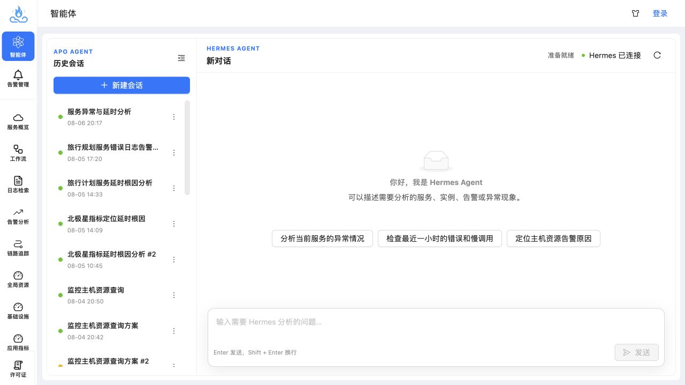
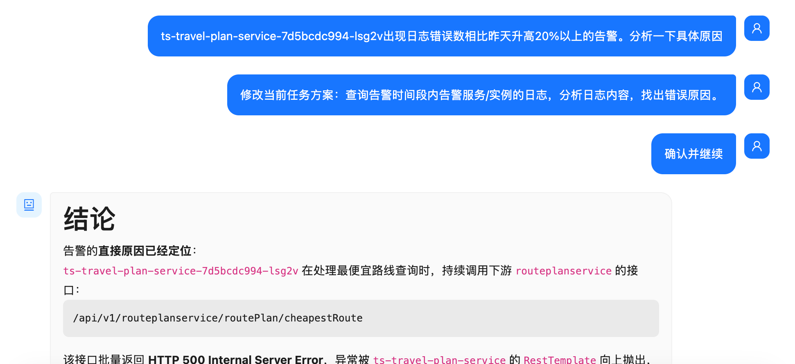
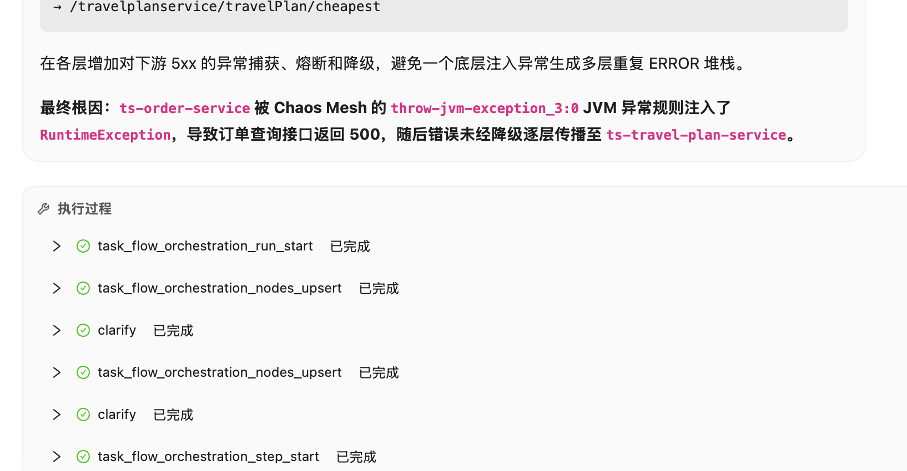
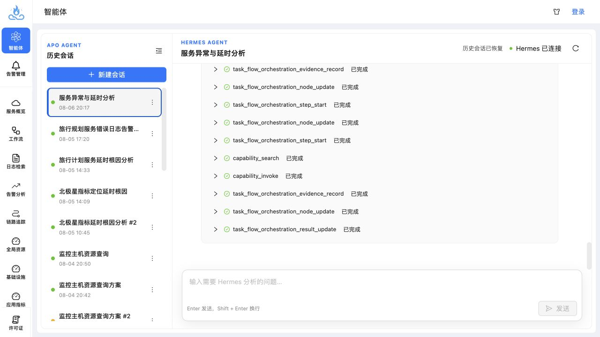
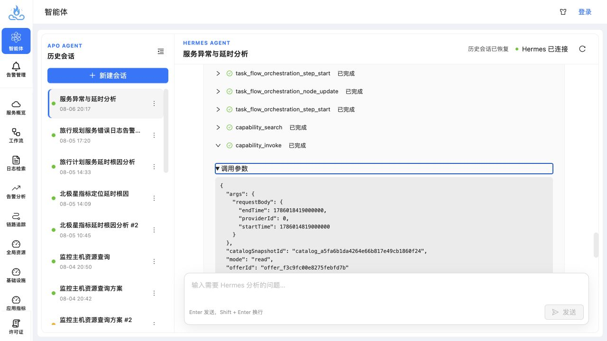
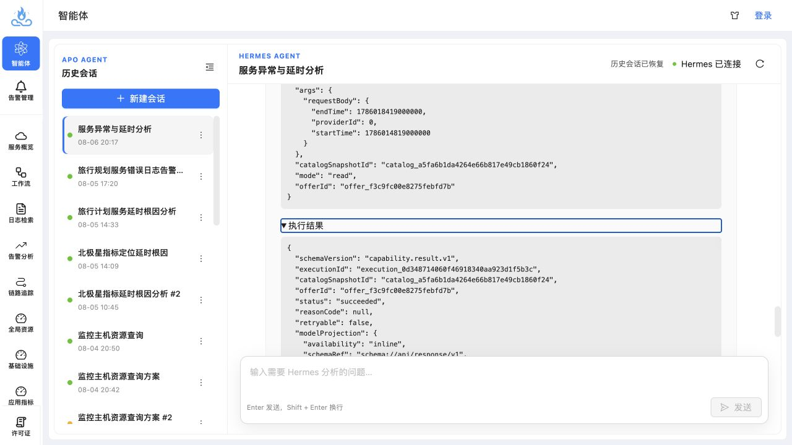
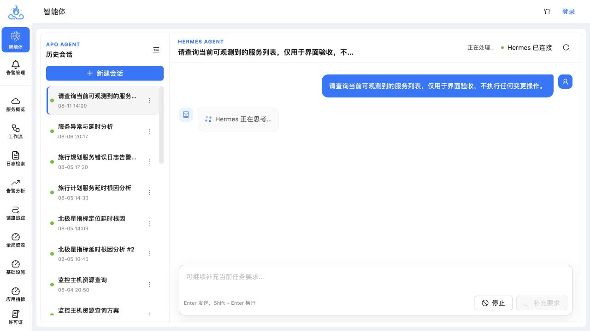
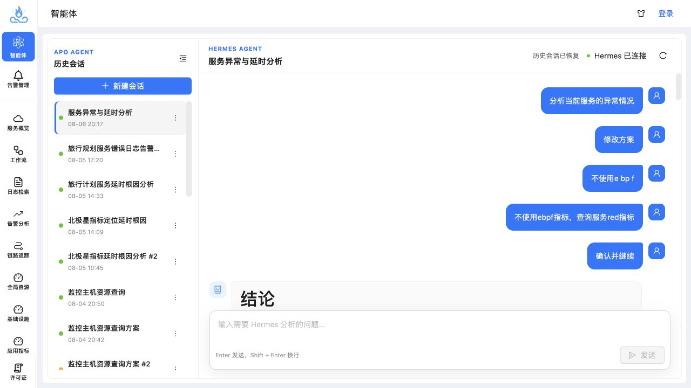

# Hermes Agent 界面用户体验验收报告

## 一、验收结论

本次以日常运维人员处理告警、查询服务状态和开展故障排查的真实使用视角，对当前 Hermes Agent 界面进行了操作验收。

当前版本已经具备新建会话、恢复历史会话、连续对话、展示最终回答、查看执行过程和停止任务等基础框架，最终回答的文字结构也能够覆盖“结论—发现—证据缺口—下一步建议”。但从普通运维用户的使用体验看，当前页面仍然更接近一个 Hermes 调试控制台，而不是一个以“快速获得排障结论并核验证据”为目标的运维助手。

本次验收结论为：**核心流程可体验，但不建议按当前默认展示方式直接面向普通运维用户验收通过。** 建议先完成以下 P0 改造：

1. 按真实事件顺序构建统一会话时间线，不能把用户消息、AI 回答和执行过程拆成三个独立区域。
2. 用户输入继续使用紧凑的右侧消息样式；AI 回答改为左侧正文阅读区，不再套用大面积消息气泡。
3. 执行过程跟随所属任务轮次展示，不能把全部活动统一堆放在最终回答底部。
4. 历史会话默认展示最终结论，而不是定位到执行过程底部。
5. 默认隐藏原始工具协议名、调用参数和执行结果 JSON，只展示用户可理解的任务进度。
6. 为指标、日志、Trace、实例和列表查询建立标准化 Evidence 数据契约及专用展示组件。
7. 补全长任务的阶段进度、耗时和异常反馈，并修复停止任务无反馈、长时间不生效的问题。

关于“工具执行过程是否需要展示”，本次验收建议是：**需要保留，但不能以当前原始调试信息的形式默认展示。** 用户默认只需要知道系统正在做什么、查了什么对象、使用了什么时间范围、得到了多少数据以及是否成功；内部协议名、请求参数、接口地址和原始 JSON 应放入受控的高级诊断模式。

---

## 二、验收环境与范围

| 项目 | 验收信息 |
| --- | --- |
| 验收日期 | 2026-08-11 |
| 前端仓库 | `/Users/misluyu/repos/apo/frontend` |
| 当前分支 | `feat/hermes-agent` |
| 前端地址 | `http://127.0.0.1:3000/#/agent` |
| Hermes Backend | `127.0.0.1:8100` |
| Hermes Gateway | `127.0.0.1:8643` |
| 验收视口 | 1280 × 720 |
| 实测场景 | 空状态、新建查询、运行中状态、停止任务、历史会话恢复、最终回答阅读、工具参数与结果展开 |
| 新建验收问题 | “请查询当前可观测到的服务列表，仅用于界面验收，不执行任何变更操作。” |
| 重点历史会话 | “服务异常与延时分析” |

验收重点是前端信息架构、交互反馈和运维用户可理解性，不对 Hermes 分析结论本身的准确率做完整业务验收。

---

## 三、当前界面的正向体验

1. 页面已经形成“历史会话 + 对话区”的基本工作台结构，用户可以恢复以前的排障上下文。
2. 空状态提供了示例问题，能够帮助首次使用者理解 Agent 的大致能力范围。
3. 历史会话中的最终回答具备结论、关键发现、拓扑分析、证据缺口和下一步建议等结构，文字层次整体可读。
4. 页面保留了任务运行状态和停止入口，说明已经考虑长任务控制需求。
5. 执行活动能够被记录和恢复，为后续制作审计记录、证据链和高级诊断模式提供了基础。

图 1：当前 Agent 空状态，基本框架完整，但快捷入口仍偏通用问句。

---

## 四、主要问题清单

| 编号 | 优先级 | 问题 | 对用户的影响 |
| --- | --- | --- | --- |
| UX-01 | P0 | 会话时间顺序被拆散，多轮用户输入被挤在一起 | 用户无法判断每句话对应哪个计划、确认或分析阶段 |
| UX-02 | P1 | AI 回答被包在大面积消息气泡中 | 长篇排障结论像聊天短消息，阅读宽度和层级都受到限制 |
| UX-03 | P0 | 执行过程脱离所属轮次，统一堆在页面底部 | 用户无法把工具步骤与对应问题、确认和结论关联起来 |
| UX-04 | P0 | 历史会话默认定位到执行过程底部 | 用户恢复任务后第一眼看不到结论，只看到大量内部事件 |
| UX-05 | P0 | 执行过程使用内部协议名 | 普通用户无法理解任务进展，信息噪声远大于有效信息 |
| UX-06 | P0 | 原始调用参数和结果 JSON 直接暴露 | 暴露内部字段、接口地址和拓扑信息，也无法支持业务阅读 |
| UX-07 | P0 | 缺少指标、日志、Trace、实例等结构化 Evidence | 用户只能相信文字结论，无法在当前页面核验事实 |
| UX-08 | P0 | 长任务只有“Hermes 正在思考…” | 无法判断任务正在查询、等待、重试还是已经卡住 |
| UX-09 | P0 | 停止任务没有即时反馈且实测未生效 | 用户失去对任务的控制感，可能重复点击或刷新页面 |
| UX-10 | P1 | 回答正文与执行过程比例失衡 | 最终结论被几十条过程事件淹没 |
| UX-11 | P1 | 输入框默认高度过大 | 在 1280 × 720 下明显压缩回答阅读区域 |
| UX-12 | P1 | APO 一级导航和会话导航同时常驻 | 主对话区过窄，长标题和证据内容更难展示 |
| UX-13 | P1 | 顶部状态重复且技术化 | “正在处理”和“Hermes 已连接”没有形成清晰的任务状态层级 |
| UX-14 | P1 | 计划确认与修改链路偏机械 | 用户需要多轮输入“修改方案”“确认并继续”等控制语句 |
| UX-15 | P2 | 时间、长标题和空状态入口不够贴近运维场景 | 增加理解成本，影响高频使用效率 |

### 4.1 多轮对话没有按照真实时间顺序展示

用户补充验收时发现，同一任务中的原始问题、修改方案和“确认并继续”被连续挤在页面上方，而中间本应出现的 AI 计划、澄清请求、确认卡片和阶段反馈没有在对应位置展示。最终回答则被统一放在所有用户输入之后。

图 2：多轮用户输入被连续堆叠，用户无法从页面还原“提问—计划—修改—确认—执行—回答”的真实过程。

这不是单纯增加消息间距就能解决的问题，而是会话数据被拆分后丢失了事件间的相对位置。正确顺序应当类似：

1. 用户提出告警分析问题。
2. AI 展示初始计划或需要确认的内容。
3. 用户提出“不使用 eBPF、改查日志”等修改要求。
4. AI 在原位置展示修改后的计划。
5. 用户确认继续。
6. 当前轮次内展示查询进度、结构化证据和最终结论。

建议建立统一的 `ConversationTimelineItem` 数据模型，至少保留 `sequenceNo`、`occurredAt`、`runId`、`kind` 和展示数据。消息、确认卡片、执行进度、Evidence 和回答都按 `sequenceNo` 排序渲染，不再分别维护“消息数组”和“活动数组”。

### 4.2 AI 回答不需要使用消息气泡

用户的短文本输入适合使用右侧气泡，以便快速区分提问者；AI 的排障回答通常包含标题、长段落、代码块、表格和证据卡片，更接近一份持续生成的分析正文。

当前 AI 回答与用户消息共用气泡基础样式，造成以下问题：

- 大面积边框和圆角包裹整篇回答，视觉上显得沉重。
- 正文可用宽度进一步缩小，长日志、接口路径和表格更容易折行。
- 回答内部还有代码块和 Evidence 卡片时，会形成“卡片套卡片”的层级。
- 用户更难把 AI 的最终结论识别为当前页面的主要内容。

建议 AI 回答采用无气泡的左侧正文布局：保留机器人标识或左侧细导轨，正文直接使用页面背景；仅对结论摘要、警告、代码、表格和 Evidence 使用局部卡片。复制、引用和反馈操作放在回答标题栏或正文底部。

### 4.3 执行过程应跟随所属任务轮次，而不是堆在底部

当前执行过程统一出现在最终回答下方，并展示为独立的大面板。

图 3：执行过程与触发它的用户问题、计划确认和最终结论脱离，页面底部形成调试事件堆积区。

建议按照任务轮次绑定执行过程：

- 运行中：在本轮用户问题之后展示紧凑的进度卡片，并持续更新当前阶段。
- 等待确认：在对应计划之后原位展示确认或修改卡片。
- 已完成：进度卡片收起为“完成 6 项检查，5 项成功，耗时 42 秒”。
- 有关键证据：在产生证据的阶段原位展示指标、日志、Trace 或实例卡片。
- 最终回答：紧接本轮执行摘要和证据之后展示，不在回答后追加全局工具事件列表。
- 高级诊断：原始协议事件可以按本轮 `runId` 展开，但默认隐藏。

### 4.4 历史会话恢复后默认展示位置错误

点击历史会话“服务异常与延时分析”后，页面自动落在会话底部。用户第一眼看到的是一整屏执行事件，而不是最终回答的结论顶部。

图 4：历史会话恢复后的默认视图，内部执行事件占据主要区域。

对运维用户而言，恢复历史会话的主要目的通常是查看上次结论、继续追问或复核证据。建议：

- 已完成会话默认定位到最新一条最终回答的顶部。
- 未完成会话默认定位到当前任务状态卡片。
- 执行过程默认折叠，只显示“完成 8 项检查，6 项获得数据，2 项无数据”一类摘要。
- 提供“查看执行明细”入口，但不抢占默认阅读路径。

### 4.5 执行过程展示的是内部协议，不是用户进度

实测页面直接展示以下事件名：

- `skill_view`
- `task_flow_orchestration_run_start`
- `task_flow_orchestration_nodes_upsert`
- `clarify`
- `capability_search`
- `capability_invoke`
- `terminal`
- `task_flow_orchestration_evidence_record`
- `task_flow_orchestration_node_update`
- `task_flow_orchestration_result_update`

同类事件会重复出现十几次。它们可以用于研发排查协议和编排问题，但不能代表用户可理解的任务阶段。

建议将内部事件聚合为业务阶段，例如：

| 内部活动 | 用户界面建议展示 |
| --- | --- |
| `capability_search` | 正在查找可用的服务查询能力 |
| `capability_invoke` | 正在查询最近 30 分钟的服务列表 |
| 多次节点更新 | 已完成 3/5 项检查 |
| Evidence 写入 | 已获得 13 个服务的查询结果 |
| 调用失败或无数据 | 指标查询无数据，正在尝试其他证据 |

### 4.6 原始参数和结果 JSON 不应默认暴露

展开 `capability_invoke` 后，调用参数中直接出现 `catalogSnapshotId`、`offerId` 等内部字段。

图 5：调用参数面向研发协议，而不是面向运维任务。

执行结果中还直接显示请求地址、接口路径、执行编号、HTTP 元数据和大段原始拓扑 JSON。

图 6：原始执行结果既难以阅读，也存在内部地址和拓扑信息暴露风险。

当前做法只是把 JSON 截断后展示，不等同于业务摘要、结构化展示或安全脱敏。建议按照三层可见性设计：

| 层级 | 默认用户 | 展示内容 |
| --- | --- | --- |
| 任务进度 | 所有用户可见 | 当前阶段、查询对象、时间范围、结果数量、耗时和成功/失败状态 |
| 证据详情 | 默认可展开 | 指标图、日志列表、Trace、实例表格、来源和查询条件 |
| 原始调试信息 | 仅高级诊断模式 | 协议事件、原始参数、请求地址、执行 ID、裁剪和脱敏后的 JSON |

### 4.7 当前 Hermes 返回内容不能直接支撑结构化证据展示

从本次界面和当前前端实现看，不能简单理解成“Hermes 完全没有返回查询数据”。实测工具结果中确实包含部分真实查询结果和元数据，但当前活动消息只保留通用的 `name`、`args`、`result`、`status` 和 `durationMs` 等字段，前端最终通过通用 JSON 组件展示。

因此，当前核心缺口是：

1. Hermes Backend 没有把 APO 指标、日志、Trace、实例和列表结果统一转换为稳定的 Evidence 类型。
2. 前端没有收到可确定识别数据种类、单位、时间范围、查询对象和展示方式的契约。
3. 前端不能依靠任意接口的原始 JSON 稳定判断“这是指标曲线、日志记录、Trace 还是实例列表”。
4. 最终回答与具体 Evidence 之间没有可点击、可追溯的引用关系。

所以更准确的结论是：**部分原始数据已经返回，但缺少可直接用于产品展示的标准结构和语义，当前前端只能把它当作通用 JSON。**

从现有迁移方案的描述看，旧 AgentSRE 页面曾经通过已知的数据类型和专用组件展示指标趋势、格式化日志和 Trace；当前 Hermes 界面在替换过程中只接入了通用 Tool Activity，尚未恢复这种确定性的数据分类与专用渲染能力。

推荐继续采用仓库方案中已经提出的方向：由 Backend 根据内置接口的固定 `resultPresentation` 转换为标准 Evidence，前端按照 `evidence.kind` 选择渲染器，而不是让前端临时猜测原始 JSON。

建议至少支持以下 Evidence 类型：

| Evidence Kind | 推荐展示 |
| --- | --- |
| `apo_metric_timeseries` | 趋势图、当前值、峰值、基线、单位、时间范围 |
| `apo_log_records` | 日志列表、级别、时间、实例、关键字高亮、上下文展开 |
| `apo_trace` | Trace 瀑布图、关键 Span、耗时、错误节点、关联服务 |
| `apo_instance_table` | 服务/主机/容器/进程实例表、状态、标签、异常摘要 |
| `apo_topology` | 服务拓扑、调用方向、异常边和跳转入口 |
| `apo_table` | 可排序、筛选、复制和导出的通用表格 |
| `apo_json` | 未识别数据的安全兜底视图 |

### 4.8 长任务缺少可感知的进度

新建只读查询后，页面超过 30 秒一直只显示“正在处理…”和“Hermes 正在思考…”，没有当前阶段、已耗时、数据源、查询对象、重试或超时信息。

图 7：运行中只有通用等待文案，用户无法判断任务是否正常推进。

建议运行状态至少包含：

- 当前阶段：理解问题、制定查询计划、查询服务、分析指标、组织结论。
- 当前动作：正在查询“最近 30 分钟服务列表”。
- 已耗时：例如“已运行 18 秒”。
- 检查进度：例如“2/5 项已完成”。
- 数据反馈：例如“已发现 13 个服务，正在补查 RED 指标”。
- 异常反馈：查询超时、无数据、正在重试或切换数据源。

进度应由真实事件驱动，不能用前端虚构百分比。

### 4.9 停止任务缺少反馈，实测长时间未生效

本次对运行中的只读查询点击“停止”后：

- 按钮没有立即变为“正在停止”。
- 页面没有新增“用户已请求停止”的消息。
- 等待约 3 秒后仍为“正在处理”。
- 继续观察至约 11 秒，仍保持“Hermes 正在思考…”，停止按钮仍可点击。

停止后的界面与图 7 完全一致。这会让用户无法确认点击是否成功，也无法判断任务是否仍在消耗资源。

建议：

1. 点击后 300 毫秒内按钮禁用并显示“正在停止…”。
2. 在消息流中即时记录“已请求停止当前任务”。
3. 后端确认后显示“任务已停止”，并恢复输入与发送能力。
4. 停止失败或超时要明确提示原因，并提供“重试停止”或“强制结束会话”。
5. 页面刷新或恢复历史会话后，仍能看到任务最终是完成、失败还是被用户中止。

### 4.10 最终回答与执行过程比例失衡

“服务异常与延时分析”历史会话中，最终回答只有一份，但执行事件达到数十条。回答本身虽然具备层次，仍然缺少支持“13 个服务”“多项耗时抬升”等判断的服务表、指标图和拓扑证据。

图 8：回答正文结构尚可，但输入区和两级侧栏进一步压缩了正文阅读空间。

建议默认阅读顺序调整为：

1. 结论摘要和影响范围。
2. 关键异常及置信度。
3. 可直接核验的指标、日志、Trace、实例和拓扑 Evidence。
4. 建议执行的下一步操作。
5. 折叠的执行过程与高级调试信息。

### 4.11 输入框、侧栏和顶部状态占用过多空间

在 1280 × 720 的常见工作视口下：

- 输入框在没有多行内容时仍占用较大高度。
- APO 一级导航和 Agent 会话导航同时常驻，主内容区明显变窄。
- 长会话标题被截断，且页面内没有明显的完整标题提示。
- “准备就绪/正在处理”和“Hermes 已连接”同时出现，用户任务状态与技术连接状态混在一起。

建议：

- 输入框默认 1～2 行，随输入自适应扩展，并设置最大高度。
- 进入 Agent 工作台后默认折叠 APO 一级导航，历史栏也支持快捷折叠。
- 长标题悬停展示完整文本，并支持重命名。
- 技术连接状态正常时弱化，仅在断开、重连或异常时突出显示。
- 顶部主要保留用户任务状态，例如“等待输入”“查询中”“等待确认”“已完成”“已停止”。

### 4.12 计划确认流程需要更自然

历史会话中，为了完成一次排障任务，用户连续输入了“修改方案”“不使用 eBPF”“不使用 eBPF 指标，查询服务 RED 指标”“确认并继续”等控制语句。

建议把计划确认设计为可操作卡片：

- 展示计划步骤、数据源、时间范围和是否包含高成本操作。
- 提供“确认执行”“修改计划”“仅执行此步骤”等按钮。
- 修改计划时使用可编辑字段或明确选项，不要求用户猜控制口令。
- 对纯只读、低风险查询可由用户设置“本会话内自动执行只读查询”，避免每一步重复确认。

### 4.13 空状态应提供更贴近日常运维的入口

当前示例问题能够说明产品能力，但对真实排障的约束信息不足。建议增加：

- 最近告警入口。
- 服务、主机或实例选择器。
- 时间范围选择，例如最近 15 分钟、30 分钟、1 小时。
- “分析这条告警”“查询服务 RED 指标”“查看错误日志”“定位慢 Trace”等任务模板。
- 对当前可观测数据范围的提示，避免用户不知道系统能够看到哪些环境和对象。

---

## 五、推荐的信息架构

Agent 页面首先应是一条真实、有顺序的会话时间线，而不是“消息区 + 页面底部执行区”。推荐每轮任务按照以下顺序组织：

| 顺序 | 时间线内容 | 展示方式 |
| --- | --- | --- |
| 1 | 用户问题或补充要求 | 右侧紧凑气泡，限制最大宽度 |
| 2 | AI 计划、澄清或确认请求 | 左侧原位卡片，与当前轮次绑定 |
| 3 | 执行进度 | 紧凑进度摘要，运行中展开、完成后折叠 |
| 4 | 结构化 Evidence | 指标、日志、Trace、实例和拓扑专用组件 |
| 5 | AI 最终回答 | 左侧无气泡正文，突出结论和证据引用 |

在单轮任务内部，再将信息划分为以下五层：

| 层级 | 核心内容 | 默认状态 |
| --- | --- | --- |
| 1. 任务状态 | 当前阶段、耗时、进度、停止/继续 | 始终可见 |
| 2. 分析结论 | 根因判断、影响范围、置信度、证据缺口 | 优先展示 |
| 3. 结构化证据 | 指标、日志、Trace、实例、拓扑、表格 | 关键证据展开，其余折叠 |
| 4. 下一步行动 | 继续查询、跳转详情、生成处置建议、执行只读验证 | 按结论提供 |
| 5. 执行明细 | 工具步骤、耗时、失败原因、原始协议和 JSON | 默认折叠，高级模式可见 |

一次服务延迟排障的理想展示示例：

> **结论：** `ts-travel2-service` 在最近 30 分钟存在 P95 延迟上升，初步定位为下游调用耗时增加，当前证据不足以确认具体下游服务为根因。
>
> **关键证据：** 1 张 RED 趋势图、3 条慢 Trace、2 个异常实例、15 条相关错误日志。
>
> **执行摘要：** 完成 6 项只读检查，5 项成功，1 项无数据，耗时 42 秒。

用户可以先理解结论，再按需核验证据，最后才查看执行细节。

---

## 六、分阶段改造建议

### P0：达到普通运维用户可用

1. 用统一时间线模型承载用户消息、AI 消息、确认卡片、活动和 Evidence，保留事件 `sequenceNo` 与 `runId`。
2. 修复消息渲染顺序，执行过程必须出现在所属任务轮次内。
3. AI 回答改为无气泡正文布局，用户输入保留紧凑的右侧气泡。
4. 修改历史会话恢复定位，默认显示最终回答或当前任务状态。
5. 将内部事件转换为用户可理解的阶段进度，并默认折叠工具执行明细。
6. 修复停止任务交互和后端中止链路。
7. 对原始参数、URL、执行 ID 和 JSON 进行权限控制、裁剪及脱敏。
8. 落地指标、日志、Trace、实例、拓扑和通用表格 Evidence 契约。
9. 建立 Evidence Renderer Registry，以及最终结论到具体 Evidence 的引用关系。

### P1：提升高频排障效率

1. 缩小输入框默认高度，优化两级导航的折叠策略。
2. 增加时间范围、对象范围和最近告警快捷入口。
3. 将计划确认改为可操作卡片，减少控制口令式对话。
4. 统一任务状态和连接状态，补充耗时、重试、无数据和超时提示。
5. 时间默认按用户本地时区展示，并明确标注时区。
6. 增加 Evidence 的筛选、复制、下载和跳转到原 APO 页面能力。

### P2：完善专业模式和工程质量

1. 增加普通模式与高级诊断模式切换。
2. 高级模式支持查看事件时间线、每步耗时、裁剪后的原始响应和失败堆栈。
3. 修复 PostHog token 未配置报错、React Router future flag 警告和菜单重复 key 告警。
4. 增加会话重命名、长标题完整提示和更清晰的历史会话状态标识。
5. 为结构化 Evidence、历史恢复和任务停止补充前端自动化测试。

---

## 七、建议验收标准

### 7.1 信息层级

- 同一任务的用户输入、计划、确认、执行进度、Evidence 和 AI 回答严格按照事件顺序展示。
- 除非中间确实没有 AI 事件，否则不得把多条用户输入连续聚合到页面顶部。
- AI 最终回答使用正文布局，不套用与用户消息相同的大面积气泡。
- 执行过程与对应的 `runId` 绑定，不得统一追加到整个会话底部。
- 已完成历史会话打开后，首屏能看到最终结论标题和摘要。
- 默认界面不出现内部工具协议名、内部请求地址和原始执行 ID。
- 执行明细折叠后，只保留检查数量、成功/失败数量和总耗时。

### 7.2 任务进度与控制

- 提交问题后 3 秒内出现真实任务阶段。
- 长任务至少每 10 秒更新阶段、耗时或真实数据反馈，避免持续静态“思考中”。
- 点击停止后 300 毫秒内进入“正在停止”状态。
- 正常情况下 3 秒内显示“已停止”；超过阈值必须显示异常反馈。
- 刷新页面或恢复历史会话后，任务最终状态保持一致。

### 7.3 结构化证据

- 指标查询能够展示趋势图、单位、时间范围、查询对象和数据来源。
- 日志查询能够展示时间、级别、服务/实例、正文和上下文。
- Trace 查询能够展示关键 Span、耗时、错误和服务关系。
- 实例查询能够展示可排序、筛选的表格。
- 每条重要结论至少能够引用一条具体 Evidence；缺少证据时必须明确标记。
- 历史会话恢复后，Evidence 仍可查看，不退化成原始 JSON。

### 7.4 安全与可理解性

- 普通模式不暴露 `catalogSnapshotId`、`offerId`、内部请求 URL 等调试字段。
- 高级诊断信息必须经过权限判断和脱敏。
- 所有面向用户的任务阶段使用运维业务语言，而不是协议或函数名称。

### 7.5 布局

- 1280 × 720 下最终回答和关键证据能够获得主要可视区域。
- 用户消息最大宽度建议控制在内容区的 65%～70%，短消息不拉伸成通栏。
- AI 回答直接使用主内容宽度，不使用包裹整篇回答的背景和边框。
- 执行摘要位于对应用户问题与 AI 最终回答之间，完成后默认折叠。
- 空输入时输入框不超过两行高度，内容增加后再自适应扩展。
- 一级导航和会话导航至少有一个可以默认折叠。

---

## 八、实现层面的核对结果

本次结合当前源码和仓库内的迁移方案进行了核对：

- `src/pro/features/hermes/components/ToolActivity.tsx` 当前直接显示活动名称、调用参数和执行结果，并通过通用 JSON 序列化输出。
- `src/pro/features/hermes/components/ChatMessages.tsx` 先执行 `messages.map(...)`，再统一渲染 `ToolActivity`，从代码结构上决定了所有执行过程只能出现在全部消息之后。
- `ChatMessages.tsx` 在消息或活动变化时总是调用 `scrollTo(...scrollHeight)`，导致历史恢复和活动更新持续把用户带到执行过程底部。
- `HermesAgentWorkspace.module.scss` 的用户消息和 AI 回答共用 `.messageBubble` 基础样式，AI 长回答因此也被套入大面积气泡。
- `src/pro/features/hermes/client/history.ts` 虽然先按 `sequenceNo` 遍历持久化事件，但随后分别写入 `messages` 和 `activities`，返回时已经失去两类内容之间的相对顺序。
- `src/pro/features/hermes/client/types.ts` 的 `HermesHistorySnapshot` 也把 `messages` 与 `activities` 分开保存；活动模型没有 `runId`、`sequenceNo` 和时间字段，同时没有指标、日志、Trace 或实例专用 Evidence 类型。
- `docs/hermes-replaces-agentsre-plan.md` 已经提出 `resultPresentation`、标准 Evidence Kind、Backend 转换和 Evidence Renderer Registry，方向与本次用户验收结论一致。

建议先重构为统一的会话时间线数据契约，再落实已有方案中的 Evidence 契约。不建议只通过 CSS 调整间距，也不建议继续在前端按照不同原始接口 JSON 增加临时判断。

---

## 九、截图索引

| 文件 | 内容 |
| --- | --- |
| `01-agent-empty-state.png` | Agent 空状态和快捷问题 |
| `02-history-execution-process.png` | 历史会话默认落在执行过程底部 |
| `03-raw-tool-parameters.png` | 原始工具调用参数 |
| `04-raw-tool-result.png` | 原始执行结果 JSON 和内部元数据 |
| `05-history-answer-reading.png` | 最终回答阅读区域和布局占用 |
| `06-running-state.png` | 长任务持续“正在思考”和停止按钮状态 |
| `07-user-message-sequence.png` | 用户补充发现：多轮用户输入被连续挤在一起，AI 回答使用大气泡 |
| `08-execution-process-placement.png` | 用户补充发现：执行过程脱离所属轮次并堆在回答底部 |

---

## 十、技术质量附录

验收过程中还观察到以下控制台问题，虽然不直接改变本次用户体验结论，但建议在正式发布前清理：

1. PostHog 未配置 token 的错误。
2. React Router v7 future flag 警告。
3. 菜单项 `alertsRule` 重复 key，React 多次输出 key warning。

这些问题会增加控制台噪声，并可能掩盖 Agent 运行时真正需要关注的异常。
