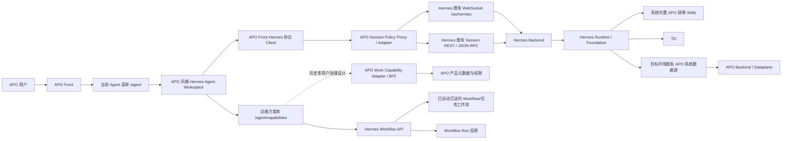

# Hermes 替换 AgentSRE 整体方案

> **当前实现标注说明（2026-08-17）**：`✅ 已完成` 表示已在当前 APO Front 仓库实现并通过相关前端测试；`⏳ 待完成/待联调` 表示尚未在本仓库完成，或需要 APO Backend、网关、Hermes 运行环境提供验收证据。Hermes 在本方案中作为黑盒运行时，内部接口、Schema、事件、错误码和原生 frontend 均不作为本项目改造对象。

> **运维任务库当前接入边界（2026-08-20）**：`/agent/capabilities*` 不增加页面权限守卫，任务库与对话历史共用 APO Front 的 `hermesApiBaseUrl()` 和 `/hermes-api` 同源代理直接访问 Hermes。列表、详情、更新和运行投影分别使用 Hermes 当前的 `GET /api/workflows?includeArchived=true`、`GET/PUT /api/workflows/{id}` 与 `GET /api/workflow-runs/{runId}`；单删、原子批删、归档/恢复和固定/取消固定使用同一 Workflow API。搜索、筛选和分页由前端基于 `{"workflows": [...]}` 完成。内容编辑开放名称、目标、典型提问、结构化输入和稳定步骤；步骤的 `providerRef`、`capabilityRef`、`inputMap`、`expectedOutput` 和 `effects` 等完整绑定必须保留，脱敏占位内容不得回写 Hermes。`disabled` 和 `archived` Workflow 均不能从任务库手动使用。带入会话时只附加 `<hermes_qa_workflow_selection>{"workflowId":"..."}</hermes_qa_workflow_selection>`，不再使用旧 Playbook 选择契约。本次实现不调用 `/api/work-capabilities*`，也不依赖 APO Work Capability Adapter。

> **当前契约与历史设计的边界**：Hermes 当前 Workflow 路由、`hermes-qa.workflow.v1` DTO 和选择标签是本次实现及验收依据。第 6、7 章中的 Work Capability Adapter 治理内容，第 11.5.1、11.6～11.14 节，以及后续实施、风险、测试、验收和交付章节中引用的 TaskDefinition v2、APO Work Capability Adapter/BFF、复杂 ACL/readiness/Promote/Patch 方案，均为 2026-08-17 形成的历史设计草案，不是当前代码已经实现或仍计划按原样实现的契约。历史章节不得覆盖本条和第 5.5 节，也不得据此把浏览器请求重新改回 `/api/work-capabilities*` 或旧 Playbook 路由。

## 1. 文档说明

| 项目 | 内容 |
| --- | --- |
| 方案目标 | 使用 Hermes 完全替换基于 CrewAI 的 AgentSRE |
| 用户入口 | 保留 APO Front 当前 Agent 菜单及 `/agent` 页面入口 |
| 页面策略 | 不保留现有 AgentSRE 页面；APO Front 依据 Hermes 既有协议独立实现页面、Client、状态和渲染，不使用 Hermes frontend |
| Hermes 边界 | Hermes Backend/Foundation 既有 HTTP、WebSocket、JSON-RPC、事件、Schema、错误码和语义保持不变；Hermes frontend 不部署、不嵌入、不复用 |
| 用户体系 | 使用 APO 现有用户及登录体系；会话由 APO Adapter 按用户/租户隔离，Hermes 仅承担其既有 Owner 语义 |
| APO 数据接入 | 使用目标 Hermes 环境已具备的 APO 系统数据源；部署只配置地址、认证和权限 |
| 分析结果展示 | 指标、日志等接口结果转换为结构化 Evidence，并使用 APO 通用组件展示 |
| 排障能力 | 内置 APO 排障 Skills，引导 Hermes 使用 APO 特殊数据并形成完整证据链 |
| 运维方案库 | 本阶段新增建设；展示 Hermes 已从成功 Run 自动沉淀的可复用 Workflow，提供列表、详情、运行历史、内容编辑、自动匹配开关、固定、归档、删除和带入会话；不在 APO Front 录制或编排 Hermes Workflow |
| 数据源管理入口 | 不接入 Hermes frontend；管理员仅通过既有 Hermes API 验收，或使用 APO 自建的管理员页，普通用户不参与 APO 数据源配置 |
| AgentSRE 能力迁移 | 不迁移原有固定 RCA、Findings、CrewAI Agent 和工具编排逻辑 |
| 最终状态 | APO Front 及 Hermes 不再依赖、调用或部署 AgentSRE |

## 2. 建设背景

当前 APO Agent 页面通过 AG-UI 协议调用 AgentSRE。AgentSRE 基于 CrewAI 实现，其意图分类、分析路径、工具组合和结果展示均围绕固定场景开发，扩展新分析能力时需要持续修改 Agent、Task、Tool 和 Findings 结构，灵活性不足。

Hermes 已经具备通用会话、任务规划、工具调用、澄清确认、运行中调整、会话恢复和执行过程管理能力。此次改造不要求 Hermes 复刻 AgentSRE 原有的固定分析链路，而是将 Hermes 作为新的 Agent 分析执行引擎，并通过预置的 APO 接口获得分析所需数据。

因此，本次建设的核心不是“迁移 AgentSRE 功能”，而是完成以下替换：

```text
原链路：APO Front → AG-UI → AgentSRE → CrewAI → APO 接口

当前链路：APO Front Hermes Client → /hermes-api 同源代理 → Hermes 既有接口 → APO 数据源

历史治理目标：APO Front → Session Policy Proxy / Work Capability Adapter → Hermes 既有接口
```

## 3. 建设目标与范围

### 3.1 建设目标

1. ✅ 保留 APO 当前 Agent 菜单，用户仍从原入口使用 Agent。
2. ✅ 将 Hermes 核心对话和会话管理能力迁入 APO Front。
3. ✅ 使用 APO 的组件、布局、样式和用户体系重新实现 Agent 页面。
4. Hermes 会话、历史和运行状态在 APO Adapter 侧按用户/租户隔离，固定 Owner 模式下不把 Hermes 自身视为隔离边界。
5. 验证并接入 Hermes 已具备的 APO 数据源和能力接口；现场只提供部署地址、认证和权限配置，不修改 Hermes 接口。
6. APO 侧维护固定接口核对清单，不依赖模型分析 Swagger，也不要求修改 Hermes 注册结果。
7. 将指标、日志等查询结果转换为结构化 Evidence，并提供通用趋势图和格式化展示。
8. 内置一组 APO 排障 Skills，确保 Hermes 在适用场景中主动查询 APO 特殊数据并遵守证据要求。
9. 建设 Agent 运维任务库，展示 Hermes 自动从成功任务 Run 形成的可复用 Workflow，支持查看来源运行、版本和运行效果，修改名称/目标/典型提问/结构化输入/稳定步骤，控制自动匹配、固定和归档，执行单个或批量删除并带入会话；不新增 Hermes 接口或人工录制流程。
10. 通过既有 Hermes 管理 API 或 APO 自建管理员页查看数据源状态，不部署 Hermes frontend。
11. 完成切换后彻底下线 AgentSRE 服务、接口代理和前端依赖。

### 3.2 保留内容

- APO 当前 Agent 菜单。
- APO `/agent` 路由。
- APO 登录态、用户和租户体系。
- APO 前端整体布局、主题和组件规范。
- Hermes 的会话协议、会话恢复和事件处理能力。
- Hermes 原有数据源管理 API 和能力注册结果（不接入其 frontend 页面）。
- Hermes 的 Skill 加载机制。

### 3.3 不保留内容

- AgentSRE 的 CrewAI 实现。
- AgentSRE 固定的慢调用、错误、资源等分析流程。
- AgentSRE 的意图分类规则。
- AgentSRE 的 Findings 数据结构和 Findings 树。
- 现有 AG-UI 通信协议。
- AgentSRE 模型配置接口。
- AgentSRE 会话接口和会话数据库依赖。
- 现有 Agent 页面中的快捷 SRE 问题、Dataplane 状态和专用证据树。

### 3.4 默认不纳入范围

- 不迁移 AgentSRE 历史会话至 Hermes。
- 不保证旧 AgentSRE 会话可以继续对话。
- 不要求 Hermes 输出与 AgentSRE 相同的结论、分析步骤或展示结构。
- 不部署、嵌入或复用 Hermes 原生管理端的页面、组件、Client、状态代码或 iframe；APO 只实现工作能力中心所需的产品页面和接口适配。
- 不将现有 Dify `/workflows` 改名或改造为工作能力中心；告警业务继续按原 `workflowId` 使用 Dify。
- 首版不建设拖拽式可视化编排器、定时触发器、Webhook 和跨租户市场。

如项目要求保留旧历史，建议将 AgentSRE 数据库做只读归档，不纳入新会话系统。

## 4. 总体架构



系统职责划分如下：

| 组件 | 主要职责 |
| --- | --- |
| APO Front | Agent 菜单、页面布局、聊天界面、会话列表、登录态和用户体验 |
| APO Front Hermes 协议 Client | 依据既有 Hermes 契约独立实现 WebSocket、JSON-RPC、会话创建与恢复、事件转换；不引入 Hermes frontend |
| APO Session Policy Proxy / Adapter | 归属 APO Backend/Gateway；保持 Hermes 传输契约不变，但在固定 Owner 模式下执行登录校验、会话 ID 映射、方法白名单和资源 ACL，禁止浏览器直达原始 Hermes 管理接口 |
| Hermes Backend | 按既有 Owner 语义持久化会话、运行上下文、数据源和能力；APO 用户/租户隔离由 Adapter 额外保证 |
| Hermes Runtime | 理解用户问题、制定计划、选择和调用能力、生成回答 |
| 系统排障 Skills | 约束排障策略、证据关联、停止条件和禁止误判规则 |
| 运维任务库 | 当前通过 `/hermes-api` 直接展示和管理可复用 Workflow、来源 Run、版本、运行记录和状态；不负责录制工作流 |
| APO Work Capability Adapter / BFF | 历史多用户治理设计，当前未实现且不是运维任务库依赖；如未来重启该方案，需重新按届时 Hermes 契约评审 |
| 既有 APO 系统数据源 | 提供 Hermes 已注册的 APO 查询接口；APO 侧维护核对表和展示映射 |
| APO Backend/Dataplane | 返回指标、日志、Trace、拓扑、服务和实例等实际数据 |

## 5. APO Front 改造方案

### 5.1 改造原则（✅ 前端已完成）

前端只参考 Hermes 已公开的协议契约，在 APO Front 独立实现 Client、类型、状态和解析逻辑；不引入 Hermes frontend 包，不复制其页面、组件、路由、状态代码或隐藏运行时依赖。

APO Front 需要独立实现的协议适配能力：

- 依据既有契约实现 WebSocket/JSON-RPC Client。
- 依据既有 Session REST 契约实现会话创建、恢复和历史加载。
- 依据既有事件 Schema 实现消息标准化和 Evidence 归一化。
- 实现断线重连及运行状态恢复。
- 为上述适配层建立 APO 自有单元测试和契约测试。

需要按 APO 风格重新实现的部分：

- Agent 页面布局。
- 会话侧边栏。
- 消息列表。
- 输入框和停止按钮。
- 工具执行状态展示。
- 澄清、确认和审批操作卡片。
- 空状态、加载状态和异常状态。

### 5.2 推荐目录结构

```text
src/pro/features/hermes/
├── client/
│   ├── jsonRpcClient.ts
│   ├── sessionClient.ts
│   ├── sessionApi.ts
│   └── types.ts
├── state/
│   ├── useHermesSession.ts
│   ├── useHermesMessages.ts
│   └── messageReducer.ts
├── components/
│   ├── SessionSidebar.tsx
│   ├── ChatMessages.tsx
│   ├── ChatInput.tsx
│   ├── ToolActivity.tsx
│   └── CheckpointCard.tsx
└── HermesAgentWorkspace.tsx
```

当前 `src/pro/views/agent/index.tsx` 已增加 Hermes 工作区入口，并默认使用 Hermes；但为兼容旧配置仍保留 AgentSRE 回退分支，因此“彻底移除 AGUI”仍为 ⏳ 待完成项。该工作区的 Client 和状态代码均为 APO 自有实现。

### 5.3 必须支持的会话能力（✅ Front 协议 Client 已完成；⏳ Session Policy Proxy 待建设）

| 能力 | Hermes 方法或接口 | 页面行为 |
| --- | --- | --- |
| 创建会话 | `session.create` | 新建会话并进入聊天页 |
| 恢复会话 | `session.resume` | 从持久化会话恢复新的实时 Session |
| 激活会话 | `session.activate` | 恢复仍然有效的实时 Session |
| 加载历史 | `session.history` | 展示历史消息和运行状态 |
| 提交问题 | `prompt.submit` | 发送用户问题并接收流式事件 |
| 运行中调整 | `session.steer` | 对正在执行的任务补充要求 |
| 停止执行 | `session.interrupt` | 中止当前任务 |
| 回应确认 | `approval.respond` | 确认或拒绝需要授权的操作 |
| 回应澄清 | `clarify.respond` | 回答 Hermes 提出的补充问题 |
| 会话管理 | `/api/sessions` 目录/历史/同步/更新/删除接口 | 查询、选择、重命名和删除会话 |

即使首期不展示完整工作计划，也必须处理确认和澄清事件，否则 Hermes 任务可能停留在等待状态。

### 5.4 页面功能范围（✅ 当前首期前端已完成）

首期 Agent 页面已实现：

1. ✅ 会话列表。
2. ✅ 新建会话。
3. ✅ 会话切换。
4. ✅ 历史消息恢复。
5. ✅ 用户消息和 Hermes 回答展示。
6. ✅ 流式生成状态。
7. ✅ 工具执行过程的简化展示。
8. ✅ 停止回答。
9. ✅ 澄清问题输入。
10. ✅ 确认、拒绝或继续操作。
11. ✅ WebSocket 断线提示和自动重连。

以下能力可后续增强：

- Workflow Run 投影的更完整执行和控制面板。
- 运行审计详情。
- 分享和导出。

### 5.5 运维方案库页面范围（✅ Front 已完成；✅ 本地 Hermes 非破坏性联调通过）

运维任务库属于 Agent 子模块，不新增独立顶级菜单，也不复用现有 Dify `/workflows`。入口放在会话侧边栏底部，用户在“运维会话”和“运维任务库”之间切换时仍处于同一 Agent 产品域。页面通过与对话历史相同的 `/hermes-api` 代理直接读取 Hermes 已形成的 Workflow 及其运行记录，当前页面不增加权限守卫，也不经过 `/api/work-capabilities*` 或 APO Work Capability Adapter。若未来新增多用户隔离，再单独评审网关或 Adapter 方案，不改变当前 Hermes Workflow 契约。

建议采用以下子路由：

```text
/agent
/agent/capabilities
/agent/capabilities/:id
/agent/capabilities/:id/versions/:version
```

页面按以下范围建设：

| 页面或入口 | 首期能力 | 后续增强 |
| --- | --- | --- |
| 会话侧边栏入口 | 进入任务库，返回会话 | 最近使用快捷入口 |
| 任务库列表 | 搜索、按状态和最近运行筛选，展示固定、自动匹配、使用次数和真实成功/失败统计；支持勾选后原子批删 | 运营看板 |
| 任务详情 | 展示任务目标、典型提问、结构化输入、稳定步骤、来源 Run、版本和运行记录；允许修改任务名称、目标、典型提问、输入和稳定步骤 | 版本差异可视化 |
| 使用能力抽屉 | 将已形成的工作流带入 Agent 会话，由 Hermes 按当前问题重新解析运行参数 | 保存常用输入预设 |
| 状态与管理 | 开关自动匹配，固定/取消固定，归档/恢复，单个删除；删除前明确保留 Run、Receipt 和 Evidence | 多环境证据对比 |
| 运行详情 | 通过 Workflow Run 投影展示真实运行状态、结果摘要、步骤、Evidence、节点缺口和失败原因；支持返回来源会话 | 跨 Run 对比 |

首版不建设技术定义编辑器、录制器或 ReactFlow 拖拽编排器。前端只提交实际发生变化的字段；步骤增删和排序时仍提交完整 Workflow step，并恢复未修改字段的原始 wire 值，避免把 `[已隐藏]` 等脱敏占位符写回 Hermes。页面不直接编辑 `providerRef`、`capabilityRef`、`inputMap`、`effects` 等绑定字段，也不暴露内部 DSL 或凭据。

当前 Hermes Workflow 接口矩阵如下：

| 方法与路径 | 当前页面用途 | 关键语义 |
| --- | --- | --- |
| `GET /api/workflows?includeArchived=true` | 列表及前端搜索、筛选、分页 | 响应必须为 `{"workflows": [...]}`；包含归档项 |
| `GET /api/workflows/{id}` | 详情、版本和最近运行 | 归档 Workflow 仍可读取 |
| `PUT /api/workflows/{id}` | 内容编辑和 `enabled` 开关 | 内容 digest 变化时 Hermes 创建新版本；前端只发送变化字段 |
| `DELETE /api/workflows/{id}` | 单个删除 | 从任务库和匹配中移除，保留历史运行；运行中返回 409 |
| `POST /api/workflows:delete` | 原子批删 | 请求为 `{"workflowIds":[...]}`，一次处理 1～100 个 ID；任一对象不存在或运行中时整批失败 |
| `POST /api/workflows/{id}:archive` | 归档 | 保留版本和运行历史，不再允许编辑、匹配或使用 |
| `POST /api/workflows/{id}:restore` | 恢复归档项 | 恢复为 active；受 Hermes active Workflow 上限约束 |
| `POST /api/workflows/{id}:pin` / `:unpin` | 固定或取消固定 | 固定项参与 Hermes active 槽位保留策略 |
| `POST /api/workflows/{id}/versions/{version}:restore` | Hermes 版本恢复契约 | 恢复内容会形成新的当前版本；当前页面仍只提供历史版本查看，尚未暴露恢复按钮 |
| `GET /api/workflow-runs/{runId}` | 运行投影 | 直接响应 `nodes/evidence/result/workflow/workflowRun` 等当前字段；Receipt 关联由 Evidence 的 `receiptId` 表达，不读取旧 `completeness/evidenceCoverage/receipts` 字段 |

页面接收的 Workflow DTO 版本固定为 `schemaVersion=hermes-qa.workflow.v1`。根字段包括 `id/name/goal/examples/inputs/steps/notes/effects/expectedResult/status/pinned/useCount/successCount/recentFailures/lastUsedAt/version/sourceRunId/lastRunStatus/recentRuns/versions/createdAt/updatedAt`；其中 `inputs[]` 至少保留 `name/required/source`，`steps[]` 完整保留 `id/purpose/providerRef/capabilityRef/inputMap/expectedOutput/effects`。前端不根据不存在的 `runCount` 推算运行总数，也不在缺少分母时伪造成功率。

`active` 是允许“使用该任务”的必要状态；前端还按 Hermes 当前匹配门槛读取 `recentFailures` 和 `lastRunStatus`，近期失败达到 3 次，或最近状态为 `failed/blocked` 时不开放使用。`disabled` 表示关闭自动匹配且禁止手动复用，`archived` 表示归档且禁止编辑、固定和使用；恢复或重新启用后才能再次带入会话。带入会话后，APO Front 在用户可见问题后附加 `<hermes_qa_workflow_selection>{"workflowId":"workflow-id"}</hermes_qa_workflow_selection>`，实时提交与历史清理使用同一 Workflow 标签规则。

2026-08-20 已在本地运行的 Hermes 与 APO Front 上完成非破坏性联调：Workflow 列表、详情、编辑抽屉、使用抽屉、删除确认和真实 Workflow Run 投影均可正常打开；投影已展示真实运行状态、计划、结果摘要、节点状态、Evidence trust 和 `receiptId`。为避免改动现有 Hermes 数据，本次未实际提交编辑、删除、启停、固定、归档或任务运行。

当前实现及验收以本节为准。第 11 章后续 TaskDefinition v2、Adapter/BFF、复杂权限和运行治理内容是历史设计资料，不是当前任务库页面的实现依赖。

## 6. APO 用户体系接入（历史治理目标，非当前任务库实现）

本章描述未来多用户/多租户部署可能需要的 Adapter 治理目标。当前 `/agent/capabilities*` 不检查页面权限，并通过 `/hermes-api` 直接访问 Hermes Workflow API；本章内容不能作为当前页面已实现能力或接口依赖。

### 6.1 身份要求

当前 Hermes checkout 的 `session_routes.py`、`capability_routes.py`、`workflow_library_routes.py` 和 `management_routes.py` 等路由使用固定 `HOST_OWNER_ID=local-host`，未暴露可由浏览器或网关传入的 Owner/Tenant Header。接入 APO 时不能假设 Hermes 会按 APO 用户自动隔离。本项目不修改 Hermes 身份接口或 Owner 数据结构，默认采用“APO Adapter 完成产品级用户/租户 ACL，Hermes 作为单一受控运行租户”的模式；只有目标部署已经提供现成的动态 Owner 契约时，才按该既有契约接入。

APO 侧产品主体映射（用于 Adapter 自有 ACL 和审计）仍建议：

```text
apo_principal_type = apo_user
apo_principal_id = apo:{tenantId}:{userId}
```

如当前 APO 不区分租户，可以使用：

```text
apo_principal_id = apo:{userId}
```

### 6.2 身份传递链路

```text
APO 用户登录
→ APO Front 携带现有 Cookie 或 Token
→ APO 网关验证身份
→ 会话链路进入 APO Session Policy Proxy；工作能力链路进入 APO Work Capability Adapter
→ 两个 Adapter 均按 APO Owner/Tenant ACL 过滤、映射和审计
→ Adapter 以部署已具备的 Hermes Owner（当前默认 `local-host`）调用既有接口
```

浏览器不能直接向 Hermes 传入或伪造 `userId`、`ownerId` 或 `tenantId`。在固定 `local-host` 模式下，Hermes 返回的会话、TaskDefinition、Run、RouteDecision 和 Capability ID 必须由 Adapter 映射到 APO 主体后再返回；不能把 Hermes 的单一 Owner 当作 APO 用户隔离证据。

### 6.3 数据隔离要求

- 会话列表按 APO 用户过滤。
- 会话详情按 APO 用户校验。
- WebSocket Session 与 APO 主体绑定，连接建立前由网关/Adapter 校验。
- 会话恢复时再次验证 APO 主体与 Hermes 会话映射。
- 删除、重命名和中断会话时验证 APO 主体。
- TaskDefinition 列表、详情、历史版本和生命周期动作由 APO Adapter 校验 Owner、Tenant 和作用域，再调用 Hermes 既有接口。
- TaskRun、WorkflowRun、StageRun、RouteDecision、CandidateDiff、Patch 和运行统计按 APO 主体过滤；Hermes 固定 Owner 只作为内部运行上下文。
- 前端提交的 `ownerId`、`tenantId`、版本号和 `contentDigest` 一律不作为可信系统字段。
- 组织共享和系统能力由独立权限控制，不能仅凭知道能力 ID 或 Run ID 读取。
- 管理员权限和普通用户权限分开处理。

## 7. 网络与部署路由（当前代理与历史治理目标并存）

当前运维任务库和对话历史统一使用 `hermesApiBaseUrl()` 指向 `/hermes-api`。本章出现的 `/api/work-capabilities*`、Policy Proxy 和 Work Capability Adapter 路由均为历史生产治理设计，未在当前任务库实现中启用。

建议由 APO 现有网关统一承接 Hermes 的传输接口；在固定 `local-host` 模式下它不是无策略的透明转发，而是 APO 受信任的 Session/Work Capability Policy Proxy。代理保持 Hermes 既有路径和请求/响应 Schema，但在转发前完成登录校验、APO 主体与 Hermes ID 映射、方法白名单和资源归属校验：

```text
/hermes-ws                 → APO WebSocket Policy Proxy → Hermes /ws/hermes
/hermes-api/sessions*      → APO Session Adapter → Hermes /api/sessions*
/api/work-capabilities*    → APO Work Capability Adapter/BFF
/api/work-capability-candidates*  → APO Work Capability Adapter/BFF
/api/work-capability-selections*  → APO Work Capability Adapter/BFF
/api/work-capability-runs*        → APO Work Capability Adapter/BFF
/api/work-capability-feedback     → APO Work Capability Adapter/BFF
Adapter 内部的 Hermes 调用  → Hermes 其他既有 REST API
```

Hermes 原有 REST/JSON-RPC 路径按接口矩阵逐项精确代理；工作能力列表、版本、权限、统计等产品接口由 APO Adapter 实现并在 APO OpenAPI 中交付。浏览器不得通过通用 `/hermes-api/*` 绕过 Adapter 访问 TaskDefinition、TaskRun、RouteDecision、Patch、Capability 和管理接口。不得把 `/api/work-capabilities*` 代理到当前不存在的 Hermes endpoint，也不得在 Hermes 内新增同名路由。

WebSocket 代理必须支持：

- `Upgrade` 和 `Connection` Header。
- 长连接超时。
- HTTPS 环境下的 WSS。
- 登录 Cookie 或认证 Header 转发。
- 握手阶段绑定 APO 主体，JSON-RPC 方法使用白名单。
- `session.resume`、`session.activate`、`session.history`、`prompt.submit`、中断、审批和澄清均校验会话映射；固定 Owner 下不能只凭 Hermes Session ID 放行。
- `<hermes_qa_workflow_selection>`、`<hermes_foundation_runtime_context>`、`<hermes_qa_workflow_context>` 等 Hermes 内部控制标签属于保留内容。若未来建设 Policy Proxy，必须拒绝、转义或清除浏览器原始 `text` 中伪造的保留标签并记录安全审计；当前 APO Front 只由受控 Workflow 带入操作生成 `workflowId` 选择段。
- 连接断开后的重新建立。

浏览器侧不直接暴露或写死 Hermes 服务地址。当前 APO Front 使用网关相对路径 `/hermes-api`、`/hermes-ws`；开发环境由 `VITE_HERMES_DEV_BACKEND_TARGET` 配置 Vite 代理目标，该直连只用于本地联调，不能作为生产用户隔离方案。生产环境由 APO Policy Proxy/网关注入 Hermes 上游地址并执行上述 ACL。若后续改为绝对地址变量，也只能改变 APO 代理配置，不改变 Hermes 接口路径：

```text
VITE_HERMES_DEV_BACKEND_TARGET=http://127.0.0.1:8100
/hermes-api/*  → Hermes /api/*
/hermes-ws     → Hermes /ws/hermes
```

### 7.1 接口完整性矩阵（发布前置条件）

工作能力中心的每个页面动作必须在冻结表中列出以下字段，并在目标环境完成验证：

| 字段 | 要求 |
| --- | --- |
| 接口归属 | Hermes 既有接口，或 APO Backend/Gateway Adapter 产品接口 |
| 路径与方法 | 与当前部署的 OpenAPI/路由注册表一致，不凭页面命名推断 |
| 请求/响应 Schema | 包含必填字段、分页、版本和事件关联方式；不得临时扩展 Hermes Schema |
| 认证与隔离 | Cookie/Token、APO Owner/Tenant、作用域、动作权限，以及 Hermes 实际 Owner 模式（当前 checkout 为 `local-host`） |
| 错误码 | 使用对应系统已有错误码；APO 新增 DTO 错误码必须由 APO 文档和实现同时交付 |
| 幂等与并发 | 创建、版本、Run、Patch、反馈的幂等键和 `baseVersion` 规则 |
| 验证证据 | 契约测试、集成调用样本、权限/错误路径和现场 endpoint 记录 |

矩阵未闭环的动作不得进入“已完成”或发布验收；发现 Hermes 既有接口缺口时，记录为 Hermes 侧前置阻塞，不通过修改 Hermes 接口补洞。

矩阵行粒度必须是一个精确的 `METHOD + PATH`，不能只写“TaskRun API”“RouteDecision API”或通配符；至少覆盖会话、TaskDefinition、候选、Run/Projection、Patch、Feedback、Capability、Receipt/Workflow Event、数据源状态和 WebSocket 传输。

## 8. 既有 APO 系统数据源接入

### 8.1 建设目的

目标环境已具备的 APO 系统数据源用于：

1. 减少现场部署配置。
2. 避免现场人员手动接入 Swagger。
3. 避免模型对接口语义分析不准确导致接入失败。
4. 控制 Hermes 能够发现和调用的 APO 接口范围。
5. 保证不同现场环境中的接口能力保持一致。

### 8.2 实现原则

目标环境既有数据源接入不依赖以下过程：

- 不要求用户填写 Swagger 地址。
- 不要求用户选择接口。
- 不调用模型分析接口用途。
- 不修改或覆盖 APO 原始 Swagger。
- 不使用人工页面修改内置接口说明。
- 不自动导入 APO 全量接口。

本项目不修改 Hermes Backend，也不新增 Loader 或注册接口。本文用 `system-apo` 表示“目标环境已注册的 APO 系统数据源”这一逻辑角色；最终 `sourceId` 必须以部署清单和 Hermes 既有返回为准（不同环境可能是其他已有 ID），不得因为文档示例而创建新 ID。部署侧只使用该既有数据源注册能力及现有接口清单；接口是否存在、是否可调用必须以当前 Hermes OpenAPI/路由注册表和真实调用结果为准。若目标环境没有该既有能力，记录为前置阻塞，不在 Hermes 内补充实现。

### 8.3 既有数据源契约核对

部署前由 APO 侧维护一份只读的接口核对表（可放在部署配置或验收材料中，不提交为 Hermes 源码改动），并与 Hermes 当前已注册的 `system-apo`/Foundation Capability 返回结果逐项比对。核对表至少包含：

| 字段 | 核对内容 |
| --- | --- |
| `operationId` | 与 Hermes 已注册能力和 APO Front Renderer 白名单一致 |
| Method/Path | 真实路由、请求体和参数类型 |
| 权限/Effect | 只读或有副作用、Owner/Tenant 传递方式 |
| 返回契约 | 原始结果、`capability.result.v1`/投影中的字段和时间单位 |
| 证据 | OpenAPI/路由记录、契约测试和真实 endpoint 样本 |

### 8.4 地址写入方式

APO 侧接口核对表的 Method、Path、参数和描述随产品版本冻结；实际注册、协议、IP、端口和认证信息沿用 Hermes/部署侧既有配置，不由 APO Front 改写。

推荐配置：

```text
APO_BUILTIN_SOURCE_BASE_URL=http://10.10.10.25:8080
APO_BUILTIN_SOURCE_AUTH_TYPE=header
APO_BUILTIN_SOURCE_CREDENTIAL_FILE=/run/secrets/apo-agent-token
```

现场用户不需要填写这些配置。安装脚本根据本次部署的 APO IP 和端口生成最终配置。

不建议将具体现场 IP 永久提交到源代码中，以免不同现场需要重新构建镜像。

### 8.5 接口范围

APO 只维护首期所需的调用白名单和验收清单，不向 Hermes 注册或新增接口。建议按以下类型整理正式接口清单：

| 类别 | 主要用途 | 是否首期必须 |
| --- | --- | --- |
| 服务发现 | 查询服务、应用和端点 | 是 |
| 实例发现 | 查询实例、Pod、主机映射 | 是 |
| 数据源状态 | 判断指标、日志和 Trace 是否可用 | 是 |
| 指标查询 | 查询服务、实例和主机时序 | 是 |
| 日志查询 | 查询日志和异常日志 | 根据现场能力 |
| Trace 查询 | 查询调用链和慢调用 | 根据现场能力 |
| 拓扑查询 | 查询服务依赖关系 | 根据现场能力 |
| 告警查询 | 查询告警和异常事件 | 可选 |

正式开发前应冻结一份“APO 既有接口核对清单”，包含：

- `operationId`。
- 接口名称。
- HTTP Method。
- Path。
- 参数及类型。
- 请求体定义。
- 必填字段。
- 时间单位。
- 返回结构。
- 是否只读。
- 超时时间。
- 接口之间的参数来源关系。

### 8.6 既有注册结果的验收

Hermes 的数据源注册和 Foundation Capability 生命周期沿用现有实现。本项目只验证，不改造：

1. 目标环境已存在接口清单冻结的 `system-apo` 数据源标识。
2. 必需 `operationId`、Method、Path、参数和 Effect 与接口核对表一致。
3. 重启、模型不可用和 APO 暂时不可用场景符合 Hermes 现有状态语义。
4. 每一个首期必需接口都能通过既有能力搜索/调用接口得到真实响应。
5. 注册过程不依赖 APO Front，也不由本项目向 Hermes 增加字段或路由。

若任一项不满足，发布状态为“接口前置未闭环”，由部署/Hermes 维护方补齐既有能力后再联调；本方案不交付 Hermes Loader、Foundation Capability 注册代码或内部表结构改造。

### 8.7 权限和凭据

如所有 APO 用户访问相同的可观测性数据，建议为 Hermes 创建只读服务账号，只开放内置清单中的查询接口。

如不同用户或租户能够访问的数据不同，应在调用时动态注入当前 APO 用户或租户身份，不能使用拥有全局权限的固定服务账号绕过 APO 权限。

## 9. 数据源管理入口

### 9.1 保留原则

本项目不部署、不嵌入或复用 Hermes frontend 的数据源管理页面。Hermes 既有管理 API 和内部管理能力保持原状；APO 侧按数据源类型调用既有 `GET /api/swagger/sources`、`GET /api/swagger/sources/{sourceId}`、`GET /api/databases/sources`、`GET /api/databases/sources/{sourceId}` 和 `GET /api/databases/modeling-jobs/{jobId}` 做只读验收，必要时由 APO 自建仅管理员可见的状态页。普通用户不获得数据源配置入口。`POST /api/databases/sources`、`POST /api/databases/sources/{sourceId}/model` 和 `POST /api/swagger/sources/{sourceId}/refresh` 仅按既有管理员流程使用，不作为工作能力中心依赖。

### 9.2 内置数据源管理行为

如建设 APO 管理页，APO 内置数据源在页面中应标记为“系统内置”；页面只读消费 Hermes 既有返回，不创造新的 Hermes 管理接口。

允许管理员：

- 查看当前数据源状态。
- 查看当前 APO 地址。
- 查看定义版本。
- 查看接口数量和接口信息。
- 执行 Hermes 已提供的连通性检测（若接口矩阵确认存在）。
- 展示既有状态刷新结果；不要求 Hermes 增加“重新加载”接口。
- 查看失败原因。

不允许通过页面：

- 删除系统内置数据源。
- 新增或删除内置接口。
- 修改内置接口 Method、Path、参数和说明。
- 修改 APO 原始 Swagger。
- 对内置接口发起 AI 语义重建。

内置接口变化由 Hermes/部署侧既有发布流程提供；APO 只更新核对表和 Renderer 白名单，并重新执行契约验收。

### 9.3 普通 Swagger 数据源

普通 Swagger 数据源继续使用 Hermes 原有管理流程，不受内置 APO 数据源影响。

| 数据源类型 | 接入方式 | 是否模型分析 | 用户可见性 |
| --- | --- | --- | --- |
| APO 既有系统数据源 | 使用 Hermes 已有注册结果 | 否 | 普通用户不可见；管理员通过既有 API 或 APO 状态页只读查看 |
| 普通 Swagger 数据源 | 仅按 Hermes 既有管理流程 | 按 Hermes 原流程 | 不在 APO Agent 页面提供入口 |

## 10. 分析结果结构化展示

### 10.1 建设必要性

Hermes 通过 OpenAPI Provider 调用 APO 接口后，可以读取指标、日志、Trace 和其他查询结果，并将其用于模型分析和最终回答。但是，Hermes 当前的通用 API Evidence 主要展示接口方法、路径、接口标识、HTTP 状态和文字摘要，不具备 AgentSRE 页面已有的指标趋势图、格式化日志和 Trace 专用视图。

如果不增加结构化展示，系统在功能上仍然可以完成分析，但用户只能看到 Hermes 的文字结论和通用 API 调用信息，无法直观核对指标趋势、异常时间段和日志原文。

因此，本次替换应增加结构化分析证据展示层。该展示层用于增强分析结果的可验证性，不影响 Hermes 对问题的规划和分析逻辑。

### 10.2 设计原则

不针对 CPU、内存、延迟、错误率等具体指标分别开发固定页面，而是按查询结果的数据类型提供通用渲染能力：

| 结果类型 | 展示方式 |
| --- | --- |
| `timeseries` | 通用指标时序图 |
| `logs` | 格式化日志列表 |
| `trace` | Trace 调用关系或调用摘要 |
| `table` | 通用表格 |
| `json` | JSON 兜底展示 |
| `text` | 普通文本 |

CPU、内存、延迟等差异通过指标标题、单位、标签和数据序列表达，不为每一种指标绑定独立组件，避免重新形成 AgentSRE 固定且难扩展的展示模式。

### 10.3 既有结果契约与前端映射

本项目不向 Hermes 数据源定义增加 `resultPresentation` 或其他字段。APO 侧只消费 Hermes 已有的结果事件和投影（例如现有 `capability.result.v1`、`modelProjection.data`、工具 `operationId` 元数据），并以已核验的字段映射驱动 Renderer。映射表属于 APO Front/Adapter 的本地契约，不改变 Hermes Schema，也不让模型猜测数据类型。

首期只按稳定 `operationId` 白名单接入 metrics、logs、topology（当前前端已验证的首批示例为 `post_api_metric_query`、`post_api_log_query`）；不同 APO 接口即使字段相似，也必须逐个完成真实样本和契约测试后才能加入。未登记或结构不匹配的结果保留为工具详情并进入 `apo_json` 兜底。

### 10.4 Evidence 数据契约（✅ APO Front 已接入）

当前 APO Front 已使用以下 Evidence Kind：

| Evidence Kind | `data` 内容 |
| --- | --- |
| `apo_metrics` | 指标标题、单位、检测说明及一组 `timeseries[].chart.chartData` |
| `apo_logs` | 日志时间、级别、服务、实例、Trace ID 和消息数组 |
| `apo_topology` | ReactFlow 可消费的 `nodes` 和 `edges` |
| `apo_json` | 未识别结构或转换失败后的 JSON 兜底数据 |

通用外层结构为：

```json
{
  "id": "evidence-id",
  "kind": "apo_metrics",
  "title": "订单服务 CPU 使用率",
  "summary": "最近一小时 CPU 使用率升高",
  "source": {
    "sourceId": "system-apo",
    "operationId": "post_api_metric_query"
  },
  "query": {
    "startTime": 1722900000000,
    "endTime": 1722903600000,
    "service": "order-service"
  },
  "data": [
    {
      "title": "CPU 使用率",
      "unit": "%",
      "timeseries": [
        {
          "legend": "order-service-1",
          "labels": {
            "service": "order-service",
            "instance": "order-service-1"
          },
          "chart": {
            "chartData": {
              "1722900000000": 31.2,
              "1722900060000": 35.7
            }
          }
        }
      ]
    }
  ]
}
```

Hermes 既有事件和历史投影必须按同一既有契约读取；APO Front/Adapter 只做确定性字段映射、校验和展示侧裁剪，不修改 Hermes 事件或持久化 Schema。只有 metrics、logs、topology 等明确白名单接口生成 Evidence 卡片；普通 API 结果保留在工具执行详情中，不自动提升为 Evidence。映射失败时使用 `apo_json` 兜底。Trace 或表格后续按 operationId 小范围增加，不因字段相似自动视为同构。

### 10.5 前端组件复用

APO Front 当前已经通过 `EvidenceRenderer` 复用 `Metrics`、`NodeLogs` 和 `Topology` 展示指标、日志和拓扑，并提供 JSON 兜底。后续增加 Trace 或表格时继续沿用 Renderer Registry，不让新组件重新依赖 AgentSRE Findings 数据结构。

当前和后续组件边界为：

```tsx
<MetricEvidenceChart evidence={evidence} />
<LogEvidenceViewer evidence={evidence} />
<TopologyEvidenceView evidence={evidence} />
<JsonEvidenceView evidence={evidence} />
<TraceEvidenceView evidence={evidence} />       // 后续
<TableEvidenceView evidence={evidence} />       // 后续
```

前端建立 Evidence Renderer Registry，根据 `evidence.kind` 选择对应渲染器，未知类型统一进入 JSON 或文本兜底展示。

### 10.6 展示策略

- 工具调用过程默认折叠，避免一次分析展示大量中间数据。
- 每次成功且属于白名单的结构化查询生成一条 Evidence。
- Evidence 按 Hermes Run 和分析步骤分组。
- 指标默认展示摘要和关键时序，可展开查看完整图表。
- 日志默认展示有限条数，支持展开、搜索和复制。
- Trace 在形成稳定专用契约前使用工具详情或 JSON 兜底，后续再增加调用关系视图。
- 最终回答下方提供“查看分析依据”入口。
- 未进入 APO 映射白名单的接口采用通用 API 卡片和 JSON 兜底。

### 10.7 数据量控制

不能将全部原始指标、日志和 Span 直接写入会话数据库；优先使用 Hermes 已有投影和事件大小限制，APO Adapter/Front 只做展示侧裁剪：

- 指标每条时序建议最多保留 300～500 个展示点，超出后由 APO 展示层降采样。
- 日志默认保存和展示前 100～200 条，并记录总命中数量。
- Trace 按服务、目标或操作聚合，不直接持久化全部 Span。
- 大型表格限制行数和字段长度。
- 原始超大响应不进入聊天消息和 Workflow Evidence。
- Evidence 中保留查询对象、时间范围、单位和数据来源，确保结果可追溯。

### 10.8 实施优先级

当前 APO Front 已完成：

1. 通用指标趋势图。
2. 格式化日志列表。
3. 服务拓扑及放大查看。
4. JSON 和未知类型兜底展示。
5. 实时与历史消息的 Evidence 统一归一化和恢复展示。

仍需 APO Adapter/联调环境完成：

1. 既有 Hermes 结果事件/投影与 operationId 白名单的契约核对。
2. 通过既有事件和投影验证 Evidence 来源、查询范围和数据裁剪。
3. 最终回答对具体 Evidence 的稳定引用。
4. 使用真实 APO 返回样本完成指标、日志和拓扑验收。

第二阶段增强：

1. Trace 调用关系。
2. 通用表格专用视图。
3. 图表异常区间和阈值标记。
4. 多指标对比和时间区间联动。

## 11. 内置排障 Skills 与工作能力中心

### 11.1 三类能力资产的职责边界

Hermes 替换 AgentSRE 后，需要同时具备确定性接口调用、通用排障方法和稳定方案复用能力，但三者不能混为一类资产。

| 资产 | 主要解决的问题 | 典型内容 | 管理方式 |
| --- | --- | --- | --- |
| 既有 APO 数据源 Capability 契约 | 某个 APO 接口如何正确调用 | 参数、单位、请求方式、前置接口、结果路径、权限、超时和展示定义 | 随 Hermes/部署版本提供，APO 侧只读核对和映射 |
| 排障 Skill（`SKILL.md`） | 面对某类问题应如何分析 | 分析策略、条件分支、证据关联、补查条件、停止条件和禁止误判规则 | 系统内置、版本化、普通用户不可修改 |
| 自动沉淀任务工作流（Workflow） | 已验证的稳定任务方案如何复用 | 成功 Run 自动提炼的目标、典型提问、结构化输入、稳定步骤、Evidence 和运行结果 | Hermes 负责形成和版本化；APO Front 负责展示、筛选、内容编辑、状态管理、删除和带入会话 |

例如，`/api/metric/list` 必须先于 `/api/metric/query` 调用、指标参数如何填写、返回数据路径和单位如何解析，应在既有数据源 Capability 契约核对表中确认；“遇到延迟问题需要比较服务耗时、北极星 NET、RTT、Trace 和下游错误证据”，应写入排障 Skill；某类任务在成功 Run 中反复形成相同的稳定步骤后，由 Hermes 自动沉淀为可复用工作流。

不得将所有规则都写入一个大型 Skill，也不得将排障 Skill 重新写成固定的 CrewAI 流程，否则只会用另一种形式恢复 AgentSRE 的僵化问题。

### 11.2 首批内置 APO 排障 Skills

建议首期内置以下系统 Skills：

| Skill | 适用场景 | 核心要求 |
| --- | --- | --- |
| `apo-observability-basics` | 所有使用 APO 数据源的分析 | 明确时间范围、对象范围、数据新鲜度、空结果处理、证据引用和结论强度 |
| `apo-latency-troubleshooting` | 慢请求、耗时升高、接口超时 | 关联服务指标、实例指标、Trace、下游调用和网络观测数据 |
| `apo-error-chain-troubleshooting` | 错误率升高、HTTP 5xx、异常调用链 | 从报错位置继续追查实际失败服务，关联 Trace、下游日志和错误指标 |
| `apo-resource-troubleshooting` | CPU、内存、负载、进程或容器资源异常 | 区分主机、容器、进程和服务范围，识别资源竞争、泄漏和关联影响 |
| `apo-ebpf-network-correlation` | 北极星、RTT、网络延迟、连接异常 | 将 eBPF 网络观测与 Trace、服务指标和下游状态联合验证 |

基础 Skill 在当前 Run 使用 `system-apo` 数据源时自动加载；场景 Skill 根据用户问题、告警类型和已经发现的证据按需触发。首期不建议一次加载全部场景 Skill，避免上下文膨胀和无差别查询全部 APO 数据。

### 11.3 Skill 编写规范

每个排障 Skill 建议至少包含以下内容：

1. 适用范围：什么问题应使用该 Skill。
2. 反向范围：什么问题不应使用该 Skill。
3. 必须确认的上下文：时间范围、服务、实例、主机、调用方向等。
4. 分析分支：根据当前证据决定下一步查询，不规定唯一固定顺序。
5. 特殊数据触发条件：在什么现象下必须补查 APO 特殊指标或接口。
6. 证据关联规则：哪些数据只能作为线索，哪些组合后才能支撑结论。
7. 空结果和失败策略：接口无数据、权限不足、对象不存在时如何调整。
8. 停止条件：证据不足时停止在哪一层，并明确说明尚未证实的部分。
9. 禁止误判：列出高频但错误的直接推断。
10. 正向和反向案例：用于 Skill 路由和回归评测。

Skill 应写成“条件—动作—证据”的分析规则，而不是固定工具调用清单。例如：

- 北极星 NET 指标升高只能作为网络方向线索，不能直接判定网络故障；必须结合 RTT、Trace 调用耗时、目标服务状态或连接错误证据。
- 上游服务收到下游 HTTP 500 时，不能把上游记录错误的位置直接判为根因；应继续查询下游 Trace、错误日志和相关指标。
- APO 接口返回空数据时，应先核对时间范围、对象标识、数据源和前置查询结果，不能把“无数据”解释为“系统正常”。
- 结论必须引用对应 Evidence；如果只有相关性而没有因果证据，应使用“疑似”“需要进一步验证”等表述。

### 11.4 Skill 加载、版本与权限

- 系统 Skill 随 Hermes/APO 版本发布，使用稳定标识和独立版本号。
- Skill 加载失败时应产生明确运行告警，不能静默退化为无 Skill 分析。
- 每次 Run 记录实际加载的 Skill 标识和版本，便于复盘同一问题为何产生不同分析路径。
- 系统 Skill 默认只读，普通用户和普通管理员不能直接修改正文。
- Skill 升级前应通过固定问题集、反向问题集和特殊数据补查用例评测。
- 新版本出现异常时应支持回退到上一稳定版本。
- 工作能力中心可以展示系统 Skill 的基本信息，但编辑系统 Skill 应进入独立的系统管理和发布流程。

### 11.5 当前实现基线与模型选型

> **本次修订的范围校正（2026-08-20）**：本项目不建设、不录制、不编辑 Hermes `TaskDefinition v2`，也不修改 Hermes 项目。运维任务库面向 Hermes 当前 `hermes-qa.workflow.v1` Workflow，提供 APO Front 的列表、详情、运行历史、名称/目标/典型提问/结构化输入/稳定步骤编辑、自动匹配开关、固定、归档、删除和带入会话界面。下文原有关于 v2 新建、克隆、Promote、execution/routing readiness、自动路由评估、复杂定义编辑和 Adapter/BFF 的设计，均不属于本次 APO Front 范围，后续实现和验收以本条及第 5.5 节为准。

工作能力中心不是从旧 AgentSRE 页面迁移一个已有模块。当前 checkout 的真实基线如下：

| 对象 | 当前已有 | 不能直接视为已完成的部分 |
| --- | --- | --- |
| APO Front Hermes 对话 | `/agent` 已默认进入 `HermesAgentWorkspace`，已有会话、消息、工具活动、确认和澄清；可接收 `workflowLaunch` 并提交 `workflowId` | 仍需在已启动 Hermes 环境完成真实 Workflow 带入会话联调 |
| APO Front 运维任务库 | 已有 `/agent/capabilities` 列表、详情、历史版本只读页和 Workflow Client；支持编辑、单删/批删、归档/恢复、固定/取消固定、启停和带入会话；本地真实列表、详情、只读抽屉和 Run 投影已联调 | 版本恢复接口已适配但页面尚未提供恢复按钮；写操作需在可修改测试数据上验收 |
| 旧 AgentSRE | 只有单次 Run 的 `processDefinition` 文本展示和 Findings，不存在能力 ID、版本、Owner、适用性或 CRUD 接口 | 没有可迁移的工作能力中心数据 |
| Dify `/workflows` | 独立 iframe，可管理 Dify App，并被告警业务通过 `workflowId` 使用 | 不是 Agent 子模块，数据模型、权限和执行链路均不能复用为 Hermes 工作能力 |
| Hermes Workflow | `GET/PUT/DELETE /api/workflows*` 提供列表、详情、更新、启停、版本、删除、归档和固定；成功 Run 可自动创建或改进 Workflow | APO Front 不负责生成或录制 Workflow，只管理 Hermes 已形成的任务方案 |
| Workflow 运行投影 | `GET /api/workflow-runs/{runId}` 返回当前运行投影 | 已用真实成功 Run 验证状态、计划、结果摘要、节点和 Evidence/Receipt 展示；其他终态仍随样本补充验收 |
| 显式选择 | 会话使用 `<hermes_qa_workflow_selection>` 和 `workflowId` 指定 Workflow | `disabled`、`archived` 不允许由任务库提交；旧 Playbook 标签和字段不再属于当前契约 |

模型选型结论如下：

1. 本次工作能力中心以 Hermes 已自动形成的 Workflow 为展示模型。
2. 成功 Run 是否沉淀由 Hermes 既有学习机制决定；APO Front 不复制该逻辑，也不修改 Hermes 项目。
3. APO Front 通过既有 Hermes Workflow API 读取列表、详情、版本和运行记录，并提供搜索、查看、内容编辑、启停、固定、归档、删除和带入会话等界面能力。
4. 工作流的临时调整只作用于当前 Run，不回写任务库；永久编辑、录制和复杂 TaskDefinition 管理不属于本阶段范围。

#### 11.5.1 历史设计：v2 执行契约发布门槛（非当前实现）

> 本节起至 11.14 节保留的是旧 Hermes checkout 下的 TaskDefinition v2 / APO Adapter 设计推演，其中路由、字段和状态可能已被当前 Workflow 实现替代。除非重新对照当前 Hermes 源码和 OpenAPI 逐项确认，否则这些内容不得作为开发接口、验收标准或“已完成”结论。

以下内容记录旧 checkout 曾讨论的 v2-only TaskDefinition Exact-Reuse 执行链和 Cutover 假设。当前合并后的 Hermes 以 Workflow 作为任务库模型，显式选择使用 `<hermes_qa_workflow_selection>` 和 `workflowId`；旧 v2 设计不能据此推断为当前仍存在或已经验收的执行能力。

RouteDecision 中的旧 `effectiveDecision` 是 v1 兼容视图：v2-only 定义没有同 ID Playbook v1 时，它仍可能显示 `new_plan`，但这不能否定已经由 Typed Route 和 TaskExecution 建立的原生 v2 Run。工作能力执行验收必须按执行策略分别取证：

1. `native_v2`：Typed Route 选中的 TaskDefinition ID/版本与当前 Head 一致且 `workflowStrategy=exact_reuse`；持久化 TaskRun 的 `cutover.mode=enforced`、`cutover.executionMode=workflow`、`cutover.workflowStrategy=exact_reuse` 且 `fallbackActivated` 不为 true；`activeExecutionSpecId` 与 Runtime `specId`、最终 ExecutionSpec `specId` 一致，ExecutionSpec 的 `sourceRef/sourceVersion` 与目标 ID/版本一致；验证 Run 在完成必需输入和审批后达到成功终态，Projection 完整度满足发布策略。当前 checkout 的验证 submission mode 固定为 `prompt_bound`，不要求旧 `effectiveDecision=exact_reuse`。
2. `verified_legacy_anchor`：除满足上述 Typed Route、持久化 TaskRun/Cutover、Runtime、ExecutionSpec 和成功终态条件外，还需证明迁移映射指向有效 v1 Playbook，并在真实 Run 中观察到兼容视图 `effectiveDecision=exact_reuse`、非 fallback。该状态用于迁移兼容取证，不代表 native v2 执行必须依赖 v1。
3. `blocked`：目标部署 Cutover 未开启或作用域不匹配、定义健康条件不满足、ID/版本不一致、ExecutionSpec 未生成、执行降级，或缺少与当前版本和目标部署绑定的真实 Run 证据。

APO Head 增加动态 `executionReadiness`：`native_v2`、`verified_legacy_anchor` 或 `blocked`。它不是 TaskDefinition 字段，也不能仅凭 Typed Candidate 推导。APO 另对会影响路由或执行的定义内容计算 `executionContractDigest`，覆盖名称/适用性、输入输出、指导、阶段、系统、数据范围、副作用、风险、验收和失败策略，不包含版本、时间、`lifecycle`、`eligibility`、健康统计和来源元数据。新建、克隆或任何执行契约变化都必须重新验证；若新版本只改变 `lifecycle`/`eligibility` 或 `health.status` 不变的统计快照，且 ID、`executionContractDigest`、目标部署/Owner/Cutover/契约指纹均未变化，可从原证据派生一条绑定新版本和新 `contentDigest` 的 evidence，再推进 Head。只有既无 `native_v2` 证据，也无经过真实 Run 验证的 `verified_legacy_anchor` 证据时，才阻塞执行闭环。未通过门槛的定义仍可作为 `candidate` 编辑和检查，但 `allowedActions` 不返回 `use/publish/enable_auto_route`；不能为了消除阻塞而恢复 APO 对 v1 的长期双写。

执行成功只证明“选定这个定义后可以运行”，不能证明 Hermes 会在正确的问题上自动选择它。APO 因此另设动态 `routingReadiness`：`not_applicable`、`not_evaluated`、`qualified`、`blocked` 或 `stale`，并保存独立 routing evaluation evidence。证据至少绑定 TaskDefinition ID/版本、`contentDigest`、`executionContractDigest`、Hermes deployment/Owner、Router/模型/契约指纹、Cutover 摘要、评测策略版本、正反例数据集 digest、样本数、准确选择数、漏选数、误选数、高风险误选数、用户纠正数和有效期。显式 selection 的成功 Run 可以作为执行证据和人工反馈样本，但不能单独把 `routingReadiness` 提升为 `qualified`；自动路由资格必须由普通候选预览和实际 RouteDecision 的独立正例、反例、近似候选与高风险误选评测证明。共享固定 Owner 下的个人/租户定义记为 `not_applicable`；没有可隔离评测环境时保持 `not_evaluated + autoRoute=false`，不通过伪造 `routing_observations` 绕过。

为避免“只有 autoRoute=true 才能被普通 Router 评测、但启用 autoRoute 又要求先有评测”的循环，路由评估只能在目标环境既有的专用 evaluation deployment/Owner 中进行：Adapter 通过既有 v2 保存接口写入与生产源定义 `executionContractDigest` 完全一致、仅 eligibility/隔离元数据不同的评测副本，在该隔离范围临时允许 autoRoute，再使用普通候选预览和真实 `prompt.submit` 取 RouteDecision。由于真实 `prompt.submit` 会创建并可能驱动 Workflow，评测部署必须使用无生产凭据、无生产写网络的沙箱 Capability；所有 `write/delete/send` 等副作用能力只能绑定 mock/no-op 或隔离测试数据，不能依赖“拿到 RouteDecision 后再取消”规避竞态。评测 Run 永不进入生产 runtimeHealth。每次评测无论成功、失败或超时，都必须为同一评测副本 ID 写入 `autoRoute=false` 的安全新版本并完成 Router 对账；清理完成前保持 evaluation quarantine。证据同时记录生产源版本/digest、评测副本 digest、沙箱指纹、安全关闭版本和二者差异；只有 evaluation 与生产的 Router/模型/契约指纹完全一致，且差异白名单仅为 eligibility/隔离元数据时，才能派生为生产源版本的 `qualified`。没有满足上述隔离和清理能力时接口返回 `routing_evaluation_unavailable`，不能在生产 Owner 中临时打开未评估定义。

新 v2 定义默认 `health.status=unknown`，而当前 Exact-Reuse Cutover 只对 `healthStatus=healthy` 的候选进入 enforced。APO 不得为了通过门槛而自行把 unknown 写成 healthy，也不能把 APO `runtimeHealth` 伪装成 Hermes 定义健康。“执行契约验证”必须同时满足两个前置条件：目标环境已经通过既有健康建立流程为当前精确版本形成 healthy 快照，并且存在与该版本、部署和 Owner 映射完全绑定的真实验证 Run；二者不能互相替代。接口冻结阶段必须确认目标部署现有的 health 建立/更新来源、最小样本、写入责任和版本语义。若目标部署没有这条既有路径，则在“不修改 Hermes 内部接口”的约束下，新建、克隆或执行契约变化的 v2 定义保持 `blocked`，不能验收手动使用、发布或自动路由。

运行期必须做健康对账。`runtimeHealth.status` 只允许 `unknown/healthy/degraded/unhealthy/stale`。它按 `(hermesDeploymentId, ownerMode, hermesOwnerId, ownerMappingFingerprint, apoTenantId, taskDefinitionId, version, executionContractDigest, submissionMode, healthPolicyVersion)` 聚合。`ownerMappingFingerprint` 由目标部署、Owner 模式、实际 Hermes Owner、APO Tenant 到 Hermes Owner 的映射策略版本和隔离范围规范化计算；禁止把不同版本、部署、实际 Owner、映射策略、提交模式或修订后的执行契约混在同一成功率中。

首版 `health-policy.v1` 固定取最近 30 天内最新 50 个合格 Run，`eligibleRunCount` 为所有进入窗口的合格 Run 数。每个 Run 只计一次：完整成功 `score=1`，部分成功 `score=0.5`，执行阶段开始后的失败或取消 `score=0`；`successRate=sum(score)/eligibleRunCount`。同一 Run 无论收到多少次负向反馈都只计一个 `negativeFeedbackRun`，`correctionRate=negativeFeedbackRunCount/eligibleRunCount`。`consecutiveHardFailures` 只统计按 `terminalAt` 倒序连续出现的 TaskRun/Runtime `failed`，部分成功和执行后取消不增加连续硬失败数，并终止该连续序列。

状态判定按 `严重事件 unhealthy > freshness stale > 样本 unknown > 阈值 unhealthy > degraded > healthy` 的固定优先级执行：出现已确认的越权访问、错误数据范围写入、未审批副作用等严重事件时立即为 `unhealthy`；否则 `computedAt` 超过 2 小时未刷新为 `stale`；否则少于 10 个合格 Run 为 `unknown`。样本充足时，`successRate < 0.70` 或 `consecutiveHardFailures >= 3` 为 `unhealthy`，`successRate < 0.90`、`correctionRate >= 0.10` 或 `consecutiveHardFailures >= 2` 为 `degraded`，其余即 `successRate >= 0.90`、`correctionRate < 0.10` 且 `consecutiveHardFailures <= 1` 才为 `healthy`。0.70 归入 degraded，0.90 归入 healthy；阈值只能通过新的 `healthPolicyVersion` 调整，不能为单个定义临时放宽。

只有已确认 Run Link、实际 ExecutionSpec 与目标版本一致且至少一个阶段已开始的 Run 进入主样本。契约验证 Run、手动选择和自动路由 Run 分别打标签并保留分桶；首版主健康度可计入受控验证 Run，但必须在响应中返回各分桶样本数。重复事件/幂等重放、provisional/quarantine Run、权限/Schema/选择阶段即失败、创建权威不确定、首阶段前由用户主动取消、已标记的部署级基础设施事故和无法确认版本归属的 Run 不进入分母。终态、反馈、Run Link 修复、版本/部署/Owner/提交模式或策略版本变化时立即重算；聚合超过 2 小时未刷新时返回 `stale`，30 天内没有足够合格样本时回到 `unknown`。

一旦 `runtimeHealth` 进入 `degraded/unhealthy` 或执行证据失效，先立即把 Head 的有效执行资格和产品 `allowedActions` 置为 blocked、使未执行 selection 失效，并建立目标 deployment/Owner 级 routing quarantine。普通 `prompt.submit` 在 quarantine 解除前由 Policy Proxy 通过 Hermes 既有 `workflowPreference=new_plan` 语义禁止复用现有 Workflow。对任何 `autoRoute=true` 定义，Adapter 随后通过既有 v2 保存接口创建一个来源可审计、`health.status=degraded|unhealthy` 且 `autoRoute=false` 的安全新版本，确认 Router 已读取后才解除 quarantine；不能只在 BFF 列表中隐藏。`runtimeHealth=stale` 时同样暂停新的手动使用和自动路由、使未执行 selection 失效并建立临时 quarantine，但先触发强制重算，不因 stale 本身创建 degraded/unhealthy 定义版本。恢复 healthy 必须来自目标环境既有健康建立流程并形成新版本和新 readiness evidence，旧版本始终不可变。`runtimeHealth=unknown` 本身不否定已经验证的手动执行契约，但不能据此启用自动路由。

四类状态必须分开展示和判定：`lifecycle` 表示产品发布阶段，`executionReadiness` 表示指定版本能否按预期执行，`routingReadiness` 表示 Router 是否已证明能正确匹配，`eligibility` 只是定义中的手动/自动资格开关。联合规则固定如下：

| 条件 | 有效动作 |
| --- | --- |
| `candidate`，任意 readiness | 允许编辑、检查、克隆和管理员执行契约验证；不向普通用户开放使用、发布或自动路由 |
| `active/verified/published` + execution ready + `manualSelection=true` + `runtimeHealth=healthy/unknown` + 无 quarantine | 允许显式手动使用；`routingReadiness` 不影响手动使用，unknown 只禁止自动路由 |
| 任意生命周期 + `executionReadiness=blocked` | 禁止手动使用、发布和自动路由，只允许修复、验证、克隆或废弃 |
| execution ready + `runtimeHealth=stale` | 暂停新的手动使用和自动路由，触发强制重算；只允许查看、反馈、控制已有 Run、修复或废弃 |
| execution ready + `routingReadiness=not_applicable/not_evaluated/blocked/stale` | 可以按本表 `active/verified/published` 的手动使用规则执行，但 `autoRoute` 必须为 false |
| `verified/published` + execution ready + `routingReadiness=qualified` + `runtimeHealth=healthy` + 定义健康快照 healthy + 隔离策略允许 + 无 quarantine | 才允许创建 `autoRoute=true` 新版本；全部条件持续满足时 `effectiveAutoRoute=true` |
| `deprecated` | 禁止新 selection 和新路由，只允许查看历史版本/Run、克隆或恢复为新的当前版本 |

`lifecycle=verified` 不等于 execution ready，成功 Run 不等于 routing qualified，`autoRoute=true` 也不等于实际生效。APO DTO 应返回 `effectiveManualUse`、`effectiveAutoRoute`、`allowedActions` 和逐动作 `actionBlockers`，前端不得自行拼接这些条件。

### 11.6 术语与职责边界

| 用户或代码术语 | 含义 | 是否允许普通用户直接编辑 |
| --- | --- | --- |
| 工作能力 | APO 页面上的产品名称，表示可复用的完整任务方案 | 是，受作用域和权限控制 |
| `TaskDefinition v2` | 工作能力在 Hermes Foundation 中的正式、可校验、可版本化契约 | 通过产品表单间接编辑 |
| Playbook v1 | Hermes 旧任务库记录 | 迁移期只读或受限维护 |
| Foundation Capability | 可被某个阶段解析和调用的原子系统能力 | 否，由数据源和 Provider 管理 |
| 排障 Skill | 分析策略、证据规则、停止条件和禁止误判规则 | 系统 Skill 默认只读 |
| TaskRun / WorkflowRun | 某次具体执行实例 | 只能执行、调整、恢复和反馈，不能当作模板直接覆盖 |

TaskDefinition 只保存稳定、可复用的业务意图和执行边界。本次执行中的日期、服务、实例、时间范围、临时筛选条件和用户补充文本进入 InputBinding 或当前 Run，不回写定义。历史 `Offer`、`Receipt`、`Evidence`、临时地址、Token 和凭据不得复制到新 Run 或 TaskDefinition；每次执行必须按当前身份、授权和 Catalog 重新解析可用 Capability。

### 11.7 作用域、角色与权限模型

产品层提供三种作用域：

| 作用域 | 可见范围 | 创建与维护 | 自动路由 |
| --- | --- | --- | --- |
| `personal` | 创建者本人 | 普通用户管理自己的定义 | 共享 `local-host` Hermes 实例中强制关闭自动路由；只有 `executionReadiness` 已验证时允许显式手动使用，既有动态 Owner 或用户专属实例也仍需执行契约证据 |
| `tenant` | 当前 APO 租户或组织 | 具备组织能力管理权限的管理员 | 只有租户专属 Hermes 实例或目标环境既有动态 Owner 且 `executionReadiness` 已验证时能启用自动路由；共享固定 Owner 模式下仅允许已验证定义手动使用 |
| `system` | 产品内置，按部署范围可见 | 仅系统发布流程维护 | 由产品策略控制，且仅在 `executionReadiness` 已验证后允许；普通用户只读 |

`TaskDefinition v2` 的字段和 Schema 以 Hermes 当前契约为准，不在 Hermes 内增加 `scope` 或 ACL 字段。工作能力的作用域、授权、Head、统计和审计元数据归 APO Backend/Adapter 管理，至少包含：

```text
task_definition_id
current_version
scope                 personal | tenant | system
apo_owner_id
apo_tenant_id
hermes_owner_id       # 当前固定模式为 local-host
owner_mapping_fingerprint
created_by
visibility_status
lifecycle
manual_selection
auto_route
execution_readiness    native_v2 | verified_legacy_anchor | blocked
submission_mode        prompt_bound | direct_run | null
readiness_evidence_id
routing_readiness      not_applicable | not_evaluated | qualified | blocked | stale
routing_evidence_id
revision
metadata_revision
created_at
updated_at
```

服务端必须从 APO 已认证上下文注入 `apo_owner_id`、`apo_tenant_id` 和操作者，不能信任前端请求中的同名字段；提交 Hermes v2 文档时，`ownerId`/`tenantId` 按目标环境既有契约填充（固定 `local-host` 模式不得伪装成 APO 用户）。权限矩阵至少包括：

- `work_capability.view`：查看本人、租户共享和系统可见能力。
- `work_capability.create_personal`：创建个人能力。
- `work_capability.create_tenant`：在当前租户创建组织共享候选。
- `work_capability.update_own`：为自己的能力创建新版本。
- `work_capability.publish_tenant`：发布或修改组织共享能力。
- `work_capability.manage_lifecycle`：激活、验证、发布和废弃；仍需同时满足作用域对应的维护或发布权限。
- `work_capability.manage_eligibility`：允许手动使用和启停自动路由。
- `work_capability.manage_acl`：修改工作能力作用域和额外主体授权；需独立 metadata revision。
- `work_capability.verify_execution`：在受控验证范围内发起或复核执行契约证据；普通用户不可用。
- `work_capability.evaluate_routing`：在专用评测部署/Owner 中发起或复核路由评估；普通用户不可用。
- `work_capability.execute`：使用当前用户可见且 readiness evidence 有效的工作能力；服务端仍需检查输入、会话和 Run 归属。
- `work_capability.view_runs`：查看允许范围内的运行记录。
- `work_capability.control_runs`：取消、暂停、恢复或重试本人发起的 Run；租户管理员只能在独立授权后控制租户 Run。
- `work_capability.approve_runs`：响应本人可见 Run 的阶段审批；审批人还必须满足业务对象和风险策略要求。
- `work_capability.adjust_run`：保留权限码但首版不授予任何角色，也不对应前端动作；手工调整和 Patch 接受接口均固定不可用，未来只有在公开 Patch 观察契约完成冻结和验收后才重新启用。
- `work_capability.submit_feedback`：对本人可见的 Run/RouteDecision 提交纠正反馈。
- `work_capability.promote_from_run`：从 Run 创建候选、更新模板或另存为。

当前 Hermes 候选路由按 Hermes Owner 读取 TaskDefinition，固定 `local-host` 模式不会理解 APO 的个人/租户 ACL。为了避免隐藏定义被跨用户自动命中，APO Adapter 在共享固定 Owner 部署中必须把非全局可见定义的 `eligibility.autoRoute` 固定为 `false`，仅通过受控 `selectionId` 做显式使用；任何 `executionReadiness=blocked` 的定义也必须固定为 `autoRoute=false`。若业务必须提供租户级自动路由，应采用目标环境已经具备的动态 Owner 契约，或按租户部署独立 Hermes 实例；不能只在预览结果返回后做前端过滤，因为正式 `prompt.submit` 路由仍可能看到同一 Owner 下的全部定义。

切换前必须对目标 Hermes 的现有 v2 定义做一次资格对账：凡是不具备全实例可见性或 `executionReadiness` 证据但当前最新版本仍为 `autoRoute=true` 的定义，先通过既有 v2 保存接口生成一个 `autoRoute=false` 的新版本并确认 Router 已读取该版本，再开放生产 `prompt.submit`。仅在 APO 候选响应中隐藏它不足以消除正式路由风险。

APO `AuthRouter` 会使用完整 `location.pathname` 请求后端校验，而 Backend 当前路由匹配按路径段数量精确匹配；已有 `/agent` 权限不会自动覆盖 `/agent/capabilities` 和详情页。因此必须在 APO Backend 增加 `/agent/capabilities`、`/agent/capabilities/new`、`/agent/capabilities/:id`、`/agent/capabilities/:id/edit`、`/agent/capabilities/:id/versions/:version` 路由，并映射到 Agent Feature 或新的工作能力权限，不能只增加前端路由。

### 11.8 TaskDefinition v2 数据结构设计

#### 11.8.1 用户可编辑字段

表单提交以 Hermes 既有 `task-definition.v2` JSON Schema 为唯一校验源（当前 Schema 对未知字段不接受）。APO 页面模型只做字段分组和中文标签映射，提交前剥离展示字段；不得把列表 DTO、权限动作、统计或选择令牌混入 TaskDefinition 文档。

| 分组 | v2 字段 | 页面表达 |
| --- | --- | --- |
| 基本信息 | `name`、`description` | 名称、用途说明 |
| 适用性 | `applicability.positiveExamples`、`negativeExamples`、`intentTypes`、`businessObjects`、`dataSources`、`methods`、`exclusions`、`preconditions`、`inputTypes`、`outputTypes` | 应使用场景、不应使用场景、对象、数据和输出边界 |
| 输入 | `inputs[]` | 名称、说明、JSON Schema、是否必填、允许来源、是否影响路由、是否允许运行时补充、敏感等级 |
| 输出 | `outputs[]` | 预期交付物及结构契约 |
| 使用指导 | `guidance` | 字段语义、常见失败、降级建议、输出要求 |
| 阶段 | `stages[]` | 阶段目标、依赖、可选性、自主级别、输入输出映射、能力要求、数据范围、副作用、审批、超时、重试和阶段验收 |
| 全局边界 | `systems`、`dataScopes`、`effects`、`riskLevel` | 可访问系统、数据范围、副作用和整体风险 |
| 最终验收 | `acceptance` | 完成条件、是否必须有 Evidence、Evidence 类型 |
| 失败策略 | `failurePolicy` | 缺少输入、能力不可用、阶段失败时的等待、阻塞、重路由、重试或失败策略 |
| 生命周期资格 | `lifecycle`、`eligibility.manualSelection`、`eligibility.autoRoute` | 生命周期、是否允许手动使用、是否参与自动路由 |

阶段 `autonomy` 使用 `fixed`、`bounded_agent`、`open_agent`：

- `fixed`：阶段逻辑和输出契约固定，适合确定性动作。
- `bounded_agent`：Agent 可在能力要求、数据范围和验收条件内自主选择实现。
- `open_agent`：只保留高层目标，首期管理页面应谨慎开放，组织共享能力默认不允许直接发布此类型阶段。

#### 11.8.2 系统维护字段

以下字段由服务端生成或维护，前端只读：

| 字段 | 规则 |
| --- | --- |
| `schemaVersion` | 固定为 `task-definition.v2` |
| `taskDefinitionId` | 历史设计要求新建时由服务端生成，复制和另存为生成新 ID，并使用长度 1～64 的 ASCII 安全标识；该限制属于旧 v2/Adapter 方案，不是当前 Workflow DTO 字段 |
| `version` | 同一 ID 下单调递增，客户端不能指定 |
| `ownerId`、`tenantId` | APO 主体只写入 APO Head/ACL；提交 Hermes 时严格按目标部署已经具备的 Owner/Tenant 契约生成。固定模式写目标契约要求的 `local-host` 等值，不把 APO 用户伪装为 Hermes Owner，也不把该值当作隔离证据 |
| `health`（APO Adapter 页面表达为 `definitionHealthSnapshot`） | 定义版本创建或发布时写入的健康快照；旧版本不可因后续 Run 被改写 |
| `source`、`sourceRef`、`derivedFrom` | 记录手工创建、v1 迁移、Run 候选、Patch 或复制来源 |
| `contentDigest` | 服务端对规范化定义计算 SHA-256 |
| `createdAt` | 服务端时间 |

生命周期语义固定使用 v2 契约：

- `candidate`：候选定义，可编辑、定义检查和隔离样本验证，默认 `manualSelection=true`、`autoRoute=false`；`executionReadiness=blocked` 时产品层不开放实际使用。
- `active`：个人或受限范围可用。
- `verified`：经过样本验证，具备提升资格。
- `published`：组织或系统正式发布。
- `deprecated`：不再用于新任务，但历史版本和 Run 永久保留。

首版生命周期跳转固定为 `candidate -> active -> verified -> published`，以及 `candidate/active/verified/published -> deprecated`；不允许原地回退。`candidate -> active` 必须已有与当前精确版本匹配的 execution evidence，个人能力要求 `update_own + manage_lifecycle`，租户能力要求 `publish_tenant + manage_lifecycle`；`verified/published` 继续叠加样本、路由、健康和发布策略。恢复废弃或历史内容只能创建新的 `candidate` 版本，不能修改旧版本状态。

“手动可用”和“自动路由”必须由 `eligibility` 分开表达，不能继续沿用 v1 单一 `enabled` 同时代表两种状态。恢复历史版本不是修改旧记录，而是以历史内容创建一个新的最新版本。

Hermes 的候选预览、RouteDecision 和执行资格仍以其既有返回和语义为权威；APO Adapter 只在产品列表/详情中聚合 `runtimeHealth`，并将定义快照显示为 `definitionHealthSnapshot`。APO 不改造 Hermes 的候选路由或发布门槛，也不回写或扩展 TaskDefinition、RouteDecision Schema；若既有返回不包含某项健康信息，记录为接口矩阵缺口，不在 Hermes 内补字段。

当前 Hermes `POST /api/workflow-candidates/preview` 的请求只包含 `prompt`、`references` 和 `routing_observations`，不能指定某个 TaskDefinition；预览内部按普通自动路由构建候选，`eligibility.autoRoute=false` 的定义不会因此获得单独评测资格。因此首版不把编辑器“定义检查”包装成单能力权威路由结论，也不把空候选解释为定义无效。编辑器只校验 Schema、阶段 DAG、输入 Schema、作用域/资格策略、权限和发布门槛；真正的匹配结果只来自普通候选预览或实际 Run 的 RouteDecision。只有目标环境具备既有动态 Owner/租户专属实例并允许该定义参与自动路由时，才可把样本问题纳入隔离环境路由评测。

虽然 Hermes 的 `routing_observations` 类型是开放字典，APO 产品预览不得透传任意浏览器字段。Adapter 只允许既有安全集合 `intentTypes`、`businessObject`、`dataSources`、`methods`、`inputTypes`、`expectedOutput`、`dataScope`、`effects`，并限制每项数量和长度；`explicitTask`、`preferredTask`、`selectionSource` 等内部路由字段必须拒绝和审计，不能利用实现旁路让 `autoRoute=false` 定义进入普通预览。

#### 11.8.3 存储与索引

继续通过 Hermes 已有 `task_definitions_v2` 接口读写不可变定义版本，并在 APO 产品侧增加。Hermes 存储与 APO 产品库不是同一事务，不能宣称跨服务原子提交；版本写入采用“APO 事务校验 `baseVersion` 并预留目标版本/操作记录 → 调用 Hermes 既有保存接口 → APO Head 提交/对账”的可重试 Saga。目标版本预留使用唯一约束，Hermes 的 `contentDigest` 幂等结果用于安全重试，写操作只保留 `pending/succeeded/failed/reconcile_required` 状态并由对账任务补偿。

- `work_capability_heads`：保存当前版本、作用域、APO Owner/Tenant、实际 Hermes Owner、Owner 映射指纹、`lifecycle`、`manual_selection`、`auto_route`、动态 `execution_readiness`、`submission_mode`、`readiness_evidence_id`、动态 `routing_readiness`、`routing_evidence_id`、展示分类/标签、可见性、`updated_at` 和乐观锁 `revision`；它是 APO 产品列表的索引，不取代 Hermes 定义版本。
- `work_capability_write_operations`：记录待提交的目标 ID/版本、规范化 digest、操作人、幂等键、Hermes 请求结果和补偿状态；状态固定为 `pending`、`succeeded`、`failed` 或 `reconcile_required`，避免 Hermes 已成功而 APO Head 未更新时丢失关联。相同幂等键和操作类型必须返回同一 `operationId`，不得重复创建定义版本。
- `work_capability_metadata_versions`：以独立 `metadata_revision` 记录 scope、展示分类/标签和可见性变化；不伪装成 Hermes TaskDefinition 版本。
- `work_capability_acl`：在简单作用域规则之外保存额外主体授权、动作集合、有效期、授权人和 ACL revision；首期若无额外共享主体，可先由 Head 承担基础可见性，但仍保留 change-scope 的修订与审计。
- `work_capability_runtime_health`：按版本、部署、实际 Hermes Owner、Owner 映射指纹/Tenant、execution-contract、submission mode 和 `healthPolicyVersion` 保存滚动窗口、样本分桶、排除计数、加权成功分数、success/correction rate、连续硬失败、严重事件、`computed_at` 与 `data_through`；APO Adapter 以 `runtimeHealth` 返回，不回写历史定义版本。
- `work_capability_execution_evidence`：保存 readiness 证据，至少绑定 TaskDefinition ID、版本、`content_digest`、`execution_contract_digest`、`execution_readiness`、`submission_mode`、Hermes 部署标识、实际 `hermesOwnerId`、Owner 映射指纹、契约/构建指纹、Cutover 配置摘要、验证 Run/RouteDecision/ExecutionSpec、TaskRun/Runtime/Projection 终态结果、`terminalAt/terminalSource`、Projection 完整度、审批状态、Evidence 覆盖、必需阶段结果、派生来源、观测字段、验证人和时间；只有 verify DTO 的全部终态条件满足时才可写入 verified evidence，不得保存密钥或完整 Prompt。
- `work_capability_execution_verifications`：保存 readiness 验证操作而非已通过证据，状态固定为 `prepared/awaiting_prompt_submit/creating/observing_terminal/verified/blocked/expired`；绑定操作者、精确定义版本/digest、部署/Owner 映射、幂等键、`expiresAt`、受保护的验证 prompt/input/reference 摘要、session/clientRunId/validationRunId、终态观测和 blocker。首版 `start_prompt_bound` 由该记录取得一次性 Run 创建权威，`creating` 与普通 selection 共用定义版本写入栅栏和 provisional Run Link，允许在当前 execution readiness 仍 blocked 时仅为管理员验证绕过普通 use 门槛；它不能被普通 selection 或自动路由复用，过期时清理受保护输入，实际 Route/Spec 版本不一致时同样 quarantine/cancel。
- `work_capability_routing_evaluations`：保存路由评估操作而非合格证据，状态固定为 `prepared/running/cleanup_pending/qualified/blocked/expired`；绑定生产源定义、评测副本 ID/版本/digest、evaluation deployment/Owner、沙箱 Capability/凭据/网络隔离指纹、样本 Run、幂等键、安全关闭目标版本、Router 对账和 blocker。真实 `prompt.submit` 开始前必须证明所有副作用能力为 mock/no-op 或隔离测试数据；任一终态都先进入 `cleanup_pending`，写入同 ID 的 `autoRoute=false` 安全新版本并完成 Router 对账后才可 `qualified/blocked/expired`。
- `work_capability_routing_evidence`：只保存已经完成隔离评测和安全关闭的独立自动路由证据，绑定定义版本/digest、部署/Owner/Router/沙箱指纹、评测策略版本和数据集 digest，记录正例、反例、近似候选、高风险样本、命中/漏选/误选/纠正计数、阈值结果、评测副本及关闭版本、派生来源、有效期和验证人；评测 Run 不进入生产 runtimeHealth，不得用执行成功率替代匹配准确性。
- `work_capability_selections`：保存短期候选选择，至少包含 `selection_id`、APO Owner/Tenant、候选 ID/版本、预期 Head revision、预览摘要 digest、规范化 `goal/prompt_digest`、路由相关 `references_digest`、`reference_binding_policy_version`、`reference_binding_digest`、输入摘要（脱敏）、风险确认状态、`expires_at`、状态、`submission_mode`、关联 `session_id`/`client_run_id`/`run_id` 和幂等键；若跨请求确需复用输入，只保存服务端受保护的绑定引用，不保存凭据、Offer 或明文完整原始输入。
- `work_capability_prompt_decisions`：保存用户“拒绝候选并重新规划”的短期可信决定，绑定 APO 主体/租户、session、`client_run_id`、prompt/references digest、reference mode、`workflowPreference=new_plan`、TTL、状态和幂等键；浏览器不能直接构造 Hermes 控制段。由于普通 `prompt.submit` 不携带 references，非空引用只有在目标 Run 已处于 Hermes 既有 prepared-context 链路、或引用内容已按产品规则进入用户可见 prompt 时才能创建该决定，否则返回 `reference_binding_blocked`。
- `work_capability_run_links`：以 `(hermes_deployment_id, run_id)` 唯一，保存稳定的 `run_id -> APO owner/tenant -> stored/live session -> TaskDefinition ID/version/contentDigest` 关联，并记录来源（selection/auto-route/direct）、`selection_id`、`submission_mode`、RouteDecision/ExecutionSpec 引用、`linkRevision`、实际 Hermes Owner/映射指纹、状态、重建来源和时间。若持久化 Route/Projection 显示 `adjust_reuse`，或 Runtime 显示 `pausedReason=workflow_patch_approval`，只记录 `unsupportedExecutionReason=patch_observation_unavailable` 并进入 quarantine；首版不尝试发现或保存 pending `patchId`。调用 Hermes 前先写 provisional link；`prompt_bound` 由 Policy Proxy/RouteDecision 观察器确认，`direct_run` 由 BFF 启动事务确认，普通 auto-route Run 也必须在对外提供投影或控制动作前完成补链。
- `work_capability_run_commands`：记录 cancel/pause/resume/retry、阶段审批、从 Run 沉淀、反馈以及不支持调整后的 quarantine/cancel 等写命令的幂等键、`taskRunStateRevision`、`runtimeStateRevision`、APO 自有 `commandRevision`、Run Link `linkRevision`、子步骤、Hermes 请求/响应、部分成功、补偿和终态；服务重启后可继续对账。原始 Projection 没有 revision，APO 不得伪造 `projectionRevision`。
- `work_capability_routing_quarantines`：按 Hermes deployment/Owner 持久化 fail-close 路由隔离，记录原因、受影响定义/版本、启用时间、安全目标版本、对账状态和释放时间；服务重启后默认继续生效。
- `work_capability_audit_log`：记录定义创建/复制/版本/发布/停用/废弃/恢复、scope/ACL、execution/routing readiness、路由评估沙箱与清理、候选曝光/选择/拒绝/过期、执行准备/创建/核验/隔离、输入绑定、Run 控制、阶段审批、不支持调整的识别/拒绝/取消、从 Run 沉淀、反馈、越权拒绝、保留标签伪造和 reference 映射失败；只保存必要摘要和 digest，不保存秘密或完整 Prompt。
- `playbook_v1_migration_map`：记录 v1 Playbook 与 v2 TaskDefinition ID、版本、迁移状态和错误。

Head 中的 `lifecycle`、`manual_selection`、`auto_route` 和 `updated_at` 是当前版本摘要；只有 Hermes 保存成功且 APO 对账确认后才推进 `current_version`，并通过 `revision` 防止并发覆盖。`execution_readiness` 只能由“当前 ID + 当前版本 + 当前 content digest + 当前目标部署/Owner/Cutover/契约指纹”完全匹配且仍有效的 execution evidence 派生；`routing_readiness` 只能由同样绑定 Router/评测策略/数据集指纹且仍有效的 routing evidence 派生。新建、克隆、执行契约变化，或目标部署/Owner/Hermes 契约/Cutover 变化时 execution 回到 `blocked`、routing 回到 `not_evaluated/stale`；只有 lifecycle/eligibility 白名单差异且 `executionContractDigest` 不变时，Adapter 才能在写入 Saga 中为目标版本派生证据，派生记录必须引用原 evidence 和差异摘要。它们不是另一套独立的定义状态源。

`selectionId` 只能由服务端生成；执行准备接口使用“未消费 + 未过期 + 版本/digest/Head revision/readiness evidence + goal/references/input/reference-binding digest 仍匹配”的条件更新原子消费选择记录，并将其绑定到当前 APO 主体、会话、`client_run_id` 和唯一 `submission_mode`，以 `idempotencyKey` 保证重试不会重复消费或绑定到另一个 Run。`prompt_bound` 的 Policy Proxy 在注入控制段前重新计算清理后用户文本的 prompt digest，并校验 selection 中冻结的 reference/input binding 未被替换、过期或撤权；它不能从 `prompt.submit` 重新读取不存在的 references。用户修改问题后必须重新预览或确认，不能拿问题 A 的 selection 强制执行问题 B。获得该 Run 创建权威的一方在调用 Hermes 前把记录从 `prepared` 原子推进到 `creating`，该短期状态既是单次 Run 创建锁，也是版本写入栅栏：新的定义版本必须等待其确认/超时，尚未进入 `creating` 的旧选择则在版本提交时统一失效。Run 的 RouteDecision/ExecutionSpec 确认后释放栅栏；前端不能通过修改候选 ID、版本、执行模式或输入摘要重新激活已消费选择。该保证成立的部署前提是 TaskDefinition 写凭据和工作能力执行入口只授予 APO Adapter/Policy Proxy，其他客户端不能绕过它们直写 Hermes 或启动同一 Run。

旧设计假设 `prompt.submit` 只携带 `session_id/text/client_run_id`，由服务端选择控制段和另行设计的 `reference-binding.v1` 处理路由与输入引用。这套字段映射、错误码和 `:prepare-execution` 流程未在当前 Workflow 页面实现，不得作为当前提交链路说明；当前带入会话仅使用第 5.5 节已确认的 `workflowId` 选择段。

Selection 状态机固定如下；未列出的跳转返回 409：

| 状态 | 含义与允许动作 |
| --- | --- |
| `offered` | 候选预览创建，尚未确认；可补充输入、选择、取消或过期 |
| `selected` | 详情页手动创建或候选已确认，输入仍可在 Schema 范围内修改 |
| `prepared` | 已绑定 session、`client_run_id`、readiness evidence 和 submission mode；禁止再改 goal/references/输入 |
| `creating` | 唯一创建方已取得锁并正在调用 Hermes；形成版本栅栏 |
| `verifying` | Hermes 已返回 Run，正在核对 Typed Route、版本、ExecutionSpec 和 Projection；provisional Run Link 已可供补偿控制 |
| `inputs_binding` | 仅 `prompt_bound` 需要的结构化输入正在通过 `/inputs` 绑定；加密输入引用仍保留 |
| `confirmed` | Run 和必要输入均已确认；可按保留策略清理 selection 输入 |
| `quarantine_cancel_pending` | 校验失败，错误 Run 已隔离，正在执行中断/cancel 和持续对账 |
| `cancelled` / `failed` / `expired` | 终态；相同幂等键返回原结果，其他写入拒绝 |

进入 `creating` 前必须先持久化不可变 `client_run_id`。若调用 Hermes 已成功但 HTTP/WS 响应丢失，重试方先按该 Run ID 查询既有 TaskRun、RouteDecision、ExecutionSpec 和 Run Link：对象已存在则只完成对账并推进 `confirmed`，绝不重发 `/api/runs/start` 或 `prompt.submit`；`confirmed` 的同幂等键返回原结果，`failed` 或不同幂等键绑定同一 Run 时返回冲突。`creating` 超时由后台对账任务查询后确认或释放，不能盲目重建 Run。

所有运行列表、投影、控制、调整和反馈接口都必须先读取 `work_capability_run_links` 校验 APO 主体和租户，再访问 Hermes 原始 Run。固定 `local-host`、浏览器提供的 `runId` 或 Hermes 返回的 Owner 都不能单独作为授权依据。显式选择链在 Run 确认时写链接；普通 auto-route 链由 Session/RouteDecision 观察器结合已认证会话映射补写，补链前不向浏览器开放运行详情或动作。

列表接口从 Head 关联当前版本和动态健康度，不直接把数据库中的所有版本平铺给管理页。Head 建立 `(tenant_id, scope, lifecycle, updated_at)` 索引；`task_definitions_v2` 保持 `(task_definition_id, version_no)` 唯一约束和版本索引；TaskRun 侧增加能力 ID/版本的运行关联索引。不得把跨表字段拼成单表索引。

### 11.9 接口设计与完整性矩阵

#### 11.9.1 Hermes 既有接口（仅作为 Adapter 内部依赖）

以下清单按一个精确接口一行列出工作能力中心需要核对的 Hermes 既有接口。路径来自目标 Hermes checkout 的 HTTP/WebSocket 路由，方法、字段、认证和错误码仍必须以部署时的 OpenAPI/路由注册表及真实调用样本为准；表中不提出任何 Hermes 改造。没有完成核验的行不能标为“已具备”。

| 类型 | 精确方法/路径或方法名 | 用途 | APO Adapter 规则 |
| --- | --- | --- | --- |
| REST | `GET /api/sessions` | 会话目录 | 按 APO 主体过滤；固定 `local-host` 模式由映射表完成隔离 |
| REST | `GET /api/sessions/{storedSessionId}` | 会话摘要 | 重新校验 APO 主体与 Hermes ID 映射 |
| REST | `POST /api/sessions/sync` | 会话同步 | 原样传递既有 Schema，不新增用户字段 |
| REST | `GET /api/sessions/{storedSessionId}/history` | 历史事件读取 | 与实时事件使用同一归一化契约 |
| REST | `PUT /api/sessions/{storedSessionId}/history` | 历史事件保存 | 仅按既有持久化格式写入 |
| REST | `PUT /api/sessions/{storedSessionId}` | 重命名/保存会话 | Adapter 先校验会话归属 |
| REST | `DELETE /api/sessions/{storedSessionId}` | 删除会话 | Adapter 先校验会话归属并记录审计 |
| REST | `POST /api/sessions/{storedSessionId}/interrupt` | 中断会话 | 只调用既有中断接口，不自建替代路径 |
| JSON-RPC | `session.create` | 创建实时会话 | APO 自有 Client 原样发送既有参数 |
| JSON-RPC | `session.resume` | 恢复实时会话 | 恢复前后都校验 APO-Hermes 映射 |
| JSON-RPC | `session.activate` | 激活实时会话 | 不改变方法名或参数 |
| JSON-RPC | `session.history` | 读取实时历史 | 与 REST 历史合并时保持序列和 Run 归属 |
| JSON-RPC | `prompt.submit` | 提交用户问题 | 仅使用当前链路已支持的 `session_id`、`text` 和关联字段；`client_run_id` 是当前 Hermes QA Backend/Proxy 的 Foundation Run 关联字段，不是官方 Gateway 的选能力字段，不新增选择参数 |
| JSON-RPC | `session.steer` | 对当前任务补充指令 | 原样适配既有请求/响应 |
| JSON-RPC | `session.interrupt` | 中断当前实时任务 | 原样适配既有请求/响应 |
| JSON-RPC | `approval.respond` | 响应审批确认 | 原样适配既有请求/响应 |
| JSON-RPC | `clarify.respond` | 响应澄清问题 | 原样适配既有请求/响应 |
| REST | `GET /api/workflows?includeArchived=true` | 当前 Workflow 列表 | 当前运维任务库直接调用；搜索、筛选和分页在前端完成 |
| REST | `GET /api/workflows/{workflowId}` | 当前 Workflow 详情 | 返回 `hermes-qa.workflow.v1` DTO、版本和最近 Run |
| REST | `PUT /api/workflows/{workflowId}` | Workflow 更新 | 当前页面用于内容编辑和 `enabled` 开关；内容变化时形成新版本 |
| REST | `DELETE /api/workflows/{workflowId}` | 单个删除 | 运行中返回 409；保留历史 Run、Receipt 和 Evidence |
| REST | `POST /api/workflows:delete` | 原子批删 | 请求字段为 `workflowIds`，一次 1～100 个；任一项失败则整批不删除 |
| REST | `POST /api/workflows/{workflowId}:archive` / `:restore` | 归档或恢复 | 归档项保留版本和运行历史；恢复受 active 上限约束 |
| REST | `POST /api/workflows/{workflowId}:pin` / `:unpin` | 固定或取消固定 | 供 active Workflow 保留策略使用 |
| REST | `POST /api/workflows/{workflowId}/versions/{version}:restore` | 恢复历史内容 | 创建新的当前版本；当前页面暂未暴露该动作 |
| REST | `GET /api/task-definitions/v2` | v2 定义列表/对账 | 当前 Hermes 路由不承担产品搜索分页；工作能力列表以 APO Head 分页，Adapter 用该接口做同步或校验 |
| REST | `POST /api/task-definitions/v2` | 保存不可变 v2 版本 | Adapter 先做 `baseVersion` 并发校验，再生成完整既有 Schema；不向浏览器暴露原始接口 |
| REST | `GET /api/task-definitions/v2/{taskDefinitionId}` | v2 最新或指定版本详情 | 通过既有 `version` 查询参数读取；历史版本不可覆盖 |
| REST | `POST /api/workflow-candidates/preview` | 候选预览和匹配解释 | 只使用既有字段；产品摘要由 Adapter 聚合 |
| REST | `GET /api/runs/{runId}/task-request` | Run 对应的任务请求 | 作为候选、输入和执行投影的关联校验 |
| REST | `GET /api/runs/{runId}/route-decision` | Run 的权威路由决策 | 以 Hermes 返回为准，不在 APO 重算权威决策 |
| REST | `GET /api/route-decisions` | 路由决策列表 | Adapter 做 Owner/Tenant 过滤和产品分页 |
| REST | `GET /api/route-decisions/{decisionId}` | 路由决策详情 | 按当前主体校验可见性 |
| REST | `POST /api/route-decisions/{decisionId}/feedback` | 记录匹配/执行反馈 | 只使用既有反馈字段；产品幂等由 Adapter 管理 |
| REST | `POST /api/runs/start` | 直接创建 Foundation Run | 当前字段使用 `sessionId`、`runId`、`goal`、`workflowId`、`references`、`inputBindings` 等；本次任务库带入会话仍走一次 `prompt.submit`，不额外启动同一 Run |
| REST | `POST /api/runs/refresh` | 刷新 Run 的能力目录 | 只按既有 Run Header/Body 契约调用 |
| REST | `GET /api/task-runs` | Run 列表 | Adapter 过滤主体、会话和生命周期 |
| REST | `GET /api/task-runs/{runId}` | Run 详情 | 版本绑定以 Hermes 返回为准 |
| REST | `GET /api/workflow-runs/{runId}` | Workflow Run 投影 | 当前页面以此展示运行状态、结果摘要、节点、Evidence trust/`receiptId`、缺口和失败信息 |
| REST | `POST /api/task-runs/{runId}/inputs` | 绑定运行输入 | 仅传递既有 `values`/`sources` 字段 |
| REST | `POST /api/task-runs/{runId}/cancel` | 取消 Run | 保留 Hermes 原有取消语义 |
| REST | `POST /api/task-runs/{runId}/compile-plan` | 编译执行计划 | 仅传递既有 `proposal`/`inputBindings` 字段 |
| REST | `GET /api/task-runs/{runId}/runtime` | Runtime 快照 | 不在 APO Front 自行推进权威状态 |
| REST | `GET /api/task-runs/{runId}/runtime/ready-stages` | 可执行阶段列表 | 以 Hermes 状态修订为准 |
| REST | `POST /api/task-runs/{runId}/runtime/stages/{stageId}/lease` | 阶段租约 | 核验租约、状态修订和幂等键 |
| REST | `POST /api/task-runs/{runId}/runtime/stages/{stageId}/start` | 阶段启动 | 仅传递既有租约和修订字段 |
| REST | `POST /api/task-runs/{runId}/runtime/stages/{stageId}/complete` | 阶段完成 | 仅传递既有输出、Evidence 引用和幂等字段 |
| REST | `POST /api/task-runs/{runId}/runtime/stages/{stageId}/fail` | 阶段失败 | 保留 Hermes 原有失败/重试语义 |
| REST | `POST /api/task-runs/{runId}/runtime/stages/{stageId}/approval` | 阶段审批记录 | 保留既有审批 ID 和幂等字段 |
| REST | `POST /api/task-runs/{runId}/runtime/pause` | 暂停 Run | 只调用既有暂停接口 |
| REST | `POST /api/task-runs/{runId}/runtime/resume` | 恢复 Run | 只调用既有恢复接口 |
| REST | `POST /api/task-runs/{runId}/runtime/retry-failed` | 重试失败阶段 | 只调用既有重试接口 |
| REST | `POST /api/task-runs/{runId}/runtime/tick` | 推进 Runtime | 只调用既有推进接口 |
| REST | `POST /api/task-runs/{runId}/patches` | Hermes 原有当前 Run Patch 提议 | 原路由、Schema 和语义保持不变；APO 首版不调用，也不向浏览器暴露 |
| REST | `POST /api/task-runs/{runId}/patches/{patchId}/accept` | Hermes 原有 Patch 接受 | 原路由、Schema 和语义保持不变；APO 首版无法从 `prompt_bound` 稳定取得 pending Patch ID，因此不调用、不代理 |
| REST | `GET /api/candidate-diffs` | 候选差异列表 | 仅读取既有差异记录 |
| REST | `POST /api/task-runs/{runId}/candidate-diffs` | 记录候选差异 | 不静默发布或覆盖定义 |
| REST | `POST /api/capabilities/search` | 搜索可用 Capability | Adapter 先校验 APO 权限，再按 Hermes 既有 Owner/授权模式调用 |
| REST | `POST /api/capabilities/authorize` | 授权受保护 Capability | 使用既有确认/授权流程，不新增字段 |
| REST | `POST /api/capabilities/invoke` | 调用 Capability | 保留既有 Run/Session/Step Header 和结果契约 |
| REST | `POST /api/workflows/events` | 记录 Workflow 事件 | 仅由受控 Adapter/Runtime 使用，不开放为任意前端写入口 |
| REST | `GET /api/receipts/{receiptId}` | 单条执行回执 | 按 Run 和主体校验可见性 |
| REST | `GET /api/runs/{runId}/receipts` | Run 回执列表 | 与投影使用同一 Run 归属 |
| REST | `GET /api/runs/{runId}/workflow-events` | Run 事件列表 | 实时与历史统一读取 |
| REST | `GET /api/workflow-runs/{runId}` | WorkflowRun 详情 | 仅在投影缺少页面所需字段时由 Adapter 使用 |
| REST | `GET /api/skill-adapters` | 系统 Skill/Adapter 只读列表 | 普通用户只读；系统管理权限由 APO 产品层控制 |
| REST | `GET /api/skill-adapters/{skillId}` | 系统 Skill/Adapter 详情 | 不向普通编辑器暴露内部实现或凭据 |
| REST | `POST /api/skill-adapters` | 注册既有 Skill Adapter | 仅系统发布流程使用，不属于普通工作能力编辑动作 |
| REST | `GET /api/databases/sources` | 数据库数据源状态 | 只读验收；不由工作能力页面配置 |
| REST | `GET /api/databases/sources/{sourceId}` | 数据库数据源详情 | 只读验收；凭据不返回前端 |
| REST | `GET /api/databases/modeling-jobs/{jobId}` | 数据源建模任务状态 | 只读验收 |
| REST | `POST /api/databases/sources` | 按 Hermes 原流程新增数据库数据源 | 仅管理员使用；不作为工作能力中心依赖 |
| REST | `POST /api/databases/sources/{sourceId}/model` | 触发现有数据库模型重建 | 仅管理员按既有流程使用，不作为工作能力依赖 |
| REST | `GET /api/swagger/sources` | Swagger 数据源状态 | 若 `system-apo` 属于 Swagger Provider，必须以此路由核对，不假设数据库路由 |
| REST | `GET /api/swagger/sources/{sourceId}` | Swagger 数据源详情 | 只读验收；不复用 Hermes frontend |
| REST | `POST /api/swagger/sources/{sourceId}/refresh` | 既有 Swagger 模型刷新 | 仅管理员按 Hermes 原流程使用；不由 APO Front 自行新增刷新接口 |
| WebSocket | `/ws/hermes` | 实时事件传输 | 只做传输代理，保持 Upgrade、认证和断线恢复 |

发布前必须把每个实际 path、method、request/response Schema、认证、Owner/Tenant 隔离方式、错误码、幂等规则和真实调用样本填入接口冻结表。若目标 Hermes 仍使用固定 `local-host`，表中必须记录“APO Adapter ACL + Hermes 单一受控 Owner”，并完成跨用户测试；表中未核验的接口不能标为“已具备”。

接口清单的初始证据可从目标 Hermes commit 的 `session_routes.py`、`capability_routes.py`、`workflow_library_routes.py`、`workflow_routes.py`、`management_routes.py`、`database_routes.py`、`swagger_routes.py`、`proxy_routes.py` 以及 Foundation 契约生成；发布时必须以实际部署 OpenAPI/路由注册表和现场调用样本复核，不能仅凭目录或历史文档。

#### 11.9.2 APO 产品接口（归属 APO Backend/Gateway Adapter）

工作能力页面所需的产品化接口由 APO 提供，内部调用上表的 Hermes 既有接口和 APO 自有元数据/权限存储。它们不是 Hermes endpoint，必须随本项目实现、写入 APO OpenAPI、完成权限和契约测试后才能接入前端：

| 方法与路径 | 用途 | 关键规则 |
| --- | --- | --- |
| `GET /api/work-capabilities` | 最新版本列表、搜索和筛选 | APO 侧分页、作用域、生命周期、资格和健康聚合 |
| `GET /api/work-capabilities/{id}?version=` | 详情或指定版本 | 只返回当前用户可见字段和允许动作，不返回凭据、Offer 或内部 Catalog 快照 |
| `POST /api/work-capabilities` | 新建 | 只接收可编辑字段和 `idempotencyKey`，服务端生成 ID、版本、身份和 digest；统一返回可查询的 `operationId + pending/succeeded` |
| `POST /api/work-capabilities/{id}/versions` | 基于 APO 侧 `baseVersion` 创建新版本 | 携带 `baseVersion/expectedContentDigest/idempotencyKey`；Adapter 先做并发校验，再生成包含 Hermes 要求的完整 v2 文档（含服务端系统字段）；统一返回 operationId，409 为 APO 产品接口语义，旧版本不可变 |
| `GET /api/work-capabilities/{id}/versions` | 版本列表 | 返回版本摘要、来源、变更说明和创建者 |
| `POST /api/work-capabilities/{id}/versions/{version}:restore` | 恢复历史内容 | 请求携带历史 `sourceContentDigest`、当前 `baseVersion/expectedContentDigest` 和 `idempotencyKey`；生成新的最新版本、不移动旧版本，并返回可查询 operationId |
| `POST /api/work-capabilities/{id}:clone` | 复制当前或历史版本 | 请求固定携带 `sourceVersion`、`sourceContentDigest`、`targetScope`、可选新名称和 `idempotencyKey`；服务端验证用户看到的正是该版本后预留不超过 64 字符的新 ID、版本 1，清除运行绑定和自动路由资格，来源通过合法 `source=manual + derivedFrom` 记录，并返回可查询 operationId |
| `POST /api/work-capabilities/{id}:change-scope` | 修改 personal/tenant/system 产品作用域 | 仅修改 APO 元数据，要求 `baseMetadataRevision`、权限和幂等键；system scope 只允许系统发布流程，不改 Hermes Owner/Schema |
| `GET /api/work-capabilities/{id}/acl` | 查看额外授权 | 仅返回当前操作者可管理的主体摘要和动作，不返回敏感身份数据 |
| `PUT /api/work-capabilities/{id}/acl` | 授权或撤权 | 要求 `baseMetadataRevision`、授权主体、动作集合、有效期和幂等键；原子推进 ACL/metadata revision 并审计 |
| `POST /api/work-capabilities/{id}:change-lifecycle` | 激活、验证、发布、废弃 | 请求携带 `targetLifecycle`、`baseVersion`、`expectedContentDigest`、所需 evidence ID 和 `idempotencyKey`；只允许冻结的生命周期跳转，`candidate -> active` 要求当前 execution evidence 有效，组织/系统发布另需对应发布权限和路由/健康门槛；APO 基于完整 v2 文档推进 Saga，返回可查询 operationId，不改 Hermes Schema |
| `POST /api/work-capabilities/{id}:change-eligibility` | 修改手动/自动路由资格 | 请求冻结 `baseVersion/expectedContentDigest/manualSelection/autoRoute/expectedExecutionEvidenceId/expectedRoutingEvidenceId/idempotencyKey`，响应返回可查询 operationId 和目标版本；共享固定 Owner 模式禁止个人/租户能力启用自动路由。启用前必须同时存在可派生到目标版本的 execution evidence 和 `routingReadiness=qualified` 证据，且 runtimeHealth/定义健康/隔离策略满足联合矩阵；不改 Hermes Schema |
| `POST /api/work-capabilities/validate-draft` | 草稿定义检查 | APO 侧校验 v2 Schema、阶段 DAG、输入 Schema、作用域/资格策略、权限和发布门槛；返回字段错误与阻断项，不伪造 Hermes RouteDecision、不创建 Run |
| `GET /api/work-capabilities/{id}/execution-readiness` | 查看当前版本执行资格和证据摘要 | 返回 readiness、submission mode、绑定版本/digest/部署指纹、最近验证结果和失效原因；敏感部署信息脱敏 |
| `POST /api/work-capabilities/{id}/execution-readiness:verify` | 创建或复用管理员执行契约验证 | 请求以 `source.mode=start_prompt_bound|existing_run` 判别并携带精确版本/digest、目标部署、Owner 映射指纹和幂等键。`start_prompt_bound` 创建 APO verification record 和一次性验证选择，返回 `awaiting_prompt_submit`，前端只按返回的 session/clientRunId/prompt 调用一次既有 `prompt.submit`；`existing_run` 绑定有权限的真实 `validationRunId`。两种方式都不调用 `/api/runs/start`，unknown 不得由 APO 越权提升 |
| `GET /api/work-capabilities/{id}/execution-readiness/verifications/{verificationId}` | 查询验证进度和终态 | 返回 `pending/verified/blocked`、当前 phase、session/clientRunId/validationRunId、终态检查和 blocker。只有 TaskRun `lifecycle=completed`、Runtime `status=completed`、Projection `lifecycle=completed`、`completeness=complete` 且 `gaps=[]`，审批全部 `approved/not_required`、Evidence coverage 满足 acceptance、必需阶段全部 `succeeded/skipped`，Typed Route/Cutover/ExecutionSpec 精确匹配且无 fallback 时才写 verified evidence；初始化、`message.complete` 和等待输入/审批保持 pending，权威终态 partial/failed/cancelled 等 blocked |
| `GET /api/work-capabilities/{id}/routing-readiness` | 查看自动路由评估状态 | 返回状态、绑定版本/Router/策略/数据集 digest、正反例计数、误选/漏选/纠正摘要、有效期和 blocker；执行成功率不出现在匹配结论中 |
| `POST /api/work-capabilities/{id}/routing-readiness:evaluate` | 创建或复用隔离路由评估 | 仅管理员；携带 expected version/digest、生产/评测 deployment、evaluationSetId/digest、policyVersion、沙箱指纹和幂等键，返回 `evaluationId + pending`。Adapter 只在无生产凭据/写网络、所有副作用 Capability 均为 mock/no-op 或隔离测试数据的 evaluation Owner/部署中建立 execution-contract 相同的评测副本，再调用普通候选预览与真实 `prompt.submit`/RouteDecision；不能指定隐藏定义或伪造内部 observations。评测 Run 不计生产 runtimeHealth。成功、失败或超时后都必须写同 ID 的 `autoRoute=false` 安全新版本并完成 Router 对账；清理前保持 quarantine。任一前置不满足返回 `routing_evaluation_unavailable` |
| `GET /api/work-capabilities/{id}/routing-readiness/evaluations/{evaluationId}` | 查询路由评估和安全清理进度 | 返回 `pending/qualified/blocked`、phase、样本进度、沙箱指纹、评测副本/关闭版本、Router 对账和 blocker；刷新或服务重启后从 `cleanup_pending` 继续，只有安全关闭完成才允许生成 qualified evidence |
| `GET /api/work-capabilities/{id}/runs` | 运行记录 | APO 侧按 Owner/Tenant 过滤和分页 |
| `GET /api/work-capabilities/{id}/statistics` | 聚合统计 | APO 侧按 Owner/Tenant 过滤；返回 runtimeHealth 的维度、窗口、样本/排除分桶、policyVersion、computedAt/dataThrough，统计口径与运行记录一致 |
| `GET /api/work-capabilities/edit-options` | 编辑器选项 | 仅返回当前用户可选范围和能力要求 |
| `GET /api/work-capability-write-operations/{operationId}` | 查询异步/补偿写操作 | 只返回当前操作者可见的操作摘要；状态固定为 `pending/succeeded/failed/reconcile_required`，用于 Promote、克隆和版本写入的断线恢复 |
| `POST /api/work-capability-candidates/preview` | 产品化候选预览 | APO 侧为每个返回候选生成 `offered` selection，并在候选 DTO 返回各自 `selectionId`/expiresAt；映射既有候选 ID/版本，不向 Hermes 增加 `previewId` 等字段。预览可使用 Hermes 既有 references，但选择响应必须标出它们能否被 `reference-binding.v1` 完整转为 observations/InputBinding |
| `POST /api/work-capability-selections` | 从详情页创建手动选择并保存本次目标/输入 | 只接收 capability ID、expected version/Head revision、可选 session、goal、references、输入和幂等键；服务端校验 ACL/readiness、ID 长度和 reference 映射后生成 `selectionId`、规范化 goal/references/input/reference-binding digest、受保护输入引用和有效期，浏览器不能指定 Owner、readiness、submission mode 或 Hermes 控制字段 |
| `POST /api/work-capability-selections/{selectionId}:bind-inputs` | 为候选预览产生的 selection 补充本次输入 | 只允许当前主体在 selection 未消费、未过期且版本仍匹配时调用；按 Input Schema 校验并更新受保护输入引用/digest，凭据只接受 `credentialRef`，不启动 Run |
| `DELETE /api/work-capability-selections/{selectionId}` | 放弃未执行选择 | `selectionId` 对当前主体天然幂等：`offered/selected/prepared` 转为 cancelled 并清理受保护输入；同主体对已 cancelled/expired 的重复 DELETE 返回同一终态，已进入 creating 返回 409，不因响应丢失产生第二种结果 |
| `POST /api/work-capability-selections/{selectionId}:prepare-execution` | 确认选择并冻结唯一 Run 创建方式 | 仅允许 readiness evidence 与当前版本/部署完全匹配、ID 不超过 64 字符且 references 已完整映射的定义；当前 checkout/首版固定返回 `prompt_bound + prepared` 等待下一次合法 `prompt.submit`。`direct_run` 仅作为目标环境已有独立执行驱动时的保留模式，同一 Run 不能走两条链 |
| `POST /api/work-capability-prompt-decisions` | 可信记录“不使用候选，重新规划” | 绑定主体、session、`clientRunId`、prompt/references digest、reference mode、TTL 和幂等键；Policy Proxy 在下一次提交中服务端注入既有 `workflowPreference=new_plan`，浏览器不得直接写控制段。非空 references 必须已进入既有 prepared-context 或可见 prompt，否则拒绝，不能假装 new-plan Run 收到了引用 |
| `GET /api/work-capability-runs/{runId}/projection` | 工作能力运行投影 | BFF 校验 Run 与当前主体/能力的归属后，内部读取 Hermes `execution.projection.v1`；浏览器不直接访问原始 TaskRun 路由 |
| `POST /api/work-capability-runs/{runId}:cancel` | 取消工作能力 Run | 请求携带 `expectedTaskRunStateRevision`、`expectedRuntimeStateRevision`、APO `expectedCommandRevision`、`expectedLinkRevision` 和幂等键；BFF 先预检并串行化命令，再分别调用既有会话中断/TaskRun cancel，事后读取对账。Hermes 原始 cancel 不提供原子 expected revision，不能宣称 CAS；冲突或响应不确定返回 `reconcile_required` |
| `POST /api/work-capability-runs/{runId}:pause` | 暂停 Runtime | 携带 `expectedRuntimeStateRevision`、APO `expectedCommandRevision`、`expectedLinkRevision` 和幂等键；BFF 预检、串行调用既有 Runtime pause 并事后对账，不宣称 Hermes 原子 CAS |
| `POST /api/work-capability-runs/{runId}:resume` | 恢复 Runtime | 携带 `expectedRuntimeStateRevision`、APO `expectedCommandRevision`、`expectedLinkRevision` 和幂等键；BFF 预检、串行调用既有 Runtime resume 并事后对账，不宣称 Hermes 原子 CAS |
| `POST /api/work-capability-runs/{runId}:retry-failed` | 重试失败阶段 | 携带 `expectedRuntimeStateRevision`、APO `expectedCommandRevision`、`expectedLinkRevision` 和幂等键；只允许投影声明可重试的失败阶段，Hermes 支持的 expected revision/idempotency 由 Adapter 透传，返回更新投影 |
| `POST /api/work-capability-runs/{runId}/stages/{stageId}:respond-approval` | 响应 Typed Runtime 阶段审批 | 校验 Run Link、审批权限、Projection 中的 pending approval、`approvalId`、`expectedRuntimeStateRevision`、APO `expectedCommandRevision`、`expectedLinkRevision` 和幂等键；映射既有 Runtime stage approval，返回更新投影 |
| `POST /api/work-capabilities/{id}/run-adjustment` | 保留的手工“仅本次调整”入口 | 首版固定返回 `409 run_adjustment_unavailable`，不调用 Hermes `propose_patch`，不在 `allowedActions` 中出现；只有未来存在可验证的暂停、Patch 观察和审批闭环后才重新评审 |
| `POST /api/work-capability-runs/{runId}/patches/{patchId}:accept` | 保留的产品 Patch 接受入口 | 首版对任何 `patchId` 固定返回 `409 patch_accept_unavailable`，只校验主体后记录拒绝审计，不读取 Patch、不泄露其存在性，也不调用 Hermes accept。页面不调用该接口；保留 endpoint 是为了冻结明确错误契约，不代表首版支持接受 |
| `POST /api/work-capability-runs/{runId}:promote` | 从 Run 更新原能力或另存为新能力 | 固定 `mode=update_existing|save_as_new`，携带 Run Link `linkRevision`、TaskRun/Runtime/command 修订、最终 ExecutionSpec 的 `specId/revision/contentDigest`、源 ID/版本/digest、经用户确认的完整可编辑 draft、可选 `candidateDiffId`、base Head revision 和幂等键，不接收或依赖 `patchId`。`update_existing` 要求 `promote_from_run + update_own`（personal）或 `promote_from_run + publish_tenant`（tenant），且不得携带或改变 scope；`save_as_new` 要求 `promote_from_run + create_personal/create_tenant`，system 只能走系统发布流程。服务端重新读取 Run/Projection/差异，校验来源后通过正常不可变 v2 写入 Saga 创建新版本或新 ID，结果默认 `candidate + executionReadiness=blocked + autoRoute=false` |
| `POST /api/work-capability-feedback` | 提交匹配/执行反馈 | Adapter 映射为既有 RouteDecision Feedback，保留幂等键 |

`lifecycle` 和 `eligibility` 是 TaskDefinition v2 的权威字段，任何变化都必须通过 Adapter 创建新的完整 v2 版本；APO Head 只镜像已经由 Hermes 保存并对账确认的当前版本摘要。只有 `scope`、ACL、展示分类/标签等 APO 专属元数据可以独立版本化；不得用 APO 元数据覆盖或替代 Hermes 定义字段，也不得原地修改 Hermes 历史版本。若某个产品接口尚未实现，前端不得绕过 Adapter 直写 Hermes。

浏览器调用 `/api/work-capabilities*`、`/api/work-capability-candidates/*`、`/api/work-capability-selections/*`、`/api/work-capability-prompt-decisions`、`/api/work-capability-runs/*`、`/api/work-capability-write-operations/*` 和 `/api/work-capability-feedback` 等 APO 路径；只有会话实时链路使用 `/hermes-api/sessions*`、`/hermes-ws`。不得将 `/hermes-api/work-capabilities` 重写到 Hermes。

列表 DTO 建议只返回页面所需摘要：

```json
{
  "items": [
    {
      "id": "workcap_latency_analysis",
      "version": 4,
      "name": "服务延迟分析",
      "description": "分析指定服务在给定时间范围内的延迟来源",
      "scope": "tenant",
      "lifecycle": "published",
      "eligibility": {
        "manualSelection": true,
        "autoRoute": false
      },
      "definitionHealthSnapshot": {
        "status": "healthy",
        "lastVerifiedAt": "2026-08-16T08:00:00Z"
      },
      "runtimeHealth": {
        "status": "healthy",
        "hermesDeploymentId": "hermes-prod-a",
        "hermesOwnerId": "local-host",
        "ownerMappingFingerprint": "owner-map-v3-abcdef",
        "eligibleRunCount": 25,
        "weightedSuccessScore": 23,
        "successRate": 0.92,
        "negativeFeedbackRunCount": 1,
        "correctionRate": 0.04,
        "consecutiveHardFailures": 0,
        "excludedCount": 3,
        "buckets": {"complete": 21, "partial": 4, "failed": 0, "cancelledAfterStart": 0},
        "policyVersion": "health-policy.v1",
        "windowStart": "2026-07-18T08:00:00Z",
        "computedAt": "2026-08-17T07:55:00Z",
        "dataThrough": "2026-08-17T07:50:00Z"
      },
      "executionReadiness": "native_v2",
      "submissionMode": "prompt_bound",
      "readinessEvidenceId": "readiness-123",
      "routingReadiness": "not_evaluated",
      "routingEvidenceId": null,
      "effectiveManualUse": true,
      "effectiveAutoRoute": false,
      "systems": ["apo"],
      "effects": ["read"],
      "updatedAt": "2026-08-17T08:00:00Z",
      "allowedActions": ["view", "use", "clone"],
      "actionBlockers": [
        {
          "action": "enable_auto_route",
          "code": "routing_not_qualified",
          "message": "尚未通过独立路由评估"
        }
      ]
    }
  ],
  "page": 1,
  "pageSize": 20,
  "total": 1
}
```

创建和新版本请求不得出现 `ownerId`、`tenantId`、`version`、`health`、`contentDigest` 或 `createdAt`。APO 产品接口的错误响应由 APO OpenAPI 固定，建议包含 `code`、`message`、`fieldErrors`、`retryable` 和 `requestId`；至少区分 `permission_denied`、`not_found`、`version_conflict`、`candidate_stale`、`schema_invalid`、`capability_unavailable`、`definition_health_source_unavailable`、`execution_contract_missing`、`readiness_evidence_stale`、`readiness_verification_blocked`、`routing_evidence_stale`、`routing_not_qualified`、`routing_evaluation_unavailable`、`routing_evaluation_cleanup_pending`、`runtime_health_blocked`、`execution_mode_conflict`、`run_creation_in_doubt`、`run_adjustment_unavailable`、`patch_accept_unavailable`、`patch_observation_unavailable`、`command_reconcile_required`、`reserved_control_tag`、`task_definition_id_incompatible`、`reference_binding_blocked`、`route_version_mismatch`、`input_binding_blocked`、`promotion_source_stale` 和 `write_operation_not_found`。这些是 APO 接口错误语义，不得冒充 Hermes 错误码；Hermes 既有错误按原契约透传或映射。常见状态码为 403 越权、404 不可见或不存在、409 版本/候选/Run/不支持动作状态冲突、422 Schema、引用映射或阶段依赖校验失败；创建结果不确定时先返回可重试的对账状态，不能盲目重建 Run。

关键 APO DTO 建议冻结为以下最小形态；字段均属于 APO 产品接口，不进入 Hermes Schema：

```json
{
  "validateDraftRequest": {
    "baseVersion": 4,
    "scope": "tenant",
    "draft": {"name": "服务延迟分析", "stages": []}
  },
  "validateDraftResponse": {
    "valid": false,
    "authoritativeRouteDecision": false,
    "fieldErrors": [{"path": "stages", "message": "至少需要一个阶段"}],
    "publishBlockers": [],
    "warnings": []
  },
  "changeLifecycleRequest": {
    "targetLifecycle": "active",
    "baseVersion": 4,
    "expectedContentDigest": "0123456789abcdef0123456789abcdef0123456789abcdef0123456789abcdef",
    "expectedExecutionEvidenceId": "readiness-123",
    "idempotencyKey": "lifecycle-123"
  },
  "changeEligibilityRequest": {
    "baseVersion": 4,
    "expectedContentDigest": "0123456789abcdef0123456789abcdef0123456789abcdef0123456789abcdef",
    "manualSelection": true,
    "autoRoute": false,
    "expectedExecutionEvidenceId": "readiness-123",
    "expectedRoutingEvidenceId": null,
    "idempotencyKey": "eligibility-123"
  },
  "definitionWriteAcceptedResponse": {
    "operationId": "write-operation-eligibility-123",
    "kind": "change_eligibility",
    "status": "pending",
    "targetCapabilityId": "workcap_latency_analysis",
    "targetVersion": 5,
    "idempotencyKey": "eligibility-123"
  },
  "cloneRequest": {
    "sourceVersion": 3,
    "sourceContentDigest": "0123456789abcdef0123456789abcdef0123456789abcdef0123456789abcdef",
    "targetScope": "personal",
    "name": "服务延迟分析副本",
    "idempotencyKey": "clone-123"
  },
  "changeScopeRequest": {
    "targetScope": "tenant",
    "baseMetadataRevision": 7,
    "idempotencyKey": "scope-123"
  },
  "replaceAclRequest": {
    "baseMetadataRevision": 8,
    "grants": [
      {
        "subjectType": "role",
        "subjectId": "ops-admin",
        "actions": ["view", "use"],
        "expiresAt": null
      }
    ],
    "idempotencyKey": "acl-123"
  },
  "routingEvaluationRequest": {
    "expectedVersion": 4,
    "expectedContentDigest": "0123456789abcdef0123456789abcdef0123456789abcdef0123456789abcdef",
    "sourceDeploymentId": "hermes-prod-a",
    "evaluationDeploymentId": "hermes-eval-a",
    "evaluationOwnerId": "eval-owner-a",
    "sandboxProfileId": "routing-sandbox-v1",
    "sandboxFingerprint": "sandbox-abcdef",
    "evaluationSetId": "route-eval-latency-v1",
    "evaluationSetDigest": "abcdef0123456789abcdef0123456789abcdef0123456789abcdef0123456789",
    "policyVersion": "routing-policy.v1",
    "idempotencyKey": "routing-eval-123"
  },
  "routingEvaluationStartResponse": {
    "evaluationId": "routing-evaluation-123",
    "status": "pending",
    "phase": "prepared",
    "idempotencyKey": "routing-eval-123"
  },
  "routingEvaluationResultResponse": {
    "evaluationId": "routing-evaluation-123",
    "status": "qualified",
    "phase": "qualified",
    "sandboxFingerprint": "sandbox-abcdef",
    "evaluationCopy": {
      "taskDefinitionId": "eval_workcap_latency_analysis",
      "enabledVersion": 1,
      "disabledVersion": 2,
      "routerReconciled": true
    },
    "samples": {"positive": 20, "negative": 20, "nearMatch": 10, "highRisk": 5},
    "productionRuntimeHealthIncluded": false,
    "routingEvidenceId": "routing-evidence-123",
    "blockers": []
  },
  "executionReadinessVerifyRequest": {
    "expectedVersion": 4,
    "expectedContentDigest": "0123456789abcdef0123456789abcdef0123456789abcdef0123456789abcdef",
    "expectedExecutionContractDigest": "abcdef0123456789abcdef0123456789abcdef0123456789abcdef0123456789",
    "deploymentId": "hermes-prod-a",
    "hermesOwnerId": "local-host",
    "ownerMappingFingerprint": "owner-map-v3-abcdef",
    "source": {
      "mode": "start_prompt_bound",
      "sessionId": "validation-session-123",
      "prompt": "验证订单服务最近一小时延迟分析能力",
      "references": [],
      "inputs": {"service": "order-service", "timeRange": "1h"}
    },
    "idempotencyKey": "readiness-verify-123"
  },
  "executionReadinessVerifyStartResponse": {
    "verificationId": "verification-123",
    "status": "pending",
    "phase": "awaiting_prompt_submit",
    "submissionMode": "prompt_bound",
    "sessionId": "validation-session-123",
    "clientRunId": "validation-client-run-123",
    "prompt": "验证订单服务最近一小时延迟分析能力",
    "promptDigest": "abcdef0123456789abcdef0123456789abcdef0123456789abcdef0123456789",
    "validationRunId": null,
    "nextAction": "submit_prompt_once",
    "expiresAt": "2026-08-17T08:15:00Z"
  },
  "executionReadinessVerifyResultResponse": {
    "verificationId": "verification-123",
    "status": "verified",
    "phase": "verified",
    "executionReadiness": "native_v2",
    "sessionId": "validation-session-123",
    "clientRunId": "validation-client-run-123",
    "validationRunId": "run-123",
    "taskRun": {
      "lifecycle": "completed",
      "stateRevision": 18,
      "activeExecutionSpecId": "spec-123",
      "cutover": {
        "mode": "enforced",
        "executionMode": "workflow",
        "workflowStrategy": "exact_reuse",
        "fallbackActivated": false
      }
    },
    "runtime": {
      "status": "completed",
      "stateRevision": 42,
      "specId": "spec-123",
      "activeSpecRevision": 2
    },
    "projection": {
      "lifecycle": "completed",
      "completeness": "complete",
      "evidenceCoverage": "complete",
      "approvalStatus": "approved",
      "gaps": []
    },
    "requiredStages": [{"stageId": "stage-1", "status": "succeeded"}],
    "route": {
      "taskDefinitionId": "workcap_latency_analysis",
      "version": 4,
      "workflowStrategy": "exact_reuse"
    },
    "executionSpec": {
      "specId": "spec-123",
      "revision": 2,
      "contentDigest": "fedcba9876543210fedcba9876543210fedcba9876543210fedcba9876543210",
      "sourceRef": "workcap_latency_analysis",
      "sourceVersion": 4
    },
    "terminalAt": "2026-08-17T08:10:00Z",
    "terminalSource": "task_run_runtime_projection",
    "evidenceId": "readiness-123",
    "blockers": []
  },
  "createManualSelectionRequest": {
    "capabilityId": "workcap_latency_analysis",
    "expectedVersion": 4,
    "expectedHeadRevision": 9,
    "sessionId": "session-123",
    "goal": "分析订单服务最近一小时延迟",
    "references": [],
    "inputs": {"service": "order-service", "timeRange": "1h"},
    "idempotencyKey": "selection-create-123"
  },
  "createManualSelectionResponse": {
    "selectionId": "selection-123",
    "expiresAt": "2026-08-17T08:05:00Z",
    "referenceBinding": {
      "status": "ready",
      "policyVersion": "reference-binding.v1",
      "digest": "abcdef0123456789abcdef0123456789abcdef0123456789abcdef0123456789"
    },
    "expected": {
      "taskDefinitionId": "workcap_latency_analysis",
      "version": 4,
      "headRevision": 9
    }
  },
  "prepareExecutionRequest": {
    "sessionId": "session-123",
    "clientRunId": "run-123",
    "idempotencyKey": "submit-123"
  },
  "prepareExecutionResponse": {
    "status": "prepared",
    "selectionId": "selection-123",
    "clientRunId": "run-123",
    "executionStrategy": "native_v2",
    "submissionMode": "prompt_bound",
    "expected": {
      "taskDefinitionId": "workcap_latency_analysis",
      "version": 4,
      "contentDigest": "0123456789abcdef0123456789abcdef0123456789abcdef0123456789abcdef",
      "headRevision": 9,
      "referenceBindingDigest": "abcdef0123456789abcdef0123456789abcdef0123456789abcdef0123456789"
    },
    "expiresAt": "2026-08-17T08:05:00Z"
  },
  "runProjectionResponse": {
    "runId": "run-123",
    "capabilityId": "workcap_latency_analysis",
    "taskDefinitionVersion": 4,
    "taskRunStateRevision": 18,
    "runtimeStateRevision": 42,
    "commandRevision": 7,
    "linkRevision": 3,
    "projection": {
      "schemaVersion": "execution.projection.v1",
      "sourceStrategy": "adjust_reuse"
    },
    "executionSupport": {
      "status": "blocked",
      "code": "patch_observation_unavailable",
      "runtimePausedReason": "workflow_patch_approval",
      "recommendedActions": ["cancel", "replan"]
    },
    "allowedActions": ["view", "cancel", "feedback"],
    "actionBlockers": [
      {
        "action": "run_adjustment",
        "code": "run_adjustment_unavailable",
        "message": "首版不支持手工仅本次调整"
      },
      {
        "action": "accept_patch",
        "code": "patch_accept_unavailable",
        "message": "首版无法可靠观察 pending Patch，不能接受调整"
      }
    ]
  },
  "runCommandRequest": {
    "expectedTaskRunStateRevision": 18,
    "expectedRuntimeStateRevision": 42,
    "expectedCommandRevision": 7,
    "expectedLinkRevision": 3,
    "idempotencyKey": "run-command-123"
  },
  "promoteFromRunRequest": {
    "mode": "update_existing",
    "expectedTaskRunStateRevision": 18,
    "expectedRuntimeStateRevision": 42,
    "expectedCommandRevision": 7,
    "expectedLinkRevision": 3,
    "source": {
      "taskDefinitionId": "workcap_latency_analysis",
      "version": 4,
      "contentDigest": "0123456789abcdef0123456789abcdef0123456789abcdef0123456789abcdef",
      "linkRevision": 3,
      "executionSpec": {
        "specId": "spec-123",
        "revision": 2,
        "contentDigest": "fedcba9876543210fedcba9876543210fedcba9876543210fedcba9876543210"
      }
    },
    "baseHeadRevision": 9,
    "candidateDiffId": "candidate-diff-123",
    "target": {
      "taskDefinitionId": "workcap_latency_analysis"
    },
    "draft": {
      "name": "服务延迟分析",
      "description": "加入新的证据完整性要求",
      "stages": []
    },
    "idempotencyKey": "promote-123"
  },
  "promoteFromRunResponse": {
    "operationId": "write-operation-123",
    "status": "pending",
    "targetCapabilityId": "workcap_latency_analysis",
    "targetVersion": 5,
    "executionReadiness": "blocked",
    "routingReadiness": "not_evaluated"
  },
  "writeOperationResponse": {
    "operationId": "write-operation-123",
    "kind": "promote_from_run",
    "status": "pending",
    "idempotencyKey": "promote-123",
    "targetCapabilityId": "workcap_latency_analysis",
    "targetVersion": 5,
    "error": null,
    "updatedAt": "2026-08-17T08:10:02Z"
  }
}
```

验证响应的 `status` 只允许 `pending`、`verified`、`blocked`，`phase` 只允许 `prepared/awaiting_prompt_submit/creating/observing_terminal/verified/blocked/expired`。`source.mode=start_prompt_bound` 时，Adapter 只有在 definition health 已由目标环境现成且通过接口冻结表验收的流程建立为 healthy、操作者具备 `verify_execution` 且输入/reference-binding 合法后，才创建专用 verification record；若没有该既有健康来源，固定返回 `definition_health_source_unavailable`，不得由 APO 写入伪 healthy。Policy Proxy 只认该 record 返回的 session/clientRunId/prompt digest，并让前端调用一次既有 `prompt.submit`。`source.mode=existing_run` 时请求改为携带 `validationRunId`，服务端重新校验 Run Link、版本和权限。相同幂等键始终返回同一 `verificationId`，进度通过验证查询接口恢复；两种模式都不走 `/api/runs/start`，验证专用绕过不能转成普通 use selection。

Run 初始化、仅收到 `message.complete`、`waiting_input`、`waiting_approval` 或尚未形成权威终态时只能返回 `pending`；进入 Typed Runtime `waiting_approval` 时，验证查询响应必须返回 `validationRunId`、pending approval 和四个产品修订域，具备业务审批权限的管理员从 ExecutionReadinessPanel 打开同一 RunProjectionPanel，经阶段 approval BFF 响应后继续轮询原 `verificationId`。权威终态为 failed/cancelled/partial、审批拒绝、Projection 不完整、Evidence coverage 不足、必需阶段未成功/跳过、Route/持久化 Cutover/Runtime/ExecutionSpec 不匹配或 fallback 时返回 `blocked` 并列出 `blockers`，均不得写入 verified evidence。`prompt_bound` 的 Run 创建返回不会持久化 `executionDisposition`，因此该字段只能作为偶发诊断信息，不能成为 readiness 或恢复条件；权威判断使用 Typed Route、TaskRun `cutover/activeExecutionSpecId`、Runtime `specId`、最终 ExecutionSpec 和 Projection 的可查询组合。`runProjectionResponse` 中的 Projection 是派生展示，不携带 Hermes 原生 revision；`taskRunStateRevision` 和 `runtimeStateRevision` 分别来自 Hermes TaskRun/Runtime，`commandRevision` 是 APO 每个 Run 串行命令账本的单调修订，`linkRevision` 是 Run Link 归属/来源修复的单调修订。非 Workflow Run 的 `runtimeStateRevision` 可为 null，但工作能力 Workflow Run 必须存在。

`promoteFromRunRequest.target` 是按 `mode` 判别的对象：`update_existing` 只能包含当前能力的 `taskDefinitionId`，不得携带 `scope`；`save_as_new` 才允许 `scope=personal|tenant`，且 system 只能走系统发布流程。Promote 只绑定 CandidateDiff、最终 ExecutionSpec、源定义和完整 draft，不接收 `patchId`。创建、版本编辑、恢复、克隆、lifecycle、eligibility 和 Promote 等所有会写入 TaskDefinition v2 的产品接口都必须接收 `idempotencyKey`，统一返回 `definitionWriteAcceptedResponse` 形态的 `operationId + pending` 或已经对账完成的 `operationId + succeeded`；响应丢失后以同一操作类型和幂等键取得同一 operationId，再通过写操作查询恢复，不能创建第二个 Hermes 版本。页面不得仅凭 HTTP 200 乐观更新 Head。

路由评估的产品 `status` 只允许 `pending/qualified/blocked`，内部 phase 使用 `prepared/running/cleanup_pending/qualified/blocked/expired`。无论样本结论如何，都必须先完成评测副本 `autoRoute=false` 安全版本和 Router 对账；处于 `cleanup_pending` 时查询接口继续返回 pending，生产 routing readiness 保持原状态且 evaluation quarantine 不释放。

`prepare-execution` 是有条件的命令接口。当前 checkout 中 `/api/runs/start` 只建立 Foundation TaskRun/Runtime，不会驱动官方 Gateway 执行阶段，因此首版固定返回 `prompt_bound`，只冻结选择并返回下一步 `prompt.submit` 所需的关联信息。只有目标环境已经存在独立 Runtime driver，并完成输入、审批、恢复、终态和页面语义验收时，才可在不修改 Hermes 接口的前提下启用保留的 `direct_run` 分支；该模式不产生 Gateway 聊天回复，前端进入独立 Run 投影，且绝不能再提交同一 Run。

#### 11.9.3 页面动作到接口链路

| 用户动作 | 浏览器调用 | Adapter 调用的 Hermes 既有接口 | 必须核验的数据 |
| --- | --- | --- | --- |
| 浏览/筛选列表 | `GET /api/work-capabilities` | APO Head/ACL 为主；必要时 `GET /api/task-definitions/v2` 对账 | 最新版本、Owner/Tenant、生命周期、资格、分页和统计；不假设 Hermes 列表接口提供产品筛选分页 |
| 查看详情/版本 | `GET /api/work-capabilities/{id}`、`/versions` | `GET /api/task-definitions/v2/{id}?version=`、`GET /api/task-runs` | 完整 v2 Schema、版本、digest、历史 Run 绑定 |
| 查看执行/路由资格 | `GET /api/work-capabilities/{id}/execution-readiness`、`/routing-readiness` | 读取既有定义、RouteDecision/验证记录并由 APO 证据表聚合 | 版本/digest、部署/Owner 映射、证据有效期、runtimeHealth、Router/评测策略和 blocker |
| 克隆当前/历史版本 | `POST /api/work-capabilities/{id}:clone` | `GET /api/task-definitions/v2/{id}?version=`、`POST /api/task-definitions/v2` | `sourceVersion/sourceContentDigest`、来源可见性、新 ID <=64、版本 1、scope 权限、幂等和默认 blocked/autoRoute=false；并发发布不能改变克隆来源 |
| 修改作用域/ACL | `:change-scope`、`GET/PUT /acl` | 不修改 Hermes Schema；必要时读取当前 v2 定义做可见性对账 | `baseMetadataRevision`、创建 tenant/system 权限、授权主体/动作/有效期、固定 Owner 下 autoRoute 限制、越权审计和幂等 |
| 新建/编辑/恢复 | `POST /api/work-capabilities`、`POST /api/work-capabilities/{id}/versions`、`POST /api/work-capabilities/{id}/versions/{version}:restore`，随后查询 operationId | `POST /api/task-definitions/v2` | `baseVersion/expectedContentDigest/idempotencyKey`、完整 v2 Schema、不可变版本和服务端系统字段；响应丢失以同键恢复，不乐观推进 Head |
| 激活/验证/发布/废弃 | `POST /api/work-capabilities/{id}:change-lifecycle`，随后查询 operationId | `POST /api/task-definitions/v2` | `targetLifecycle`、冻结跳转、scope 对应权限、expected evidence、runtime/routing 门槛、幂等和目标版本对账 |
| 修改手动/自动资格 | `POST /api/work-capabilities/{id}:change-eligibility`，随后查询 operationId | `POST /api/task-definitions/v2` | `baseVersion/expectedContentDigest`、manual/auto 分离、expected execution/routing evidence、definition/runtime health、Owner 隔离、quarantine、幂等和目标版本；共享固定 Owner 的个人/租户 autoRoute 必须拒绝 |
| 检查草稿 | `POST /api/work-capabilities/validate-draft` | 不调用候选预览；按冻结的 Hermes v2 Schema 和 APO 产品策略校验 | 字段错误、依赖环、权限、发布阻断和非权威的可用性提示；不得返回“命中/不命中”结论 |
| 验证执行契约 | `POST /api/work-capabilities/{id}/execution-readiness:verify` 创建/复用验证，随后查询 verification；waiting approval 时由同一面板打开 validation Run 的阶段审批 BFF | `start_prompt_bound` 只按响应调用一次既有 `prompt.submit`；也可复核有权限的 existing Run，再读取 TaskRun/Runtime/Projection、RouteDecision 和 ExecutionSpec | 现成 definition health 来源、verification record、session/clientRunId/prompt digest、Run Link；必须等三方成功终态、`completeness=complete`、`gaps=[]`、审批/Evidence/必需阶段满足 acceptance 后才写 evidence，初始化或 `message.complete` 只能 pending；不依赖不可持久化 executionDisposition |
| 评估自动路由 | `POST /api/work-capabilities/{id}/routing-readiness:evaluate`，随后查询 `evaluationId` | 既有普通候选预览、正式 `prompt.submit`、RouteDecision 查询和 v2 安全关闭版本写入 | 生产/评测 deployment/Owner、Router/模型/Owner、沙箱 Capability/凭据/网络指纹、评测集 digest、正反例、误选/漏选/高风险误选、纠正和 TTL；副作用只能 mock/no-op/隔离数据，评测 Run 不计生产健康；所有终态完成 autoRoute=false + Router 对账后才释放 quarantine |
| 候选预览 | `POST /api/work-capability-candidates/preview` | `POST /api/workflow-candidates/preview` | 候选 ID/版本、差异、硬约束、Capability 可用性和当前身份；预览不创建 Run，也不产生权威 RouteDecision |
| 查看运行记录/统计 | `GET /api/work-capabilities/{id}/runs`、`/statistics` | `GET /api/task-runs`、Projection/反馈读取；runtimeHealth 由 APO 聚合 | Owner/Tenant 过滤、分页、健康窗口、样本/排除分桶、policyVersion 和 freshness |
| 打开编辑器 | `GET /api/work-capabilities/edit-options` | 读取已注册系统、输入类型和用户可用范围 | 只返回当前用户可编辑的选项，不泄露凭据或隐藏 Capability |
| 拒绝候选并重新规划 | `POST /api/work-capability-prompt-decisions` 后只发送一次原 `prompt.submit` | Policy Proxy 服务端生成既有控制段，仅写 `workflowPreference=new_plan`；Hermes QA Backend 删除控制段后路由 | 主体、session/clientRunId、prompt/references digest、reference mode、TTL、幂等和实际 RouteDecision；不得再次 exact-reuse 被拒绝候选，非空引用未进入 prepared-context/可见 prompt 时必须阻断 |
| 从详情页手动选择 | `POST /api/work-capability-selections` | 不启动 Hermes Run；读取当前 v2 定义和 Capability 状态 | 当前 Head、版本/digest、ACL、readiness evidence、ID <=64、输入 Schema/敏感级别、reference-binding、服务端输入引用和 TTL；与候选预览产生的 selection 共用 prepare-execution |
| 补充候选输入 | `POST /api/work-capability-selections/{selectionId}:bind-inputs` | 不调用 Hermes | selection 主体/状态/TTL、TaskDefinition 输入 Schema、敏感级别、输入 digest 和幂等；消费后禁止修改 |
| 放弃未执行选择 | `DELETE /api/work-capability-selections/{selectionId}` | 不调用 Hermes | `selectionId` 对同主体天然幂等；`offered/selected/prepared` 转 cancelled 并清理输入，重复 DELETE 返回同一终态，creating 后 409 |
| 明确使用能力 | `POST /api/work-capability-selections/{selectionId}:prepare-execution` 后严格按返回的唯一 `submissionMode` 启动 | 历史 `prompt_bound` 设计拟由 Policy Proxy 生成 `<hermes_qa_workflow_selection>` 并只提交一次原 `prompt.submit`；当前实现由 APO Front 直接生成同一 Workflow 选择段 | 此行为属于旧 Adapter 流程设计；当前实现只核验 `workflowId` 和页面状态，不得宣称 readiness/Run Link 已落地 |
| 绑定输入/查看执行 | 历史设计拟由 Adapter 绑定输入并暴露产品投影 | 当前页面实际调用 `GET /api/workflow-runs/{runId}`；旧 TaskRun Runtime 细节需要重新核验 | 当前 Workflow 页面展示 Hermes 返回的运行状态、结果摘要、节点、Evidence trust/`receiptId`、缺口和失败信息 |
| 取消/暂停/恢复/重试 | `POST /api/work-capability-runs/{runId}:cancel`、`:pause`、`:resume`、`:retry-failed` | 活跃对话按需调用既有会话中断；分别映射 TaskRun cancel、Runtime pause/resume/retry-failed | Run/会话归属、四个产品修订域、幂等键和更新后的 allowedActions；BFF 预检/串行/事后对账不等于 Hermes 原子 CAS |
| 响应阶段审批 | `POST /api/work-capability-runs/{runId}/stages/{stageId}:respond-approval` | `POST /api/task-runs/{runId}/runtime/stages/{stageId}/approval` | pending approval、approvalId、业务审批权限、`runtimeStateRevision`、`commandRevision`、`linkRevision`、幂等和更新投影；区别于会话 JSON-RPC `approval.respond` |
| 仅本次调整 | 页面不提供按钮；若调用保留的 `run-adjustment` 或产品 Patch accept endpoint，分别固定返回 `run_adjustment_unavailable` / `patch_accept_unavailable` | 不调用 Hermes Patch propose/accept | 若 Route/Projection 为 `adjust_reuse` 或 Runtime 为 `workflow_patch_approval`，记录 `patch_observation_unavailable`，Run Link quarantine，幂等取消并引导重新规划；不得猜测 patchId |
| 更新模板/另存为 | `POST /api/work-capability-runs/{runId}:promote` | `GET /api/candidate-diffs`、Run/Projection/定义读取及 `POST /api/task-definitions/v2` | 固定 promote DTO、Run Link `linkRevision`、TaskRun/Runtime/command 修订、最终 ExecutionSpec specId/revision/digest、源 ID/版本/digest、用户确认的完整 draft、mode 联合权限、Head revision、幂等和审计；CandidateDiff 只作来源证据 |
| 查询写入状态 | `GET /api/work-capability-write-operations/{operationId}` | 读取 APO 写操作账本并按需对账 Hermes 定义 | 当前操作者可见范围、固定状态、目标 ID/版本、错误和同幂等键同 operationId |
| 反馈匹配结果 | `POST /api/work-capability-feedback` | `/api/route-decisions/{id}/feedback` | 反馈类型、Run/Decision 归属、幂等键和权限 |

其中“浏览器调用”全部是 APO 产品接口或 APO 传输代理；浏览器不直接访问 Hermes Store、内部数据库或未列入矩阵的管理路由。

### 11.10 APO Front 模块设计

建议在 APO Front 的 Hermes Feature 内新增独立子模块，避免工作能力状态污染当前会话 Hook；该模块只调用 APO 产品接口和 Hermes 既有传输接口，不引入 Hermes frontend：

```text
src/pro/features/hermes/capabilities/
├── client/
│   ├── workCapabilityApi.ts
│   ├── executionApi.ts
│   └── types.ts
├── state/
│   ├── useWorkCapabilities.ts
│   ├── useWorkCapabilityDetail.ts
│   └── capabilityFormModel.ts
├── pages/
│   ├── CapabilityListPage.tsx
│   ├── CapabilityDetailPage.tsx
│   └── CapabilityEditorPage.tsx
└── components/
    ├── CapabilityFilters.tsx
    ├── CapabilitySummary.tsx
    ├── ApplicabilityEditor.tsx
    ├── InputContractEditor.tsx
    ├── StageEditor.tsx
    ├── VersionTimeline.tsx
    ├── RunHistory.tsx
    ├── DefinitionCheckPanel.tsx
    ├── CapabilityAccessPanel.tsx
    ├── RuntimeHealthPanel.tsx
    ├── ExecutionReadinessPanel.tsx
    ├── RoutingReadinessPanel.tsx
    ├── RunProjectionPanel.tsx
    ├── RunActionBar.tsx
    ├── RunAdjustmentBlocker.tsx
    ├── PromoteFromRunDrawer.tsx
    └── UseCapabilityDrawer.tsx
```

页面职责如下：

- `CapabilityListPage`：服务端分页、搜索和筛选；卡片只展示名称、作用域、生命周期、`definitionHealthSnapshot`、`runtimeHealth`、execution/routing readiness、最新版本、最近运行和可执行动作，四类状态不得合并成一个“健康”标签。
- `CapabilityDetailPage`：以业务语言展示适用性、输入输出、阶段、风险、证据要求、失败策略、版本和运行记录；技术字段放入折叠区。动作直接消费 `allowedActions/actionBlockers`，被阻断的关键动作应显示原因而不是简单隐藏。lifecycle/eligibility 等写动作提交后保存 operationId，刷新时查询终态再更新 Head。
- `CapabilityEditorPage`：使用分区表单编辑 v2 可编辑字段；Stage 首期使用列表、依赖多选和上下移动，不提供自由画布。新建、编辑、恢复和克隆都以 operationId 展示 `pending/succeeded/failed/reconcile_required`，不能因请求超时重复提交。
- `VersionTimeline`：展示不可变版本、来源 digest 和写操作状态；恢复历史版本时固定源版本/digest，并用同一 operationId 在断线后恢复目标版本结果。
- `CapabilityAccessPanel`：展示和修改 personal/tenant/system scope、额外授权主体、动作和有效期；始终提交 `baseMetadataRevision`，system scope 和租户 ACL 只对有权限用户显示。
- `RuntimeHealthPanel`：展示 APO 动态聚合的 deployment、实际 Hermes Owner、Owner 映射指纹、窗口、policyVersion、`eligibleRunCount`、分桶/排除、加权 `successRate`、按 Run 去重的 `correctionRate`、`consecutiveHardFailures` 和 computedAt/dataThrough；明确 0.70/0.90 边界及 stale 阻断，不把它显示为 Hermes 定义健康快照。
- `UseCapabilityDrawer`：根据 `inputs[].schema` 渲染本次输入表单，值先保存在 APO 服务端受保护的选择记录中；引用只有在 Adapter 返回 `referenceBinding.status=ready` 时才能继续。APO Front 不增加 Hermes 字段，Adapter 按 readiness evidence 返回的 `executionStrategy + submissionMode` 启动。`prompt_bound` 在 TaskRun 创建后按既有 `/inputs` 契约绑定，`direct_run` 由 BFF 在 `/api/runs/start` 时传入既有 `inputBindings`，均不修改定义。
- `DefinitionCheckPanel`：调用 APO 草稿定义检查，展示字段错误、阶段依赖、权限和发布阻断；明确标注“这不是 Hermes 路由命中结果”。普通候选解释只在 Agent 提交前候选预览中展示。
- `ExecutionReadinessPanel`：展示当前版本的 readiness、submission mode、证据时间、目标部署摘要和失效原因；验证过程显示 verification phase 与 `pending/verified/blocked`，并分别展示 TaskRun、Runtime、Projection、审批、Evidence 和必需阶段终态。只有具备 `work_capability.verify_execution` 权限时显示“验证执行契约”；`start_prompt_bound` 返回后按服务端 prompt/session/clientRunId 只提交一次，刷新后以 `verificationId` 查询恢复。验证 Run 等待阶段审批时，以 `validationRunId` 嵌入同一 `RunProjectionPanel` 和阶段审批动作，审批完成后继续轮询；初始化或 `message.complete` 不显示为通过。
- `RoutingReadinessPanel`：展示独立匹配评估的生产/评测 deployment、正反例、误选/漏选/高风险误选、Router/Owner/数据集/策略版本、沙箱指纹和有效期；明确标注“成功执行不代表匹配正确”。具备 `work_capability.evaluate_routing` 权限时才显示“开始/重新评估”，以 `evaluationId` 恢复进度；`cleanup_pending` 显示“正在关闭评测副本”，无安全沙箱或清理能力时显示服务端 blocker。
- `RunHistory`：展示固定版本、`exact_reuse` / `adjust_reuse` / `new_plan`、状态、完整度、Evidence 覆盖和用户反馈。native v2 的产品 `sourceStrategy` 由可持久化的 Typed Route `workflowStrategy`、TaskRun Cutover/active spec、Runtime 和 ExecutionSpec 确定性映射；旧 `effectiveDecision=new_plan` 不能覆盖已经确认的 native v2 精确复用。`executionDisposition` 在 `prompt_bound` 中不可恢复，不作为页面或 readiness 字段；legacy 兼容记录才额外读取旧兼容字段。
- `RunProjectionPanel` / `RunActionBar`：只消费 APO Projection/Action BFF，根据 `allowedActions/actionBlockers` 展示阶段审批、取消、暂停、恢复、失败重试和反馈，并回传 `taskRunStateRevision/runtimeStateRevision/commandRevision/linkRevision`，不拼接原始 Hermes Run URL。会话级 `approval.request` 继续走既有 JSON-RPC `approval.respond`，Typed Runtime 阶段审批走独立 BFF，二者不能混用。
- `RunAdjustmentBlocker`：当产品投影发现 `sourceStrategy=adjust_reuse` 或 `pausedReason=workflow_patch_approval` 时显示 `patch_observation_unavailable`，说明首版不能查看或接受该 Patch，只提供“取消并重新规划”；不展示 Patch 内容、patchId、提议或接受按钮。
- `PromoteFromRunDrawer`：把 CandidateDiff 只作为来源提示，加载并让用户确认完整可编辑 draft；分别提交 `update_existing` 或 `save_as_new`，显示 Run Link、TaskRun/Runtime/command 和最终 ExecutionSpec 修订、mode 联合权限、目标版本/ID、幂等写操作状态和默认 blocked 结果。它不接收或依赖 Patch；断线后通过 write operation 查询恢复，`update_existing` 不显示 scope 编辑器。

所有路由继续设置 `hideSystemTimeRangePicker: true`。列表和详情使用 URL 查询参数保存筛选条件与版本，避免刷新后丢失；编辑页面离开时提示未保存内容。

输入字段按 `inputs[].sensitivity` 处理：普通业务输入可短期加密保存；`prompt_bound` 只有 `/inputs` 已确认或 Run 明确终止后才能清理，`creating/verifying/inputs_binding/quarantine_cancel_pending` 期间为重试和补偿保留加密引用。凭据、Token、数据库密码等秘密不允许以明文进入表单、Prompt 或 selection，只能选择服务端已有 `credentialRef`/授权引用，且该引用不得回显真实值。

### 11.11 用户使用流程

#### 11.11.1 浏览和手动使用

以下流程只对 `executionReadiness=native_v2` 或已经在目标环境验证通过的 `verified_legacy_anchor` 定义开放。v2-only 定义可以在 Exact-Reuse Cutover 开启并完成真实 Run 验证后成为 `native_v2`；新建、克隆或执行契约发生变化的编辑/恢复版本默认显示“执行契约待验证”。只有 execution-contract 完全不变的 lifecycle/eligibility/健康统计版本，才能通过派生 evidence 保留资格。

```text
进入 /agent/capabilities
→ 搜索或筛选工作能力
→ 查看详情和当前最新版本
→ 点击“使用该能力”
→ 填写本次服务、实例、时间范围等输入
→ POST /api/work-capability-selections 创建手动 selection 并安全保存输入
→ 服务端校验权限、输入、生命周期、executionReadiness、ID 64 字符兼容、goal/reference-binding digest 和 Capability 可用性
→ 创建或进入 Agent 会话
→ 生成 client_run_id 并调用 prepare-execution 原子绑定选择记录
→ 返回唯一 submissionMode：prompt_bound 或 direct_run
→ prompt_bound 只发送一次原 prompt.submit；direct_run 已由 BFF 内部只调用一次原 /api/runs/start
→ 校验实际 Typed Route、Cutover、TaskDefinition ID/版本和 ExecutionSpec
→ prompt_bound 在安全状态绑定 /inputs；direct_run 的 inputBindings 已在启动时传入
```

显式选择优先于普通候选匹配，但仍必须检查当前输入是否兼容、用户是否有权限、所需 Capability 是否可用以及是否产生新的业务副作用。

当前显式选择使用 `workflowId`，没有指定历史 Workflow 版本的字段；因此当前页面只允许使用 active 的当前版本，历史版本页保持只读。后续关于 APO Head、TaskDefinition readiness 和 ExecutionSpec 的要求属于旧 Adapter 设计，不是当前实现。

`prompt.submit` 和既有选择控制段都不接受 `inputBindings`，该链路也不会原样转发浏览器 references。APO 不向其中增加字段，也不把表单 JSON 或引用正文塞进隐藏控制段。`prompt_bound` 的输入值和已通过 `reference-binding.v1` 转换的引用先保存在服务端受保护的选择记录中；路由枚举只进入白名单 `routingObservations`，执行值在 Hermes 创建 TaskRun 后通过既有 `POST /api/task-runs/{runId}/inputs` 绑定。首版只为已经通过契约测试、能够在输入绑定完成前保持 `waiting_input`，或仅依赖当前 prompt 与已声明 InputBinding 的定义开放表单直用；无法完整映射引用或保证绑定时序的定义仍可带入普通会话并由 Hermes 澄清，但不宣称已完成结构化预绑定。`direct_run` 可使用 `/api/runs/start` 既有 `references/inputBindings`，但只有目标环境已经验证直接 Run 的实际驱动、状态恢复和页面语义时才开放，不能为绕过 `prompt_bound` 输入时序而未经验证地启用。

管理员验证使用独立 verification record，不复用普通 selection 的 readiness 门槛：管理员填写受控验证 prompt/输入后调用 `execution-readiness:verify`，服务端返回唯一 `verificationId/sessionId/clientRunId/promptDigest`；前端只提交一次返回的 prompt，Policy Proxy 注入与目标精确版本绑定的既有选择控制段，Run 创建后绑定 `validationRunId` 并进入 `observing_terminal`。页面通过验证查询接口恢复进度；只有完整成功终态才生成 execution evidence，blocked/expired 记录不能被普通 use 或 auto-route 消费。

#### 11.11.2 普通提问和候选匹配

首版工作能力接入采用“提交前候选预览、用户明确选择、运行时重新校验”的方式。原因是当前 APO `sendMessage` 会直接调用 `prompt.submit`，而 Hermes `exact_reuse` 命中后不会再出现技术计划确认；如果不在提交前展示，用户无法区分本次是否使用了已有工作能力。

APO Front 的交互规则如下：

1. 无需业务数据的简单解释直接回答，不展示伪工作流。
2. 单一原子能力可完成时进入 `atomic_action`，不强行套用工作能力。
3. 对可能复用 Workflow 的问题，先调用候选预览；唯一低风险候选可以默认选中，但首版仍由用户选择“使用此能力”或“不使用，重新规划”。
4. 多个候选接近、关键输入缺失或硬约束未知时，展示最多三个候选或提出澄清；需要结构化输入时先调用 selection `:bind-inputs`，消费后不允许再改。
5. 用户选定候选并完成 `prepare-execution` 后再提交 `prompt.submit`；用户选择“不使用，重新规划”时先创建可信 prompt decision，再由 Policy Proxy 注入 `workflowPreference=new_plan` 后提交一次，不能直接裸提交而再次命中被拒绝候选。若候选预览依赖非空 references，而这些引用未进入 Hermes 既有 prepared-context 或用户可见 prompt，则不提供该快捷动作，转入正常引用/澄清流程。
6. 低风险只读复用不再重复确认抽象技术计划；写入、发送、删除、费用、敏感数据访问、扩大数据范围或永久修改模板时，仍必须确认用户可理解的实际影响。

`eligibility.autoRoute=true` 表示定义声明参与自动路由，但是否实际生效仍受 APO CutoverPolicy、`executionReadiness`、`routingReadiness=qualified`、definition/runtime health、部署隔离模式和 routing quarantine 共同控制。共享固定 `local-host` 实例中只有对该实例全部用户可见、执行契约已验证且独立路由评估合格的系统能力可以保持自动路由资格，个人/租户能力必须为 `false`；首版统一保持显式选择。只有切换到目标环境既有动态 Owner 或租户专属实例，验证原生 v2 执行契约，并通过正反例、近似候选、真实命中、纠正和安全数据评测后，才逐步开放租户级直接复用。

普通候选预览只覆盖 Hermes 当前允许自动路由的定义；APO Adapter 还必须剔除 `executionReadiness=blocked` 的 Typed Candidate。共享固定 Owner 下 `autoRoute=false` 的个人/租户能力不会出现在这里，只有执行契约已验证的定义才可从工作能力中心手动选择。候选卡至少展示名称、匹配原因、本次差异、主要阶段、Hermes 既有结果中的风险/健康信息（没有则显示“未知”）、Capability 可用性，并提供“使用此能力”“不使用，重新规划”。不得为了填充卡片而虚构 Hermes 未返回的字段。

首版同时关闭手工“仅本次调整”提议和 Patch 接受。Hermes 的手工 `propose_patch()` 只保存 Patch，不会自动暂停 Runtime；而 `prompt_bound` 在内部创建 `adjust_reuse` Run 后只把执行上下文追加到 Prompt，不对外保留含 `workflowPatch.patchId` 的创建返回，公开 TaskRun、Runtime、Projection 和事件也不能稳定恢复 pending Patch ID。因此 APO 不调用 propose/accept，页面不建设接受闭环。若权威 Route/Projection 显示 `adjust_reuse`，或 Runtime 进入 `workflow_patch_approval`，Adapter 将 Run Link 标记为 `patch_observation_unavailable`，进入 quarantine，幂等中断/取消并引导用户重新规划；不能从 `allowedActions=accept_patch`、浏览器参数或数据库旁路猜测 patchId。

#### 11.11.3 创建、编辑、复制和版本恢复

- 新建：创建 `candidate`、版本 1，默认允许手动选择、禁止自动路由。
- 编辑：从明确的 `baseVersion` 创建新版本，不允许覆盖旧版本。
- 复制：请求固定源版本和 `sourceContentDigest`，生成不超过 64 字符的新 ID；使用 Schema 允许的 `source=manual` 并通过 `derivedFrom` 记录原 ID/版本，版本从 1 开始，execution/routing readiness 重置，自动路由关闭，运行统计从零开始。不得写入不存在的 `source=clone`，也不得在并发发布后改为克隆最新版本。
- 恢复：选择历史版本内容创建一个新的最新版本，并记录恢复来源；历史版本本身不可直接执行。
- 发布：组织共享能力必须通过权限、Schema、Capability 可用性、风险和评测门槛。
- 废弃：只影响新选择和新路由，历史 Run 仍可读取当时版本。

#### 11.11.4 从 Run 沉淀或调整工作能力

运行结束后的用户动作必须明确区分：

| 用户动作 | 数据结果 |
| --- | --- |
| 仅本次调整 | 首版不可用：不提议也不接受 Patch；若 Hermes 实际选择 `adjust_reuse`，安全取消并引导重新规划 |
| 更新工作能力 | 调用 Run promote BFF，以 Run Link 中的源 ID/版本/digest 和当前 Head revision 为基础，让用户确认完整 draft 后创建新版本；需要相应维护权限 |
| 另存为新能力 | 调用 Run promote BFF 创建不超过 64 字符的新 TaskDefinition ID；使用合法 `source=run_candidate`、`sourceRef=runId`，有基础定义时同时记录 `derivedFrom` |
| 系统发现复用价值 | 只创建 CandidateDiff 或候选提示，不静默修改或自动发布 |

成功 Run 只能作为候选证据，不代表定义已经安全、通用或适合自动路由。任何永久改变阶段、输出、数据范围、副作用或组织流程的操作都必须形成可审计的新版本。

首版没有 `run_only` Patch 产品命令。`run-adjustment` 固定返回 `run_adjustment_unavailable`，产品 Patch accept 固定返回 `patch_accept_unavailable`，两者都不调用 Hermes。`adjust_reuse/workflow_patch_approval` 只作为不支持执行状态进入 `RunAdjustmentBlocker` 和 quarantine/cancel；服务重启后根据持久化 Route、Projection、Runtime pausedReason 和 Run Link blocker 恢复同一处理，不读取 Hermes 数据库，也不把该 Run 标记为成功执行。

Run promote 不能仅提交一个 `candidateDiffId`。CandidateDiff 的 `changes` 是开放对象，只能作为来源和差异提示；浏览器必须提交用户确认后的完整可编辑 `draft`，Adapter 重新读取 Run Link `linkRevision`、TaskRun/Runtime/command 修订、最终 ExecutionSpec `specId/revision/contentDigest`、源定义、CandidateDiff 和当前 Head 后做 Schema、权限、边界与并发校验，不接收 `patchId`。`update_existing` 要求源 ID 与当前能力一致且 `baseHeadRevision/baseVersion/contentDigest` 未变化，并同时具备 `promote_from_run + update_own/publish_tenant`；该模式不得改变 scope。`save_as_new` 要求 `promote_from_run + create_personal/create_tenant`，由服务端生成兼容 ID；system 只允许系统发布流程。两种模式都进入正常写入 Saga，并默认生成 `candidate + manualSelection=true + autoRoute=false + executionReadiness=blocked + routingReadiness=not_evaluated/not_applicable`，不得继承源 Run 的自动路由资格。相同幂等键返回同一 `operationId`，前端通过写操作查询恢复 `pending/succeeded/failed/reconcile_required` 状态。

### 11.12 对话提交与执行投影集成

Hermes 现有 `prompt.submit`、Session JSON-RPC、事件和错误契约保持不变。APO Front 不复制 Hermes frontend 的实现，也不向 JSON-RPC 增加 `candidate_id`、`preview_id`、`selection_mode`、`input_values` 或其他新字段。当前 checkout 使用 `<hermes_qa_workflow_selection>` 控制段和 `workflowId` 显式选择 Workflow。后续 Policy Proxy、选择记录、Typed Route 和 Cutover 内容均为历史方案，当前 Front 没有实现这些产品层。

选择流程由 APO Adapter 承担：

1. 候选预览或工作能力详情页在 APO 侧创建选择记录，保存当前用户、租户、TaskDefinition ID、当前版本/digest、`reference_binding_digest`、输入绑定引用和有效期；个人/租户手动能力不要求先经过 Hermes 候选预览。
2. 用户确认后调用 `:prepare-execution`，Adapter 重新校验选择记录、Owner/Tenant、当前最新版本、ID <=64、生命周期、手动资格、Capability 可用性、readiness evidence、reference-binding 和会话归属，并原子绑定 `client_run_id`、`executionStrategy` 与唯一 `submissionMode`。
3. `prompt_bound`（历史 Adapter 设计）：APO Front 只发送一次 `prompt.submit(session_id, text, client_run_id)`；原方案拟由 Policy Proxy 写入 provisional Run Link 并注入 `<hermes_qa_workflow_selection>`。当前实现没有该 Proxy/Run Link，而是从受控任务库操作取得 `workflowId` 后直接提交。
4. Hermes QA Backend 的 `FoundationSessionRuntime.enrich_json_rpc()` 解析并删除选择控制段，建立 Foundation/TaskRun，再把可信 Foundation/Execution Context 追加到转发文本，随后才发往官方 Hermes Gateway。该调用不会把 selection 中的原始 references 传给 `start_run`；需要的执行对象只能按已冻结映射通过 InputBinding 进入。模型需要看到可信运行上下文，但看不到原始选择令牌；用户可见 Prompt 和普通会话正文不得暴露该令牌。`client_run_id` 用于当前 Backend/Proxy 的 Run 关联，不作为官方 Gateway 的选能力输入。
5. `direct_run`：`prepare-execution` BFF 在同一 APO 事务内原子推进选择记录为 `creating`、写入 provisional Run Link，再把已校验输入作为既有 `inputBindings` 只调用一次 `POST /api/runs/start`；浏览器不得再对同一 `client_run_id` 调用 `prompt.submit`。当前 checkout 没有驱动官方 Gateway 自动执行该 Runtime，首版固定不返回此模式；只有目标环境已存在并验收独立执行驱动、审批、恢复和终态投影时才可开放。
6. Run 创建后，selection 和 provisional Run Link 进入 `verifying`。Adapter 读取实际 RouteDecision、TaskRun、Runtime、最终 ExecutionSpec 和 ExecutionProjection：`native_v2` 要求 Typed Route 的 ID/版本与 `workflowStrategy=exact_reuse` 匹配，TaskRun 的持久化 `cutover.mode=enforced/executionMode=workflow/workflowStrategy=exact_reuse` 且未激活 fallback，`activeExecutionSpecId`、Runtime `specId`、最终 ExecutionSpec `specId/sourceRef/sourceVersion` 一致；`verified_legacy_anchor` 在同一组条件外再要求兼容视图 `effectiveDecision=exact_reuse`、非 fallback。`executionDisposition` 不进入该判断。仅 `prompt_bound` 在需要结构化输入且状态允许时进入 `inputs_binding` 并调用既有 `/api/task-runs/{runId}/inputs`，全部确认后才转为 `confirmed`。
7. `adjust_reuse`、`workflow_patch_approval`、执行降级、ID/版本/active spec 不一致、Run 已越过安全绑定点、输入契约不成立、RouteDecision 超时，或选择已过期、权限/版本/Capability/readiness evidence 变化时，Run Link 进入 quarantine，selection 进入 `quarantine_cancel_pending`。其中调整链固定使用 `patch_observation_unavailable`；`prompt_bound` 立即调用既有会话中断和 TaskRun cancel，`direct_run` 调用 TaskRun cancel；后台命令对账持续到 cancelled/terminal，完成后才释放栅栏并返回稳定产品错误。错误 Run 在取消前不得继续向用户呈现为有效执行，也不能因 Link 未确认而失去 BFF 控制入口。

Policy Proxy 在每次 `prompt.submit` 前按以下优先级处理可信路由决定：合法且处于 `awaiting_prompt_submit` 的管理员 execution verification record；合法且已 prepared 的普通显式 selection；用户绑定当前 prompt 的 `new_plan` decision；deployment/Owner routing quarantine；最后才是普通自动路由。verification、selection 与 new-plan decision 任意两个同时存在时返回冲突。verification 只能匹配服务端冻结的操作者、session、clientRunId 和 prompt digest，允许在普通 execution readiness 仍 blocked 时进入一次受控验证，但必须满足 definition health/权限/InputBinding 前置并全程审计，不能转成普通用户选择。quarantine 下的普通提交统一服务端注入既有 `workflowPreference=new_plan`；受影响定义的显式 selection 直接阻塞，未受影响的显式 selection 只有 readiness evidence 仍有效时才可继续。安全新版本确认、Router 对账和 quarantine 释放必须在同一补偿流程中持久化，服务重启不能默认放行。

这里的 `selectionId`、候选有效期、输入绑定引用、`executionStrategy`、`submissionMode` 和产品错误码只属于 APO 接口，不进入 Hermes JSON-RPC。Hermes 只接收其当前已支持的请求字段以及由服务端生成的既有选择控制段。`prompt_bound` 与 `direct_run` 是互斥的 Foundation/TaskRun 创建权威；幂等重试必须返回同一 Run 或同一终态错误，不能再次创建。

对话时间线不应只依赖当前简化 `PlanCard`。有 Run ID 后，前端读取 APO BFF 的 `GET /api/work-capability-runs/{runId}/projection`；BFF 完成主体和 Run 归属校验后内部读取 Hermes `execution.projection.v1`，页面展示：

- `sourceStrategy`：精确复用、仅本次调整或新规划。
- 固定的 TaskDefinition ID、名称和版本。
- 阶段状态、输入、输出、审批和 Evidence 引用。
- `complete`、`partial`、`none` 等结果完整度，不能把部分成功展示为完整成功。
- Capability 不可用、输入缺失、失败和数据缺口。
- 根据当前投影状态计算的阶段审批、取消、暂停、恢复、失败重试、从 Run 沉淀和反馈动作；所有动作只调用 APO BFF，并返回对应 `actionBlockers`。调整提议与 Patch 接受永不进入首版 `allowedActions`。

页面刷新、会话恢复和 Hermes 服务重启后应从 Hermes 既有持久化 TaskRun、Runtime 与 ExecutionProjection 恢复相同状态。RouteDecision Feedback 只记录“匹配错误”“不需要工作流”“用户选用/拒绝”等纠正信号，不直接产生数据变更；首版“仅本次调整”不可用，遇到该策略只恢复 blocker 与取消/重新规划引导。“更新模板”“另存为”必须调用不依赖 Patch 的 Run promote BFF，并可另附 Feedback，不能仅靠 Feedback 改变 Run 或定义。

### 11.13 历史设计：Playbook v1 迁移策略（非当前实现）

本节记录旧 checkout 下从 Playbook 迁移到 TaskDefinition 的设想。当前 Hermes 已将任务库统一迁移为 Workflow，APO Front 直接读写 Workflow API；以下内容不再描述当前实现，也不得恢复旧路由调用：

1. 读取 v1 名称、目标、输入提示、步骤、工具提示、启停状态、版本和运行样本。
2. 转换为 v2 `applicability`、`inputs`、`stages`、`outputs`、`acceptance` 和 `failurePolicy`。
3. 写入 `source=playbook_v1`、`sourceRef` 和迁移映射；不复制临时 Offer、凭据和历史 Evidence。
4. 默认迁移为 `candidate`、`manualSelection=true`、`autoRoute=false`；只有通过契约、能力可用性和样本验证后才恢复自动路由资格。
5. 对无法确定输入类型、输出契约、Evidence 要求或阶段依赖的记录标记为“待补全”，不自动发布。
6. 迁移期列表可聚合展示 v1 兼容记录；新建、编辑和复制只写 v2。
7. APO Front 不调用 Hermes 内部学习入口；当前 Hermes 由 `WorkflowLibraryService.learn_from_run` 负责 Workflow 自动沉淀，其内部路径不在本项目修改范围内。
8. 当前 APO 页面已经停止调用旧 v1 写入和自动匹配入口，统一使用 Workflow 更新、归档、固定和删除接口。
9. 完成抽样对比和回滚演练后移除 APO 对 v1 写接口的依赖，保留 Hermes 原有 v1 接口供既有调用方使用。

现有 Dify `/workflows` 不纳入本次迁移。若未来需要把 Dify App 转换为工作能力，必须另行检查真实 Dify API、数据库、发布版本、凭据和告警业务依赖，不能仅凭 `workflowId` 推断可迁移。

### 11.14 审计、指标与首版非目标

审计记录至少包含：操作者/授权主体、APO Owner/Tenant、Hermes deployment/Owner 和 Owner 映射指纹、能力 ID、基础与目标版本/digest、metadata/Head revision、`taskRunStateRevision/runtimeStateRevision/commandRevision/linkRevision`、动作、幂等键、请求 ID、权限决策、差异摘要、关联 session/selection/Run/RouteDecision/ExecutionSpec/CandidateDiff/write operation/evaluation、结果码和时间。动作范围覆盖定义写入、scope/ACL、execution/routing readiness、评测沙箱和安全关闭、候选曝光/选择/拒绝/过期、执行准备/创建/核验/隔离、reference/InputBinding、阶段审批、Run 控制、不支持调整的识别/固定拒绝/取消、Run promote 和 Feedback；越权、猜测他人 ID、伪造保留标签/内部 observations、Patch propose/accept 尝试、reference 映射失败和 quarantine 拦截也必须产生安全审计。对保留 Patch accept endpoint 的审计不得泄露 patchId 是否真实存在。日志只保存规范化摘要和 digest，凭据、秘密、引用正文、完整 Prompt 和敏感输入值不得落入普通审计。

运营指标至少区分候选曝光、显式选择、自动路由、精确复用、不支持的 `adjust_reuse/workflow_patch_approval`、新规划、输入等待、阶段/会话审批等待、成功、部分成功、失败、用户纠正和模板升级；匹配质量另统计正例命中、漏选、误选、高风险误选和拒绝后再次命中，不能用执行成功率替代。路由评测样本必须单独标记并排除生产 runtimeHealth。runtimeHealth 指标必须带版本、部署、实际 Hermes Owner、Owner 映射指纹、submission mode、policyVersion、窗口和排除原因标签，避免跨口径汇总。

首版非目标如下：

- 不建设完整可视化拖拽编排器。
- 不建设跨租户能力市场、订阅和计费。
- 不允许普通用户编辑系统 Skill、Foundation Capability 或数据源凭据。
- 不自动把一次成功 Run 发布为组织能力。
- 不提供 APO 手工 Patch propose 或 Patch accept；`adjust_reuse/workflow_patch_approval` 首版统一隔离、取消并重新规划。
- 不把所有普通 API 调用自动沉淀为工作能力。
- 不替换 Dify 告警工作流，也不改变其现有 `workflowId` 契约。

## 12. AgentSRE 下线方案

### 12.1 下线对象

完成切换后移除：

- AgentSRE 服务和容器。
- AgentSRE 数据库运行依赖。
- `/ai/api/v1/srechat` 代理。
- `/ai/api/v1/conversations/*` 代理。
- `/ai/api/v1/model-setting/*` 代理。
- APO Front 中的 `AGUIProvider` 和 `AGUIChat` 页面引用。
- AgentSRE Findings API 和前端 Findings 展示入口。
- AgentSRE 专用配置、健康检查和部署文件。

### 12.2 下线顺序

1. Hermes 环境完成部署。
2. APO Front 接入 Hermes 测试环境。
3. 完成会话、用户隔离和内置数据源验收。
4. 通过配置开关将 Agent 菜单切换到 APO Front 新 Agent 页面（底层调用 Hermes）。
5. 观察稳定性并确认无 AgentSRE 请求。
6. 停止 AgentSRE 服务。
7. 删除 AgentSRE 网关代理和部署资源。
8. 清理 APO Front 未使用代码。
9. 备份或归档 AgentSRE 历史数据库。

## 13. 实施阶段

### 阶段一：范围和接口冻结

- 确认首期 Agent 页面功能。
- 确认 APO 用户身份字段和租户规则。
- 确认 `TaskDefinition v2` 为工作能力唯一主模型，冻结用户术语、作用域和生命周期语义。
- 冻结 APO Work Capability Adapter DTO、接口、错误码、路由权限和 v1 迁移规则；明确 `candidate -> active -> verified -> published`、独立 routing evaluation 权限和 mode 联合权限。
- 冻结服务端 TaskDefinition ID 生成规则（1～64 ASCII 字符）、`reference-binding.v1`、确定性 `health-policy.v1` 和 `routing-policy.v1`；存量超长 ID 进入迁移清单，不允许静默截断。
- 冻结 execution readiness verify 的 `pending/verified/blocked` DTO、真实成功终态、waiting approval 处理，以及 TaskRun/Runtime/APO Command/Run Link 四个修订域；明确 Projection 本身没有 revision，`prompt_bound` 不以不可持久化的 `executionDisposition` 作为证据。
- 冻结所有 v2 写入操作统一 `idempotencyKey -> operationId -> write operation 查询` 契约，以及路由评估 `evaluationId`、沙箱指纹、`cleanup_pending` 和安全关闭对账。
- 冻结首版 Patch 双关闭：产品 propose/accept 固定错误、`adjust_reuse/workflow_patch_approval` quarantine/cancel、RunAdjustmentBlocker 和审计口径；Hermes 原始 Patch 路由保持不变。
- 确认低风险只读直接执行与高风险业务影响确认策略。
- 冻结内置 APO 接口清单。
- 冻结 Hermes 既有结果字段、operationId 白名单和 APO Evidence 类型映射。
- 完成 Hermes 既有接口与 APO 产品接口的完整性矩阵，所有页面动作都有真实 endpoint 和验证证据。
- 盘点目标环境全部 v2 定义的 Owner、最新版本/digest、`autoRoute`、Playbook anchor、Cutover 配置和真实执行结果，形成绑定部署/契约指纹的 `executionReadiness` 初始证据；没有证据的项默认 `blocked`。
- 确认首批系统排障 Skills、评测问题集和版本管理方式。
- 确认 Hermes 和 APO 的部署地址及代理路径。
- 确认 AgentSRE 历史数据处理方式。

### 阶段二：APO Front 自研 Hermes 协议 Client（✅ 已完成）

- 依据 Hermes 既有契约独立实现 JSON-RPC Client。
- 依据 Hermes 既有契约独立实现 Session Client。
- 独立实现事件类型、标准化和历史恢复逻辑。
- 建立 APO Front Hermes Feature 目录。
- 完成 APO Front 协议 Client 单元测试；不引入 Hermes frontend 源码或包。

### 阶段三：APO Agent 页面建设（✅ 已完成）

- 新建 Hermes Agent Workspace。
- 实现会话列表和会话切换。
- 实现消息列表和输入区。
- 实现停止、澄清和确认交互。
- 实现加载、错误和断线状态。
- 替换 `/agent` 页面入口。

### 阶段四：用户体系和资产隔离改造

- APO 网关解析用户身份，Adapter 在 APO 侧完成可信主体、租户和权限过滤；Hermes 使用目标环境已经具备的 Owner 模式（当前 checkout 为固定 `local-host`）。
- 建设生产 `/hermes-api/sessions*` 与 `/hermes-ws` Session Policy Proxy，执行会话映射、JSON-RPC 方法白名单和逐动作 ACL；本地 Vite 直连代理不作为生产方案。
- 建立 Hermes 内部控制标签和 `routing_observations` 安全白名单，拒绝浏览器伪造选择、runtime context、`explicitTask` 等内部字段。
- 验证 Hermes 既有会话查询、更新、WebSocket 和恢复接口在该 Owner 模式下的行为，不修改其接口。
- TaskDefinition、TaskRun、RouteDecision、Patch、CandidateDiff 和运行统计的产品级 Owner/Tenant 过滤由 APO Adapter 承担，并以映射表和跨用户测试证明隔离。
- APO Backend 增加 `/agent/capabilities/*` 路由及功能权限映射。
- 验证至少两个用户和两个作用域的会话、能力与 Run 隔离。

### 阶段五：APO Work Capability Adapter / BFF

- 建设归属 APO Backend/Gateway 的 Work Capability Adapter 和管理 DTO。
- 服务端生成 ID、版本、Owner、Tenant、digest 和时间。
- 增加最新版本聚合、分页搜索、筛选、复制、生命周期和运行记录接口。
- 增加 Head、metadata revision、scope/ACL、按固定维度和窗口聚合的动态 runtimeHealth、审计日志和版本并发控制。
- 增加动态 `executionReadiness` 与独立 `routingReadiness`、版本/digest/部署/Cutover/Router 绑定的两类证据、execution verification 专用状态机/查询、互斥 Run 创建模式、选择版本栅栏和 Run Projection BFF；当前版本执行门槛未通过时只允许受权验证，不开放普通使用/发布，路由门槛未通过时不开放自动路由。
- 在生产对话切换前，为无隔离/无执行证据但仍 `autoRoute=true` 的现有定义创建安全新版本并对账确认，不能只做 BFF 返回过滤。
- 增加版本写操作记录、`GET /api/work-capability-write-operations/{operationId}` 和补偿对账：先记录 APO 操作，再调用 Hermes 既有保存接口，成功确认后推进 Head；状态固定为 `pending/succeeded/failed/reconcile_required`，同幂等键返回同 operationId，不使用跨服务事务假设。
- 生命周期和 Eligibility 动作统一基于 `baseVersion` 创建新版本。
- 建设 APO 侧短期选择记录、TTL、版本栅栏、ID 长度准入、reference-binding、风险和动态健康度聚合，不向 Hermes 增加字段。
- 建设 Run Link、Run Command 幂等账本、四个修订域、provisional/quarantine 补偿和 deployment/Owner routing quarantine；对不支持 Hermes expected revision 的 cancel/pause/resume 只承诺 BFF 预检、串行和事后对账，不宣称原子 CAS。
- 接入候选预览、TaskRun、ExecutionProjection、阶段 approval、Run cancel/pause/resume/retry、RouteDecision Feedback 和 Run promote；手工 Patch propose 与 accept 均固定不可用，检测到调整链时执行 quarantine/cancel，浏览器只调用 APO BFF。
- 完成 v1 Playbook 转换器、迁移映射和失败报告。
- 为全部 APO 产品接口提供 OpenAPI、权限、错误码、幂等和契约测试。

### 阶段六：工作能力只读中心与手动使用

- 在会话侧边栏增加“工作能力”入口。
- 新增列表、筛选、详情、版本时间线、definition health、runtime health、execution/routing readiness 和运行记录页面。
- 新增“使用该能力”抽屉和 InputBinding 表单，但只对 `executionReadiness` 已验证的当前最新版本开放。
- 通过 APO 选择接口绑定 TaskDefinition ID、版本、readiness evidence、输入和唯一 submission mode；`prompt_bound` 使用既有选择控制段/`prompt.submit`，`direct_run` 只在已单独验收时使用既有 `/api/runs/start`，同一 Run 不串联两条链。
- 通过 APO Run Projection BFF 接入 ExecutionProjection，展示固定版本、阶段、Evidence、完整度和缺口。
- 通过 APO Run Action BFF 接入阶段审批、取消、暂停、恢复、失败重试和反馈，所有动作校验主体、四个产品修订域和幂等键，并返回 `actionBlockers`；增加 `RunAdjustmentBlocker`，前端不显示 Patch propose/accept。

### 阶段七：工作能力管理与版本

- 建设新建、复制和结构化编辑页面。
- 建设定义检查面板；新建、克隆或执行契约变化的编辑/恢复版本在完成与该版本及部署绑定的真实 Run 验证前保持 `candidate + executionReadiness=blocked`，纯 lifecycle/eligibility/健康统计版本按派生 evidence 规则处理。
- 修改、恢复和永久调整均创建不可变新版本。
- 建设个人、组织和系统作用域、metadata revision、ACL 授权/撤权及其跨用户操作权限。
- 建设激活、验证、发布、手动资格、自动路由和废弃动作；共享固定 Owner 模式下只允许全局可见且 `executionReadiness` 已验证的系统能力启用自动路由。
- 接入从 Run “更新模板、另存为”的固定 DTO、完整 draft 确认、最终 ExecutionSpec/Run Link/CandidateDiff 来源绑定、mode 联合权限和可查询写入 Saga；Promote 不依赖 Patch，`run-adjustment` 与 Patch accept 保持不可用。

### 阶段八：候选匹配、反馈和迁移切换

- Agent 页面接入 `workflow-candidates/preview` 和匹配解释；Adapter 过滤未通过 ACL/`executionReadiness` 的结果并对白名单 observations 做校验。
- 建设隔离环境 routing evaluation、正反例/近似候选数据集和独立 routing evidence；评测部署禁用生产凭据/写网络，副作用 Capability 仅 mock/no-op/隔离数据，评测 Run 排除生产健康；所有评测终态写入 `autoRoute=false` 安全版本并完成 Router 对账，没有隔离或清理能力时保持 `autoRoute=false`。
- 区分直接回答、原子能力、精确复用、不支持的本次调整和新规划；调整链只展示 blocker 并取消重规划。
- 在多候选、缺少关键输入和高风险副作用时提供澄清或业务确认。
- 接入错误匹配、无需工作流、仅本次、更新模板和另存为反馈。
- 完成 v1 双读、新写 v2，并验证 v2 已覆盖当前页面的编辑、恢复和自动匹配能力；满足切换条件后 APO 再停止调用 v1 写入、恢复和自动匹配入口，Hermes 原有接口保持不变，随后完成回滚演练。

### 阶段九：内置 APO 数据源

- 编制 APO 侧只读接口核对表和 operationId 白名单。
- 验证目标 Hermes 环境已具备接口清单冻结的 `system-apo` 数据源及 Foundation Capability。
- 配置部署地址、凭据和最小权限，不修改 Hermes 源码或接口。
- 逐项验证既有搜索、调用、授权、状态和连通性接口。
- 如需管理查看，由 APO 自建只读状态页调用既有接口；不部署 Hermes frontend。

### 阶段十：结构化分析证据

- 固化当前 `apo_metrics`、`apo_logs`、`apo_topology` 和 `apo_json` 契约。
- 核对 metrics、logs、topology operationId 的既有结果字段，并在 APO 映射表中固定转换规则。
- 在 APO Front/Adapter 完成既有结果到 Evidence 的确定性映射，普通 API 仍保留工具详情。
- 验证 Hermes 既有 Evidence/Workflow Projection 的实时与历史一致性，不扩展其 Schema。
- 复用已完成的 `EvidenceRenderer`、指标、日志、拓扑和 JSON 展示。
- 完成降采样、日志条数和数据大小限制。
- Trace 和通用表格作为后续独立契约接入。

### 阶段十一：内置排障 Skills

- 编制首批五个系统排障 Skills。
- 建立基础 Skill 自动加载和场景 Skill 条件触发逻辑。
- 记录每次 Run 实际加载的 Skill 标识和版本。
- 建立正向、反向、空数据、特殊数据补查和禁止误判评测集。
- 完成系统 Skill 只读、版本升级和回退机制。

### 阶段十二：联调与切换

- 验证 Hermes 能搜索并调用 APO 接口。
- 验证多轮会话、恢复、停止、确认和澄清。
- 验证工作能力列表、版本、四类状态、scope/ACL、Run Action 和 ExecutionProjection；手动使用只对 execution evidence 与当前版本/部署匹配的定义验收，自动路由还需独立 routing evidence、健康和隔离策略全部满足，未闭环时保持阻塞。
- 验证历史 Run 始终读取启动版本，当前 Run 调整不会静默修改模板。
- 验证排障 Skill 能在适用场景补查 APO 特殊数据。
- 验证断线和服务重启恢复。
- 通过开关将 Agent 菜单切换到 Hermes。
- 确认不再产生 AgentSRE 网络请求。
- 停止并移除 AgentSRE。

## 14. 风险与控制措施

| 风险 | 影响 | 控制措施 |
| --- | --- | --- |
| Hermes 既有协议契约版本变化 | APO Adapter 与既有 Schema 不兼容 | 锁定目标 Hermes 契约版本、维护接口矩阵、执行 REST/WS/JSON-RPC 契约测试；不复制 Hermes frontend |
| WebSocket 代理配置错误 | 无法连接或频繁断线 | 独立验证 Upgrade、超时、WSS 和重连 |
| 生产沿用无策略的 Vite/透明 Hermes 代理 | 浏览器可绕过 APO ACL 直接读取固定 Owner 下的其他会话或资产 | 生产改为 Session Policy Proxy，按会话映射和 JSON-RPC 方法逐项授权；Vite 直连仅限本地联调 |
| 只迁移聊天而遗漏确认事件 | Hermes 任务停在等待状态 | 必须实现 approval 和 clarify 操作卡片 |
| APO 用户身份由前端伪造 | 会话越权 | 身份仅由网关和 Backend 注入 |
| 内置接口描述不准确 | Hermes 选择错误接口或参数 | 接口清单评审、固定契约测试、禁止模型改写 |
| 接口返回结构变化 | Evidence 转换失败或展示为空 | 为每个内置接口建立结果契约测试和 JSON 兜底 |
| 指标、日志数据量过大 | 页面卡顿、数据库膨胀 | Backend 降采样、条数限制、聚合和字段裁剪 |
| 展示组件继续依赖 Findings | AgentSRE 无法彻底下线 | 抽取通用 Evidence Props，禁止引用 Findings 类型 |
| APO 地址写死在代码中 | 不同现场需要重新构建 | 地址由部署脚本写入配置，接口信息保持固定 |
| APO 接口临时不可用 | 既有数据源调用或 Evidence 展示失败 | 使用 Hermes 既有状态/错误结果，APO 页面标记异常并支持重试和人工检测 |
| 固定服务账号权限过大 | 绕过 APO 权限 | 使用最小权限只读账号或动态注入用户权限 |
| Skill 内容过大或无差别加载 | 每次分析查询全部数据、上下文膨胀 | 基础 Skill 自动加载，场景 Skill 按条件触发并限制职责范围 |
| Skill 加载失败或未命中 | Hermes 遗漏 APO 特殊数据 | 加载失败显式告警、记录 Run 版本、建立特殊数据补查评测 |
| Skill 重新固化为固定流程 | 形成新的 AgentSRE 式僵化编排 | 使用条件分支、证据要求和停止条件，不写唯一工具调用顺序 |
| APO 页面直接调用原始 v2 保存接口 | 用户可伪造 Owner、Tenant、版本和 digest | 由 APO Work Capability Adapter 生成系统字段并调用 Hermes 既有接口 |
| Hermes 与 APO 产品库跨服务写入不一致 | Hermes 已保存但列表 Head 未更新，或重试产生重复版本 | 使用 APO 写操作记录、contentDigest 幂等、`pending/succeeded/failed/reconcile_required` 状态、同幂等键同 operationId 和补偿对账；不宣称跨服务事务 |
| 固定 Owner 下开启个人/租户自动路由 | Hermes Router 能看到同一 `local-host` 下的全部定义，可能跨用户命中隐藏能力 | 共享实例强制非全局定义 `autoRoute=false`，仅受控手动选择；租户自动路由需要既有动态 Owner 或租户专属实例 |
| 把 Typed v2 Candidate、Run 初始化、`message.complete` 或旧 `effectiveDecision` 当作执行真相 | 页面可能过早写入 readiness、误放行未完成 Run，或把已成功运行的 native v2 误判为 `new_plan` | verify DTO 强制 TaskRun/Runtime/Projection 成功终态、完整度/审批/Evidence/必需阶段满足 acceptance；再核对 Typed Route、Cutover、TaskExecution 和 ExecutionSpec，legacy anchor 额外核对兼容视图 |
| 把成功执行当作自动路由准确 | 定义在显式选择时能运行，但普通问题可能误选、漏选或跨业务命中 | execution 与 routing readiness 分开；自动路由必须有绑定 Router/数据集/策略的正反例和真实 RouteDecision 评估证据 |
| 浏览器伪造选择标签或内部 observations | 用户绕过 APO `selectionId`/ACL 指定隐藏能力，或让 `autoRoute=false` 定义进入预览 | Proxy 拒绝保留标签；Adapter 对 `routing_observations` 使用精确白名单、数量/长度限制和安全审计，只允许服务端注入选择控制段 |
| TaskDefinition ID 超过 64 字符 | 既有控制段解析静默截断，可能找不到定义或选中错误对象 | 新 ID 服务端限制 1～64；存量超长 ID blocked 并克隆迁移；prepare 与 Run 后核验都比较完整 ID，禁止截断容错 |
| selection 保存 references 但 prompt_bound 未传入 | 候选预览和实际 Run 的上下文不同，引用对象缺失或范围漂移 | 只接受能完整映射为白名单 observations 和已声明 InputBinding 的引用；绑定策略/digest 随 selection 冻结，其他引用返回明确 blocker 并走普通会话 |
| 选择后并发发布新版本 | `workflowId` 无历史版本字段，可能执行与用户查看时不同的当前版本 | 当前页面仅允许使用当前版本；更严格的 Head revision 栅栏属于历史 Adapter 设计，尚未实现 |
| 先调用 `/api/runs/start` 再提交对话 | 同一 `client_run_id` 被重复初始化，ExecutionSpec 或上下文冲突 | 对话链路只使用已验证选择策略；直接 Foundation Run 独立验收，不在无 prepared-run 契约时串联两者 |
| readiness 继承旧版本、旧部署或未终态证据 | 新版本、部署升级、Cutover 改动或 partial Run 后仍错误开放执行 | evidence 强绑定 ID、版本、digest、部署/契约/Owner/Cutover 指纹和真实成功终态；任一变化或终态条件不满足立即回到 `blocked` 并重新验证 |
| runtimeHealth 混入其他 Owner/版本或公式不确定 | 健康度被动态 Owner、权限失败、重放、旧版本样本或边界歧义污染，错误触发放行或降级 | 固定实际 `hermesOwnerId + ownerMappingFingerprint` 聚合键、每 Run 分数/反馈去重、分子分母、0.70/0.90 边界、判定优先级、30 天/50 Run 窗口和排除规则；stale fail-close 后强制重算 |
| 浏览器绕过 BFF 操作原始 TaskRun，或把 BFF 预检当作 Hermes CAS | 可越权控制其他用户 Run，或并发阶段变化后错误认为命令具备原子修订保护 | 原始 Run 路由不对浏览器开放；DTO 分开 TaskRun/Runtime/Command/Link 修订。支持 expected revision 的 Hermes 动作透传，不支持的 cancel/pause/resume 只做命令串行、事后对账和 `reconcile_required` |
| `prompt_bound` 无法恢复 pending Patch ID，却仍建设 propose/accept 闭环 | 页面只看到 `accept_patch` 或暂停原因，无法证明 patchId、scope、内容和来源，可能错误接受或永久卡住 | 首版同时关闭 propose/accept；两个产品入口固定返回不可用且不调用 Hermes。检测 `adjust_reuse/workflow_patch_approval` 后记录 blocker、quarantine、幂等取消并重新规划，不查 Hermes 数据库 |
| 从 Run 更新模板未固定完整来源和恢复状态 | 并发发布或 Run Link 修复后把差异写到错误版本，响应丢失时用户无法确认结果 | promote DTO 固定 link/TaskRun/Runtime/command 修订、最终 ExecutionSpec、源定义、CandidateDiff 和 Head revision；不接收 patchId，mode 联合权限、update 禁止改 scope，同幂等键同 operationId，并通过写操作查询恢复 |
| 路由评估使用真实 `prompt.submit` 触发副作用 | 为取得 RouteDecision 的评测可能执行发送、删除或写入，并让临时 autoRoute 副本持续污染后续样本 | 只在无生产凭据/写网络的评测部署运行，副作用 Capability 必须 mock/no-op 或隔离数据；评测 Run 排除生产健康。任一终态都写 `autoRoute=false` 安全版本并完成 Router 对账，清理前保持 quarantine |
| 新 v2 定义长期 `health=unknown` | Exact-Reuse Cutover 无法 enforced，验证 Run 无法自举，页面却误承诺新定义可用 | 接口冻结表必须给出现成且现场验证过的 definition health 建立来源；APO 不伪造 healthy。没有该来源时返回 `definition_health_source_unavailable`，只验收管理/版本/权限/检查，不验收新定义 use/publish/auto-route |
| 表单输入晚于 Workflow 开始绑定 | 可选输入未生效或任务按错误范围执行 | 仅对可保持 `waiting_input` 或可确定性解析输入的定义开放结构化直用；其余转为 Hermes 澄清或接口阻塞，不扩展 `prompt.submit` |
| 仅配置 `/agent` 路由权限 | 能进入 Agent 但能力列表或详情被拒绝，或通过放宽匹配造成越权 | 为 `/agent/capabilities/*` 增加精确后端路由和动作权限测试 |
| v1 Playbook 与 v2 TaskDefinition 长期双写 | 两套版本、状态和运行统计不一致 | 迁移期只双读，APO 新写只进 v2；停止 APO v1 写调用，Hermes v1 接口不改 |
| 把 Dify `/workflows` 当作工作能力中心 | 破坏告警工作流、权限和 Dify 用户映射 | 保留独立路由与契约，新建 Agent 子路由 |
| 工作能力修改覆盖历史定义 | 历史 Run 无法复盘，运行结果随最新版本漂移 | 定义版本不可变，编辑和恢复均创建新版本，Run 固定 ID 与版本 |
| 自动把成功 Run 提升为正式能力 | 把偶然成功和临时参数扩散到其他用户 | 只生成候选和差异，发布、共享及自动路由必须经过门槛和权限 |
| 复用历史 Offer、Evidence 或凭据 | 使用过期能力、泄露敏感信息或绕过当前授权 | 定义只保存 Requirements；每次 Run 按当前身份重新解析 Capability |
| 高置信度匹配统一要求确认技术计划 | 低风险只读任务交互冗余 | 只在输入、数据边界、副作用或永久变更上确认可理解的业务影响 |
| ExecutionProjection 未接入 | 能力中心与实际执行状态脱节，部分成功被误报为成功 | 以 `execution.projection.v1` 作为运行展示主数据源并覆盖恢复测试 |
| AgentSRE 过早下线 | 新链路问题无法回退 | 先通过开关切流，稳定后再删除服务 |

## 15. 测试方案

### 15.1 前端测试

- 创建新会话。
- 切换历史会话。
- 页面刷新后恢复会话。
- 发送问题并接收流式回答。
- 显示工具执行状态。
- 停止当前任务。
- 回应 Hermes 澄清。
- 确认或拒绝操作。
- WebSocket 断开后自动重连。
- Hermes 不可用时显示明确错误。

### 15.2 用户隔离测试

- 用户 A 无法查看用户 B 的会话。
- 修改 Session ID 不能越权访问。
- WebSocket 恢复时重新校验 Owner。
- 删除和重命名会话时校验 Owner。
- 用户 A 不能通过能力 ID、版本号、Run ID、RouteDecision ID 或 Patch ID 读取用户 B 的数据。
- 前端伪造 `ownerId`、`tenantId`、版本号和 `contentDigest` 不生效。
- 普通用户不能编辑组织共享或系统能力，组织发布和自动路由启用受独立权限控制。
- 共享固定 `local-host` 实例中，用户 A 的个人能力和租户 A 的能力不能进入用户 B/租户 B 的自动候选或正式路由；前端过滤不能作为唯一证明。
- `/agent/capabilities/*` 各层级路由权限与页面动作权限一致。
- 管理员入口与普通用户入口权限正确。

### 15.3 既有数据源接口测试

- 目标环境已存在接口清单冻结的 `system-apo` 数据源标识。
- 重启、模型不可用和 APO 暂时不可用时，既有 Hermes 状态语义符合接口矩阵。
- 已注册 operationId、Method、Path、参数和 Effect 与 APO 核对表一致。
- 接口地址和凭据来自部署配置，前端不暴露或持久化凭据。
- Hermes 能搜索、授权并调用每一个首期必需接口。
- 既有管理 API 返回的系统内置属性可被 APO 只读状态页展示（如建设）。
- 不存在依赖 Hermes 新增 Loader、注册接口或管理页面的测试项。

### 15.4 结构化展示测试

- 指标接口结果能够生成 `apo_metrics` Evidence。
- 多条时序能够按标签区分并正确绘制。
- 不同时间单位能够统一转换为前端时间戳。
- 大量时序点能够被正确降采样。
- 日志接口结果能够生成 `apo_logs` Evidence。
- 日志时间、级别、服务、实例和消息展示正确。
- 日志支持搜索、展开和复制。
- `apo_topology` 能放大查看，`apo_json` 和未知类型能够兜底渲染。
- 页面刷新和恢复历史会话后 Evidence 仍可展示。
- 未知或异常返回结构不会导致 Agent 页面崩溃。

### 15.5 排障 Skill 测试

- 使用 `system-apo` 数据源时自动加载基础 Skill。
- 延迟、错误链、资源和网络问题能够触发对应场景 Skill。
- 反向问题不会错误加载不相关的场景 Skill。
- 触发条件满足时能够主动补查 APO 特殊数据。
- 北极星 NET 高但 RTT、Trace 和下游证据不支持时，不直接输出网络故障结论。
- 上游记录下游 HTTP 500 时，能够继续追查下游 Trace 和日志。
- 接口空数据时能够核对时间、对象和前置结果，不将空结果解释为正常。
- 每个 Run 能记录实际加载的 Skill 标识和版本。
- 系统 Skill 加载失败时产生明确告警。
- 普通用户不能修改、删除或覆盖系统 Skill。

### 15.6 工作能力数据与接口测试

- 新建能力由服务端生成 1～64 字符的 ASCII 安全 ID、版本 1、Owner、Tenant、digest 和时间；Hermes v2 Schema 可接受但长度超过 64 的存量 ID 会被 APO 标记为 `executionReadiness=blocked`，不能静默截断使用。
- TaskDefinition v2 Schema、Stage 依赖、Input Schema、Effect、Evidence 和失败策略校验正确。
- 编辑已存在定义只能生成新版本，旧版本内容和 digest 不变。
- `executionContractDigest` 对路由/执行语义变化敏感，对版本、时间、lifecycle/eligibility 和健康统计元数据稳定；白名单外字段变化不能派生旧 readiness evidence。
- 并发基于同一 `baseVersion` 保存时，只有一个请求成功，另一个返回 409。
- 恢复历史版本会生成新的最新版本，不修改历史记录。
- 克隆必须按 `sourceVersion + sourceContentDigest` 读取用户正在查看的历史版本；并发发布后仍克隆原版本，digest 不匹配返回 stale，相同幂等键只生成一个新 ID。
- 列表只返回每个定义的最新版本摘要，详情可读取指定历史版本。
- APO 聚合的动态 `runtimeHealth` 可随 Run 变化，但历史 TaskDefinition 版本中的 `health`（页面显示为 `definitionHealthSnapshot`）和 digest 保持不变；健康引导、降级和恢复只能通过服务端生成新 v2 版本，不能原地回写旧版本。
- 生命周期、execution readiness、routing readiness、手动选择和自动路由资格按联合矩阵判定；`candidate -> active -> verified -> published` 和各状态到 deprecated 的合法/非法跳转、作用域联合权限均有测试，`lifecycle=verified` 不会自动变成可执行，显式执行成功不会自动变成 routing qualified。
- 生命周期或 Eligibility 变化必须基于 `baseVersion` 创建新版本，并验证 409 并发冲突；candidate 不能绕过 execution evidence 直接 active。
- 仅 lifecycle/eligibility 或健康统计快照变化、且执行契约和部署指纹不变时，目标版本可生成引用旧 evidence 的派生记录；阶段、输入、输出、适用性、能力要求、边界或风险变化后必须回到 `blocked`。
- 共享固定 Owner 模式下，个人/租户能力启用 `autoRoute=true` 的请求被 Adapter 拒绝；系统全局能力或隔离部署也只有在 execution ready、`routingReadiness=qualified`、definition/runtime health 合格且无 quarantine 时才按策略放行。
- Hermes 保存成功而 APO Head 提交失败时，写操作进入 `reconcile_required` 并可查询、重试对账，不重复创建同一 digest 版本；状态只允许 `pending/succeeded/failed/reconcile_required`，相同操作类型和幂等键始终返回同一 `operationId`，APO Head 只有对账确认后才推进。
- 草稿定义检查返回字段错误、依赖环、权限和发布阻断，不调用候选预览、不创建 Run，也不返回“命中/不命中”的 Hermes 路由结论。
- 共享固定 Owner 下，个人/租户 `autoRoute=false` 定义不应出现在普通候选预览中；空候选不能被解释为定义无效。
- 切换前发现无 ACL/执行证据但最新版本仍 `autoRoute=true` 时，会生成安全新版本并验证正式 `prompt.submit` 不再路由到旧资格；仅隐藏预览结果不算通过。
- 浏览器提交 `routing_observations.explicitTask`、`preferredTask` 或超出白名单/长度限制的值时被 Adapter 拒绝，不能借此测试或选择隐藏定义。
- 历史版本不可直接执行；恢复历史内容会生成新的当前版本，手动使用只允许 `executionReadiness` 已验证且已对账的当前最新版本。
- 新定义 `health.status=unknown` 时，`execution-readiness:verify` 返回健康前置条件未满足；APO 不写入伪 healthy 快照。只有目标环境既有健康建立流程完成后才能继续真实 Run 验证，否则 Head 保持 `blocked`。
- runtimeHealth 跨过失败/纠正阈值时，Head 立即 blocked，未执行 selection 失效；`autoRoute=true` 定义会生成 health degraded/unhealthy 且 autoRoute=false 的安全新版本并确认 Router 生效，恢复 healthy 也需要新版本和新 evidence。stale 会先暂停新使用/路由并强制重算，不会仅因 stale 创建健康降级版本。
- runtimeHealth 只聚合同一部署、实际 `hermesOwnerId`、`ownerMappingFingerprint`、Tenant、定义版本、execution-contract、submission mode 的合格 Run；测试固定 `score(complete)=1/score(partial)=0.5/score(failed|cancelled-after-start)=0`、`successRate` 分母、负向反馈按 Run 去重、`correctionRate`、连续硬失败、0.70/0.90 边界、判定优先级、30 天/50 Run、最小 10 样本和排除规则。反馈、Run Link 修复和聚合超过 2 小时会触发重算或 stale。
- `execution-readiness:verify` 的 `start_prompt_bound` 只有在 definition health healthy 且具备管理员权限时，才能为 executionReadiness blocked 的当前精确版本创建专用 verification record，返回一次性 session/clientRunId/prompt；`existing_run` 能复核有权限的真实 Run。相同幂等键返回同一 verificationId，查询接口可在刷新/重启后恢复。Run 初始化、仅收到 `message.complete`、等待输入/审批或尚无权威终态时返回 pending；等待阶段审批时能通过 validationRunId 调用阶段 approval BFF 后继续；只有 TaskRun/Runtime/Projection 均成功终态、Projection `completeness=complete` 且 `gaps=[]`、审批和 Evidence coverage 满足 acceptance、必需阶段成功/跳过、Typed Route、持久化 Cutover、Runtime/ExecutionSpec 组合匹配且未 fallback 才 verified，并记录可追溯的 `terminalAt/terminalSource`；权威终态 partial/failed/cancelled 等情况 blocked 且不写 readiness evidence，专用 record 不能转成普通 selection。
- `routing-readiness:evaluate` 要求 `work_capability.evaluate_routing` 权限，并在明确的 source/evaluation deployment/Owner 和无生产凭据/写网络的 sandbox 中创建 execution-contract 相同、仅 eligibility/隔离元数据不同的评测副本；副作用 Capability 为 mock/no-op 或隔离测试数据，评测 Run 排除生产 runtimeHealth。使用独立正例、反例、近似候选和高风险样本；无论样本结论如何，先完成同 ID `autoRoute=false` 安全版本和 Router 对账，`cleanup_pending` 不释放 quarantine。证据绑定生产/评测 digest、沙箱和 Router/模型/部署/Owner/策略/数据集指纹。一次成功显式 Run 不会使其变为 qualified，Router 指纹不同、隔离或清理失败时返回 unavailable 并保持生产 autoRoute=false。
- native v2 只有在真实 Run 的 Typed Route `workflowStrategy=exact_reuse`、TaskRun `cutover.mode=enforced/executionMode=workflow` 且 `fallbackActivated` 不为 true，`activeExecutionSpecId` 与 Runtime `specId`/最终 ExecutionSpec `specId` 一致、ExecutionSpec ID/版本匹配时标记 `native_v2`；迁移锚点还需兼容视图 `effectiveDecision=exact_reuse`、非 fallback 才标记 `verified_legacy_anchor`。不读取或要求不可持久化的 `executionDisposition`。
- `creating` 选择形成单次创建锁和短期版本栅栏：并发新版本写入必须等待或冲突，RouteDecision/ExecutionSpec 确认或超时对账后栅栏会释放；未进入 `creating` 的旧选择在版本提交后失效。
- 显式选择和普通 auto-route Run 都会建立 `work_capability_run_links`；无 APO 主体/租户/会话/定义版本关联的 Run 不能通过 BFF 查询、控制、调整或反馈。
- Run Action BFF 的 cancel/pause/resume/retry-failed 会校验发起人或独立租户授权、Projection 状态、`taskRunStateRevision/runtimeStateRevision/commandRevision/linkRevision` 和幂等键，并返回更新后的 Projection；测试明确原始 Projection 没有 revision，cancel/pause/resume 只有 BFF 预检/串行/事后对账而非 Hermes CAS，响应不确定进入 `reconcile_required`。
- scope/ACL 修改基于 `baseMetadataRevision`；创建 tenant、变更 system scope、授权和撤权分别验证权限、409 并发、幂等、有效期和审计，不能改变 Hermes Owner/Schema。
- DTO 返回的 `definitionHealthSnapshot`、`runtimeHealth`、`executionReadiness` 和 `routingReadiness` 保持独立；`allowedActions` 与 `actionBlockers` 对联合矩阵的每个阻断原因一致。
- 审计断言覆盖 readiness 验证及 waiting approval 恢复、路由评估沙箱/清理、候选选择/拒绝/过期、执行准备/隔离、输入绑定、Run 控制、阶段审批、不支持调整的固定拒绝/quarantine/cancel、Run promote/write operation、反馈、越权拒绝、保留标签伪造和 reference-binding 失败；Patch accept 尝试不能泄露 Patch 存在性，且日志不含完整 Prompt、秘密或明文敏感输入。
- APO 产品接口错误契约能区分越权、不存在、版本冲突和契约校验失败；Hermes 原有错误码按既有契约透传或映射。

### 15.7 工作能力前端与用户流程测试

- 会话侧边栏能够进入工作能力中心并返回会话。
- 列表搜索、分页、作用域、生命周期、definition/runtime health、execution/routing readiness 和资格筛选正确。
- 详情、版本时间线、运行历史和允许动作按权限展示；关键禁用动作显示服务端 `actionBlockers`，不由前端猜原因。
- Access Panel 的 scope/ACL 查看、授权、撤权和 metadata revision 冲突反馈正确；无 `create_tenant/manage_acl` 权限时不可提交。
- 使用抽屉能根据输入 Schema 渲染表单，缺少必填输入时不能提交；未通过 InputBinding 时序契约测试的定义不显示“结构化直用已就绪”。
- reference-binding ready 时展示由引用生成的只读输入摘要；需要原始 Hermes references、映射不完整或引用 revision 变化时禁用提交并显示明确 blocker。
- 敏感业务输入按 TTL 加密保存并在 selection 终态后清理；凭据类字段只能提交受权 `credentialRef`，前端、Prompt、审计和接口响应均不出现明文秘密。
- 定义检查面板清楚区分字段/发布自检与 Hermes 候选预览、实际 RouteDecision。
- ExecutionReadinessPanel 能创建/复用 verification、按返回值只提交一次验证 prompt，并以 verificationId 恢复 pending/verified/blocked；验证 Run 进入 waiting approval 时，页面用 validationRunId 打开同一 RunProjectionPanel，经阶段 approval BFF 提交后保留四个修订域并继续轮询；普通用户不可见，blocked 定义也不能借验证 record 进入普通使用。
- 新建、精确历史版本克隆、编辑、激活、验证、恢复、发布、停用自动路由和废弃操作反馈明确；非法生命周期跳转显示服务端 blocker。
- RoutingReadinessPanel 仅对具备 `evaluate_routing` 权限的管理员展示触发动作，正确提交 source/evaluation deployment、sandbox profile，并按 evaluationId 恢复 running/cleanup_pending/qualified/blocked；清理未完成时不能显示 qualified，运行历史、statistics、edit-options、写操作查询和放弃未执行 selection 的接口、权限、刷新恢复均有前端测试。
- RunAdjustmentBlocker 在 `adjust_reuse/workflow_patch_approval` 显示 `patch_observation_unavailable` 和取消/重新规划引导，不展示 Patch 内容、patchId 或接受按钮；两个产品 Patch endpoint 固定返回不可用且不调用 Hermes。Promote Drawer 明确区分更新版本和另存新 ID，`update_existing` 不出现 scope 编辑，不接收 patchId，并通过 write operation 查询恢复写入状态。
- 普通页面不展示 Offer ID、内部 operationId、Catalog Snapshot、凭据或复杂 DSL。
- URL 查询参数、目标版本和未保存表单在刷新与离开场景下行为正确。

### 15.8 匹配、执行与迁移测试

- 显式使用只针对当前最新 TaskDefinition；提交前校验完整 ID（<=64）、版本/digest，Run 创建后再核对 Hermes 实际 RouteDecision/Projection，ID 被截断或版本不一致时停止继续执行。
- 普通提问在提交前只展示允许自动路由的可复用候选，用户可以明确选用或重新规划；个人/租户手动能力从工作能力中心进入。
- APO `prepare-execution` 返回 `selectionId`、`executionStrategy` 和唯一 `submissionMode`；这些产品字段不进入 Hermes JSON-RPC，只有 `prompt_bound` 由 Policy Proxy 注入 Hermes 已有选择控制段。
- 候选预览和详情页手动选择都绑定规范化 goal/prompt、references、reference-binding 和输入 digest；提交前修改问题、引用 revision 或映射结果会返回 `candidate_stale/reference_binding_blocked`，不能复用旧 selection。
- 合法引用只被确定性映射到选择控制段中的白名单 `routingObservations` 和 Run 创建后的 InputBinding；抓包/TaskRequest 验证 `prompt.submit` 未增加 references 字段，也不声称原始 references 已被 Backend 转发。
- 用户选择“不使用，重新规划”时，prompt decision 与当前 prompt/clientRunId 绑定，Proxy 服务端注入 `workflowPreference=new_plan`，实际 RouteDecision 不得再次 exact-reuse 被拒绝候选；非空 references 只有已进入 prepared-context 或用户可见 prompt 时允许该快捷动作，否则必须返回 `reference_binding_blocked`。
- 浏览器伪造 `<hermes_qa_workflow_selection>`、runtime context 或其他保留标签时，历史设计要求 Proxy 拒绝或清理并记录审计；当前页面未建设该 Proxy，本条不能作为已完成的安全验收结论。
- `prompt_bound` 只调用一次 `prompt.submit`；`direct_run` 只由 `prepare-execution` BFF 内部调用一次 `/api/runs/start` 并在启动时传 `inputBindings`。同一 `clientRunId` 串联两条链会被创建锁拒绝，且有回归测试证明不会触发 fallback 或覆盖 Projection。
- `native_v2` 和 `verified_legacy_anchor` 分别有目标环境契约样本；TaskRun `cutover.mode` 非 enforced、`fallbackActivated=true`、Runtime/ExecutionSpec 缺失或 stable ID/版本不一致时不能标记为可执行。native v2 的旧 `effectiveDecision=new_plan` 不能单独判失败；`executionDisposition` 不作为刷新/恢复条件。
- 成功显式选择只更新 execution evidence/运行样本，不会直接提升 routing readiness；自动路由只有独立评测 qualified 后才允许启用，误选/漏选或评测过期会关闭有效自动路由。
- 从创建方建立 `creating` 栅栏到 RouteDecision/ExecutionSpec 确认期间，并发版本发布不能让 Hermes 静默选择另一个版本；超时、断线和响应丢失由对账释放栅栏且不留下永久阻塞。
- Run 创建后的版本、Cutover、ExecutionSpec 或输入校验失败时，provisional Run Link 进入 quarantine，系统调用会话中断/TaskRun cancel 并持续对账到终态；错误 Run 不继续执行，也不会因未确认 Link 而失去控制入口。
- `prompt_bound` 的结构化输入只在 TaskRun 创建后通过既有 `/api/task-runs/{runId}/inputs` 绑定；无法保证 `waiting_input`/绑定时序时不宣称表单预绑定成功。`direct_run` 在 `/api/runs/start` 时原子传入既有 `inputBindings`。
- APO 选择记录过期、版本变化或 Capability 状态变化时返回 APO `candidate_stale`，不会静默切换到最新版本；Hermes JSON-RPC 请求仍符合原 Schema。
- runtimeHealth 降级到安全 `autoRoute=false` 新版本确认期间，deployment/Owner routing quarantine 在服务重启后仍生效，普通 prompt 被服务端强制 `new_plan`；安全版本 Router 对账完成后才释放。
- 运行投影能区分直接回答、原子能力、精确复用、本次调整和新规划。
- 多候选接近、关键输入缺失和硬约束未知时能够选择或澄清。
- 低风险只读复用不要求确认抽象技术计划；高风险动作确认实际对象、范围和影响。
- APO BFF Run Projection 接口完成主体归属校验后，正确展示阶段、审批、Evidence、完整度、缺口和允许动作；浏览器不能直接访问 Hermes 原始 TaskRun 路由。
- APO Run Action BFF 能按 Projection 动态允许阶段审批、取消、暂停、恢复、失败重试和反馈；请求/响应保留四个修订域，调整链不出现在 allowedActions，两个 Patch 产品 endpoint 返回固定不可用，动作后页面读取同一更新投影，越权或状态过期返回明确 403/409/reconcile_required。
- Typed Runtime 阶段进入 waiting_approval 时，只有具备业务审批权限的用户能通过阶段审批 BFF 同意或拒绝；请求映射到既有 stage approval 路由并恢复投影，不能误用会话 `approval.respond`。
- 手工 `run-adjustment` 和产品 Patch accept 均固定不可用且不会调用 Hermes propose/accept；检测到 `adjust_reuse/workflow_patch_approval` 时只执行 quarantine/cancel/replan，响应丢失和服务重启均恢复同一 blocker，不读取 patchId、Patch base spec 或 Projection `patchIds`。
- 部分成功不能显示为完整成功；页面刷新、会话恢复和服务重启后投影一致。
- “仅本次调整”不改变定义；Run promote 的 `update_existing` 固定 Run Link、TaskRun/Runtime/command、最终 ExecutionSpec、源定义和 Head revision，并禁止改变 scope；`save_as_new` 创建 <=64 字符新 ID。两种 mode 的组合权限、同幂等键同 operationId、四种写操作状态和查询恢复均有测试，CandidateDiff 不能绕过完整 draft、权限和 Schema。
- 历史 Run 始终关联启动版本，不受最新版本或废弃状态影响。
- v1 Playbook 转换成功、失败报告、双读、APO 新写 v2、停止 APO v1 写调用和回滚路径均可验证；Hermes v1 路由不做冻结或删除。

### 15.9 下线验证

- 浏览器不再请求 AgentSRE 接口。
- APO Backend 和网关不再转发 AgentSRE 请求。
- AgentSRE 容器停止后 Agent 页面仍能正常使用。
- AgentSRE 数据库不可用时不影响 Hermes。
- 删除旧代理配置后 Agent 页面仍能完成完整对话。

## 16. 验收标准

满足以下条件后认定替换完成：

1. ✅ 用户仍从 APO 当前 Agent 菜单进入 Agent 页面。
2. ✅ 页面使用 APO 样式，核心逻辑由 Hermes 提供。
3. ✅ 用户可以创建、恢复、切换和删除自己的会话（前端已实现，后端权限待联调）。
4. ✅ 用户可以正常提问并获得 Hermes 回答（协议及页面已实现，需环境联调）。
5. ✅ Hermes 的停止、澄清和确认流程可用（前端交互及协议调用已实现）。
6. 会话、能力、Run、RouteDecision 和 Patch 按 APO 用户或租户隔离；在 Hermes 固定 `local-host` 模式下由 Adapter 映射表和跨用户测试提供证据。
7. 目标 Hermes 环境已具备并可验证 APO 系统数据源及首期能力接口；本项目不通过改 Hermes 接口补齐缺口。
8. 现场用户不需要配置 Swagger 或接口信息，部署只提供既有接口所需的地址和认证配置。
9. 既有数据源/能力注册和状态接口按接口矩阵验收，注册过程不依赖 APO Front 或大模型。
10. Hermes 能通过既有搜索、授权和调用接口完成首期 APO 数据获取。
11. 指标查询结果能够以通用时序图展示。
12. 日志查询结果能够格式化展示并支持搜索和复制。
13. 未进入 APO 展示白名单的结果能够使用表格、JSON 或通用 API 卡片兜底。
14. Evidence 在历史会话恢复后仍然可查看。
15. 管理员可以通过既有 Hermes API 或 APO 自建只读状态页查看内置数据源状态和接口信息。
16. 普通用户不能修改或删除内置数据源，且 Hermes frontend 未部署、未嵌入、未复用。
17. 系统已内置首批 APO 排障 Skills，并能按基础和场景规则正确加载。
18. 特殊 APO 数据满足触发条件时能够被主动补查，并形成可引用 Evidence。
19. 系统 Skill 具备版本记录、评测和回退能力，普通用户不能修改。
20. 用户可以从 Agent 侧边栏进入工作能力中心，完成列表、搜索、筛选、详情、版本和运行记录查看。
21. executionReadiness blocked 的当前版本只能由具备权限的管理员通过专用 verification record 受控验证，不能普通使用；同幂等键返回同 verificationId，刷新后可查询恢复。用户只能手动选择 readiness evidence 与当前版本和目标部署完全匹配的工作能力；verified evidence 必须来自 TaskRun/Runtime/Projection 均成功终态、Projection `completeness=complete` 且 `gaps=[]`、审批和 Evidence coverage 满足 acceptance、必需阶段成功/跳过的真实 Run。native v2 还满足 Typed Route ID/版本、`workflowStrategy=exact_reuse`、Cutover enforced、`runtime_managed_workflow` 和 ExecutionSpec source 匹配，legacy anchor 在此基础上额外满足 `effectiveDecision=exact_reuse`、非 fallback；初始化、`message.complete` 或 partial 不能通过，历史版本只能查看、恢复或克隆。
22. 新建、复制、编辑和恢复遵守不可变版本规则，历史 Run 永久绑定启动版本。
23. 个人、组织和系统作用域的查看、编辑、激活、验证、发布、自动路由和废弃权限均通过跨用户测试；生命周期只能按冻结路径推进，`executionReadiness=blocked` 的定义不能 active/use/publish，`routingReadiness` 未 qualified 的定义不能启用自动路由。
24. 前端不能伪造 APO Owner、Tenant、版本和 digest，按 ID 访问也不能绕过 Adapter ACL；Hermes 的固定 Owner 不被当作用户隔离凭据。
25. 普通提问在提交前展示允许自动路由候选的匹配原因和差异，用户明确选择精确复用或新规划；候选过期不会静默换版本，个人/租户手动能力从中心进入。
26. 用户选定候选后，低风险只读任务不再被抽象计划确认阻塞；高风险或永久变更会确认实际业务影响。
27. ExecutionProjection 能展示固定定义版本、阶段状态、审批、Evidence、完整度和缺口，历史恢复结果一致；产品响应明确区分 `taskRunStateRevision/runtimeStateRevision/commandRevision/linkRevision`，不伪造 Projection revision，也不把 BFF 预检描述成 Hermes 原子 CAS。
28. 首版不开放手工 Patch propose；“仅本次调整”只接受 Hermes 已进入 `workflow_patch_approval` 的 pending `run_only` Patch，并只改变当前 Run。“更新模板”“另存为”通过固定 Run promote DTO 绑定 Run Link、最终 ExecutionSpec、源定义和 Head 修订，执行 mode 联合权限、update 不改 scope，并可通过同 operationId 查询写入终态。
29. v1 Playbook 完成可追溯迁移或明确失败报告，APO 新写入只进入 TaskDefinition v2，Hermes v1 原有接口保持不变。
30. Agent 页面不再调用任何 AgentSRE 接口。
31. 生产环境不再部署 AgentSRE 服务。
32. 工作能力中心接口完整性矩阵逐项闭环：每个页面动作都有已实现接口、Schema、认证、错误码、幂等规则和契约/集成验证证据；v2-only 显式执行不能仅凭 Typed Candidate 标为闭环。
33. Hermes Backend/Foundation 既有接口、事件、Schema、错误码和语义未发生代码或协议变更。
34. 浏览器伪造 Hermes 内部选择/runtime 标签不能绕过 APO 选择记录、会话归属和 ACL；合法选择控制段在发往官方 Gateway 前被 Hermes QA Backend 删除，模型只接收可信 Foundation/Execution Context，用户可见正文不暴露原始令牌。
35. 工作能力运行投影和控制动作只通过 APO BFF 暴露，`/api/runs/start`、TaskRun、RouteDecision、Patch 等 Hermes 原始路由不对浏览器开放。
36. 显式选择和普通 auto-route Run 都建立可审计的 APO Run Link；所有投影、控制、调整和反馈先按该关联完成主体、租户、会话和定义版本校验。
37. 新建、克隆和另存为生成的 TaskDefinition ID 不超过 64 字符；存量超长 ID 不会被截断执行，而是 blocked 并通过精确源版本克隆迁移。
38. 历史版本克隆固定 `sourceVersion/sourceContentDigest/idempotencyKey`，并发发布不会改变用户正在查看的克隆来源。
39. 页面分别展示 `definitionHealthSnapshot`、`runtimeHealth`、`executionReadiness` 和 `routingReadiness`；服务端返回 `effectiveManualUse/effectiveAutoRoute/allowedActions/actionBlockers`，unknown 只禁止自动路由，stale 暂停新使用并强制重算，前端不自行推导。
40. 自动路由有独立的正反例、近似候选和真实 RouteDecision 评估证据；评估请求明确区分生产与评测 deployment/Owner，只有具备 `evaluate_routing` 权限的管理员可触发。一次成功显式执行不能直接证明匹配合格，证据过期或误选超阈值时自动路由失效。
41. runtimeHealth 按冻结的 deployment、实际 Hermes Owner、Owner 映射指纹、Tenant、版本、execution-contract、submission mode 维度和 30 天/50 Run 窗口复算；每 Run 分数、success/correction rate 分子分母、负向反馈去重、连续硬失败、0.70/0.90 边界、最小样本、排除规则和判定优先级均可复现，且不回写历史 TaskDefinition。
42. prompt_bound 不增加或伪装 references 字段；只有能完整映射到白名单 observations 和已声明 InputBinding 的引用可显式使用。拒绝候选并 new_plan 时，非空引用也只有已进入 prepared-context 或用户可见 prompt 才允许，否则返回 `reference_binding_blocked` 并走既有普通会话流程。
43. Typed Runtime 阶段审批、Hermes pending Patch 接受、Run promote/write operation、scope/ACL、readiness/路由评估、选择创建/放弃/拒绝、运行记录/统计/edit-options、越权和伪造控制标签均有权限、幂等、恢复和审计断言。

## 17. 交付物

本次改造应至少交付：

1. APO Front Hermes 协议 Client。
2. APO 风格 Agent 会话页面。
3. APO 用户/租户主体与目标 Hermes Owner 模式（当前为固定 `local-host`）的 Adapter 映射实现。
4. WebSocket/Session REST Policy Proxy、会话映射、JSON-RPC 白名单和网关配置。
5. TaskDefinition v2 字段映射、产品术语和生命周期说明。
6. APO Work Capability Adapter/BFF、OpenAPI/接口文档、错误码和接口完整性矩阵。
7. 工作能力 scope/ACL、metadata revision、审计日志、路由权限和跨用户隔离配置。
8. 工作能力列表、详情、结构化编辑、版本、运行历史、四类状态面板、访问控制、使用、Hermes pending Patch 接受和 Run promote/write operation 恢复页面。
9. APO execution/routing evidence、确定性 runtime health policy、reference-binding、选择记录、Run Link/Command 四修订域、routing quarantine、候选预览、Run Projection/Action BFF，以及基于 Hermes 既有 `prompt.submit` 选择控制段、InputBinding、阶段审批、RouteDecision Feedback、pending Patch 和 ExecutionProjection 契约的集成；不扩展 Hermes JSON-RPC，不调用首版手工 Patch propose。
10. Playbook v1 迁移脚本、迁移映射、失败报告、回滚和 APO 停止调用 v1 写接口说明。
11. 工作能力 Schema、API、RBAC、metadata/版本并发、ID 长度、历史克隆、readiness 成功终态 DTO、确定性健康/路由评估、Run 四修订域、Promote 联合权限/write operation、幂等恢复、审计、组件、用户流程和跨用户端到端测试。
12. APO 侧既有数据源接口核对表、部署配置和接口契约测试。
13. Hermes 既有数据源/能力注册结果的验收记录，不交付 Hermes Loader 或注册代码。
14. （可选）APO 自建只读数据源状态页，不复用 Hermes frontend。
15. Hermes 既有 REST、WebSocket、JSON-RPC 和 APO 产品接口的完整性矩阵及集成测试。
16. 指标、日志、Trace、表格和 JSON Evidence 数据契约。
17. 通用 Evidence Renderer 组件及结果转换逻辑。
18. 首批 APO 系统排障 Skills 及版本清单。
19. 排障 Skill 正向、反向、特殊数据补查和禁止误判评测集。
20. 前端、Backend 和集成自动化测试。
21. AgentSRE 下线及回退操作说明。
22. 部署配置说明和验收报告。

## 18. 最终结论

本次替换采用“APO 原入口、APO 原用户体系、Hermes 会话内核、Hermes 自动沉淀的任务工作流、既有 APO 数据源接入”的建设方式。

前端不复刻 AgentSRE，也不部署、嵌入或复用 Hermes frontend；APO Front 依据 Hermes 既有协议独立实现 Client、会话、事件和页面。Hermes 使用目标环境已经具备的 APO 系统数据源和能力接口，APO 只完成部署配置、接口核对和调用验收，不修改 Hermes 内部接口。

对于指标、日志、Trace 等分析结果，APO Front/Adapter 根据 Hermes 既有结果事件、投影和稳定 operationId 做确定性字段映射，转换为已验证的 Evidence。APO Front 按数据类型使用通用趋势图、日志列表、Trace、表格和 JSON 组件展示，不针对具体指标和固定分析场景开发专用页面，使用户既能获得 Hermes 的文字结论，也能查看支持结论的实际数据。

系统同时内置 APO 排障 Skills，确保 Hermes 在适用场景下能够使用 APO 特殊数据、建立证据关联并避免常见误判。运维任务库作为 Agent 同域子模块，展示 Hermes 从成功 Run 自动形成的 Workflow，以及对应的版本、最近运行和 Workflow Run 投影。APO Front 不录制、不生成或可视化编排 Workflow；Dify `/workflows` 保持独立，不参与本次替换。

当前运维任务库与对话历史统一通过 `/hermes-api` 直接访问 Hermes。页面已同步 `hermes-qa.workflow.v1` DTO 和 `/api/workflows*`、`/api/workflow-runs/{runId}` 契约，支持内容编辑、启停、固定、归档/恢复、单删/原子批删和带入会话；只有满足 Hermes 当前健康门槛的 `active` Workflow 可以使用，`disabled`、`archived`、近期失败达到门槛和最近运行失败/阻断均被前端阻止。显式带入统一使用 `<hermes_qa_workflow_selection>` 和 `workflowId`。

TaskDefinition v2、APO Work Capability Adapter/BFF、复杂 ACL/readiness、Promote 和 Patch 等内容仅作为旧方案资料保留，不属于当前实现或验收前置。当前前端自动化验证与本地 Hermes 非破坏性联调已完成；实际写入、删除、状态动作和运行提交仍需在可修改测试数据上验收。

数据源管理不接入 Hermes frontend；管理员通过既有 Hermes API 或 APO 自建只读状态页查看，普通用户无需接触。完成接口矩阵、会话和工作能力验收后，AgentSRE 的服务、接口、前端协议和运行依赖全部下线。
