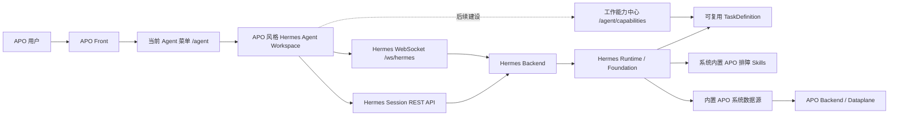

# Hermes 替换 AgentSRE 整体方案

> **当前实现标注说明（2026-08-12）**：`✅ 已完成` 表示已在当前 APO Front 仓库实现并通过 Hermes 前端单元测试、生产构建；`⏳ 待完成/待联调` 表示尚未在本仓库完成，或需要 Hermes Backend、网关、部署环境提供验收证据。以下标注仅反映当前仓库可确认的状态。

## 1. 文档说明

| 项目 | 内容 |
| --- | --- |
| 方案目标 | 使用 Hermes 完全替换基于 CrewAI 的 AgentSRE |
| 用户入口 | 保留 APO Front 当前 Agent 菜单及 `/agent` 页面入口 |
| 页面策略 | 不保留现有 AgentSRE 页面，迁移 Hermes 核心前端逻辑并按 APO 风格重新实现 |
| 用户体系 | 使用 APO 现有用户及登录体系，Hermes 会话按 APO 用户隔离 |
| APO 数据接入 | Hermes 内置固定的 APO 系统数据源，部署后自动可用 |
| 分析结果展示 | 指标、日志等接口结果转换为结构化 Evidence，并使用 APO 通用组件展示 |
| 排障能力 | 内置 APO 排障 Skills，引导 Hermes 使用 APO 特殊数据并形成完整证据链 |
| 工作能力中心 | 保留 Agent 页面入口及管理设计，待能力中心优化完成后实施，不纳入首期建设 |
| 数据源管理入口 | 保留 Hermes 数据源管理入口，普通用户不参与 APO 数据源配置 |
| AgentSRE 能力迁移 | 不迁移原有固定 RCA、Findings、CrewAI Agent 和工具编排逻辑 |
| 最终状态 | APO Front 及 Hermes 不再依赖、调用或部署 AgentSRE |

## 2. 建设背景

当前 APO Agent 页面通过 AG-UI 协议调用 AgentSRE。AgentSRE 基于 CrewAI 实现，其意图分类、分析路径、工具组合和结果展示均围绕固定场景开发，扩展新分析能力时需要持续修改 Agent、Task、Tool 和 Findings 结构，灵活性不足。

Hermes 已经具备通用会话、任务规划、工具调用、澄清确认、运行中调整、会话恢复和执行过程管理能力。此次改造不要求 Hermes 复刻 AgentSRE 原有的固定分析链路，而是将 Hermes 作为新的 Agent 分析执行引擎，并通过预置的 APO 接口获得分析所需数据。

因此，本次建设的核心不是“迁移 AgentSRE 功能”，而是完成以下替换：

```text
原链路：APO Front → AG-UI → AgentSRE → CrewAI → APO 接口

目标链路：APO Front → Hermes 会话协议 → Hermes → 内置 APO 数据源
```

## 3. 建设目标与范围

### 3.1 建设目标

1. ✅ 保留 APO 当前 Agent 菜单，用户仍从原入口使用 Agent。
2. ✅ 将 Hermes 核心对话和会话管理能力迁入 APO Front。
3. ✅ 使用 APO 的组件、布局、样式和用户体系重新实现 Agent 页面。
4. Hermes 会话、历史和运行状态按 APO 用户隔离。
5. 内置 Hermes 分析所需的 APO 接口，现场部署后无需配置数据源。
6. 内置数据源采用固定接口清单，不依赖模型分析 Swagger。
7. 将指标、日志等查询结果转换为结构化 Evidence，并提供通用趋势图和格式化展示。
8. 内置一组 APO 排障 Skills，确保 Hermes 在适用场景中主动查询 APO 特殊数据并遵守证据要求。
9. 预留 Agent 页面工作能力中心的入口、路由、权限和 TaskDefinition 管理设计，但不纳入首期开发范围。
10. 保留数据源管理入口，用于内部查看状态及管理其他 Swagger 数据源。
11. 完成切换后彻底下线 AgentSRE 服务、接口代理和前端依赖。

### 3.2 保留内容

- APO 当前 Agent 菜单。
- APO `/agent` 路由。
- APO 登录态、用户和租户体系。
- APO 前端整体布局、主题和组件规范。
- Hermes 的会话协议、会话恢复和事件处理能力。
- Hermes 原有数据源管理能力。
- Hermes 的 Skill 加载机制。

### 3.3 不保留内容

- AgentSRE 的 CrewAI 实现。
- AgentSRE 固定的慢调用、错误、资源等分析流程。
- AgentSRE 的意图分类规则。
- AgentSRE 的 Findings 数据结构和 Findings 树。
- 现有 AG-UI 通信协议。
- AgentSRE 模型配置接口。
- AgentSRE 会话接口和会话数据库依赖。
- 现有 Agent 页面中的快捷 SRE 问题、Dataplane 状态和专用证据树。

### 3.4 默认不纳入范围

- 不迁移 AgentSRE 历史会话至 Hermes。
- 不保证旧 AgentSRE 会话可以继续对话。
- 不要求 Hermes 输出与 AgentSRE 相同的结论、分析步骤或展示结构。
- 不在首期重写 Hermes 完整管理端页面。
- 不在首期建设 Agent 工作能力中心，待 Hermes 工作能力中心优化完成后再实施。

如项目要求保留旧历史，建议将 AgentSRE 数据库做只读归档，不纳入新会话系统。

## 4. 总体架构



系统职责划分如下：

| 组件 | 主要职责 |
| --- | --- |
| APO Front | Agent 菜单、页面布局、聊天界面、会话列表、登录态和用户体验 |
| Hermes 前端协议层 | WebSocket、JSON-RPC、会话创建与恢复、事件转换 |
| Hermes Backend | 会话持久化、身份隔离、运行上下文、数据源和能力注册 |
| Hermes Runtime | 理解用户问题、制定计划、选择和调用能力、生成回答 |
| 系统排障 Skills | 约束排障策略、证据关联、停止条件和禁止误判规则 |
| 工作能力中心（后续） | 管理可复用 TaskDefinition、版本、适用范围、测试和启停状态；首期仅保留设计 |
| 内置 APO 数据源 | 提供固定的 APO 查询接口及确定性接口描述 |
| APO Backend/Dataplane | 返回指标、日志、Trace、拓扑、服务和实例等实际数据 |

## 5. APO Front 改造方案

### 5.1 改造原则（✅ 前端已完成）

前端采用“迁移协议逻辑、重写展示组件”的方式，不直接整体复制 Hermes 大型页面。

可以复用的部分：

- JSON-RPC WebSocket Client。
- Hermes Session Client。
- 会话事件类型和解析逻辑。
- 消息标准化逻辑。
- 会话创建、恢复和历史加载逻辑。
- 断线重连及运行状态恢复逻辑。
- 协议层单元测试。

需要按 APO 风格重新实现的部分：

- Agent 页面布局。
- 会话侧边栏。
- 消息列表。
- 输入框和停止按钮。
- 工具执行状态展示。
- 澄清、确认和审批操作卡片。
- 空状态、加载状态和异常状态。

### 5.2 推荐目录结构

```text
src/pro/features/hermes/
├── client/
│   ├── jsonRpcClient.ts
│   ├── sessionClient.ts
│   ├── sessionApi.ts
│   └── types.ts
├── state/
│   ├── useHermesSession.ts
│   ├── useHermesMessages.ts
│   └── messageReducer.ts
├── components/
│   ├── SessionSidebar.tsx
│   ├── ChatMessages.tsx
│   ├── ChatInput.tsx
│   ├── ToolActivity.tsx
│   └── CheckpointCard.tsx
└── HermesAgentWorkspace.tsx
```

当前 `src/pro/views/agent/index.tsx` 已增加 Hermes 工作区入口，并默认使用 Hermes；但为兼容旧配置仍保留 AgentSRE 回退分支，因此“彻底移除 AGUI”仍为 ⏳ 待完成项。

### 5.3 必须支持的会话能力（✅ 前端协议层已完成）

| 能力 | Hermes 方法或接口 | 页面行为 |
| --- | --- | --- |
| 创建会话 | `session.create` | 新建会话并进入聊天页 |
| 恢复会话 | `session.resume` | 从持久化会话恢复新的实时 Session |
| 激活会话 | `session.activate` | 恢复仍然有效的实时 Session |
| 加载历史 | `session.history` | 展示历史消息和运行状态 |
| 提交问题 | `prompt.submit` | 发送用户问题并接收流式事件 |
| 运行中调整 | `session.steer` | 对正在执行的任务补充要求 |
| 停止执行 | `session.interrupt` | 中止当前任务 |
| 回应确认 | `approval.respond` | 确认或拒绝需要授权的操作 |
| 回应澄清 | `clarify.respond` | 回答 Hermes 提出的补充问题 |
| 会话管理 | Session REST API | 查询、选择、重命名和删除会话 |

即使首期不展示完整工作计划，也必须处理确认和澄清事件，否则 Hermes 任务可能停留在等待状态。

### 5.4 页面功能范围（✅ 当前首期前端已完成）

首期 Agent 页面已实现：

1. ✅ 会话列表。
2. ✅ 新建会话。
3. ✅ 会话切换。
4. ✅ 历史消息恢复。
5. ✅ 用户消息和 Hermes 回答展示。
6. ✅ 流式生成状态。
7. ✅ 工具执行过程的简化展示。
8. ✅ 停止回答。
9. ✅ 澄清问题输入。
10. ✅ 确认、拒绝或继续操作。
11. ✅ WebSocket 断线提示和自动重连。

以下能力可后续增强：

- 完整工作计划展示。
- Evidence 分类展示。
- 工作能力中心入口及管理页面。
- 运行审计详情。
- 分享和导出。

### 5.5 工作能力中心预留设计（非首期）

工作能力中心当前仍在优化，本次 Hermes 替换 AgentSRE 的首期建设不开发该入口和管理页面，仅保留后续集成设计。后续实施时，建议在 Agent 页面提供可见的“工作能力”入口，放在会话侧边栏底部或页面头部，与“新建会话”“历史会话”处于同一产品域内，使用户无需离开 Agent 模块即可查看和维护可复用工作能力。

建议采用以下子路由：

```text
/agent
/agent/capabilities
/agent/capabilities/:id
```

工作能力中心后续功能范围如下：

| 功能 | 说明 |
| --- | --- |
| 列表与搜索 | 按名称、分类、作用域、状态和更新时间查询工作能力 |
| 详情查看 | 查看说明、适用范围、正向示例、反向示例、必填输入、稳定步骤和证据要求 |
| 创建与复制 | 从空白或现有能力创建个人工作能力 |
| 编辑与版本 | 修改定义时生成新版本，保留历史版本和变更说明 |
| 启用与禁用 | 控制是否参与新问题的自动匹配，不影响历史运行记录 |
| 废弃与归档 | 停止新任务使用，但保留已有版本和运行记录 |
| 命中测试 | 输入一段问题，验证是否命中、命中原因及未命中的约束 |
| 运行统计 | 查看最近命中、确认、修改、执行成功和用户纠正情况 |

权限范围建议如下：

- 普通用户可以查看和管理自己创建的个人工作能力。
- 管理员可以创建和维护组织共享工作能力。
- 普通用户不能修改组织共享能力，只能查看、复制为个人版本或申请调整。
- 系统内置排障 Skills 不作为普通 TaskDefinition 编辑；可在管理端只读查看其名称、版本、状态和适用场景。
- 数据源管理权限、系统 Skill 管理权限和工作能力管理权限分别控制，避免一个入口获得全部系统配置权限。

上述内容属于后续建设设计，不作为本次首期开发、测试和验收要求。后续启用工作能力复用时，工作能力命中只代表系统找到了可复用方案，不代表用户已经授权执行。Agent 页面必须展示复用后的完整当前任务方案，并同时提供“确认并继续”和“修改方案”。用户修改只作用于当前 Run，不能静默回写或覆盖工作能力中心中的原定义；修改后应重新展示完整方案并再次确认。

## 6. APO 用户体系接入

### 6.1 身份要求

Hermes 当前主机版默认使用固定 `local-host` 作用域。接入 APO 后，必须由可信服务端将 APO 用户身份映射为 Hermes Owner。

建议映射规则：

```text
owner_type = apo_user
owner_id = apo:{tenantId}:{userId}
```

如当前 APO 不区分租户，可以使用：

```text
owner_id = apo:{userId}
```

### 6.2 身份传递链路

```text
APO 用户登录
→ APO Front 携带现有 Cookie 或 Token
→ APO 网关验证身份
→ 网关向 Hermes Backend 注入可信用户信息
→ Hermes 按 owner_id 查询和保存会话
```

Hermes Backend 不能直接信任前端传入的 `userId`，防止用户伪造身份读取其他用户的会话。

### 6.3 数据隔离要求

- 会话列表按 APO 用户过滤。
- 会话详情按 APO 用户校验。
- WebSocket Session 与当前用户绑定。
- 会话恢复时再次验证 Owner。
- 删除、重命名和中断会话时验证 Owner。
- 管理员权限和普通用户权限分开处理。

## 7. 网络与部署路由

建议由 APO 现有网关统一代理 Hermes：

```text
/ws/hermes          → Hermes Backend WebSocket
/hermes-api/*       → Hermes Backend REST API
```

如果复用 Hermes 原有 REST 路径，也可以按具体路由进行精确代理，但应避免与 APO 已有 `/api/*` 路由冲突。

WebSocket 代理必须支持：

- `Upgrade` 和 `Connection` Header。
- 长连接超时。
- HTTPS 环境下的 WSS。
- 登录 Cookie 或认证 Header 转发。
- 连接断开后的重新建立。

前端不得写死 Hermes 服务地址，应通过部署环境配置：

```text
VITE_HERMES_WS_URL
VITE_HERMES_API_BASE_URL
```

## 8. 内置 APO 系统数据源

### 8.1 建设目的

内置 APO 数据源用于：

1. 减少现场部署配置。
2. 避免现场人员手动接入 Swagger。
3. 避免模型对接口语义分析不准确导致接入失败。
4. 控制 Hermes 能够发现和调用的 APO 接口范围。
5. 保证不同现场环境中的接口能力保持一致。

### 8.2 实现原则

内置数据源不依赖以下过程：

- 不要求用户填写 Swagger 地址。
- 不要求用户选择接口。
- 不调用模型分析接口用途。
- 不修改或覆盖 APO 原始 Swagger。
- 不使用人工页面修改内置接口说明。
- 不自动导入 APO 全量接口。

内置数据源采用固定接口定义文件，由 Hermes Backend 直接加载和注册。

### 8.3 内置定义示例

建议增加：

```text
hermes_qa/builtins/apo_data_source.json
```

示例结构：

```json
{
  "id": "system-apo",
  "name": "APO 可观测性数据源",
  "type": "builtin",
  "definitionVersion": "1.0.0",
  "baseUrl": "http://APO_DEPLOY_IP:APO_PORT",
  "operations": [
    {
      "operationId": "queryServiceList",
      "name": "查询服务列表",
      "method": "GET",
      "path": "/api/service/endpoints",
      "description": "查询指定时间范围内的服务列表",
      "effect": "read",
      "parameters": []
    },
    {
      "operationId": "queryMetrics",
      "name": "查询指标时序",
      "method": "POST",
      "path": "/api/metric/query",
      "description": "查询指定服务、实例或主机的指标时序",
      "effect": "read",
      "requestBody": {}
    }
  ]
}
```

该文件是 Hermes 内部数据源定义，不是对 APO Swagger 的修改。

### 8.4 地址写入方式

接口的 Method、Path、参数和描述由产品版本固定维护；协议、IP、端口和认证信息由部署阶段写入。

推荐配置：

```text
APO_BUILTIN_SOURCE_BASE_URL=http://10.10.10.25:8080
APO_BUILTIN_SOURCE_AUTH_TYPE=header
APO_BUILTIN_SOURCE_CREDENTIAL_FILE=/run/secrets/apo-agent-token
```

现场用户不需要填写这些配置。安装脚本根据本次部署的 APO IP 和端口生成最终配置。

不建议将具体现场 IP 永久提交到源代码中，以免不同现场需要重新构建镜像。

### 8.5 接口范围

内置接口数量由产品研发控制，只注册 Hermes 分析需要的查询接口。建议按以下类型整理正式接口清单：

| 类别 | 主要用途 | 是否首期必须 |
| --- | --- | --- |
| 服务发现 | 查询服务、应用和端点 | 是 |
| 实例发现 | 查询实例、Pod、主机映射 | 是 |
| 数据源状态 | 判断指标、日志和 Trace 是否可用 | 是 |
| 指标查询 | 查询服务、实例和主机时序 | 是 |
| 日志查询 | 查询日志和异常日志 | 根据现场能力 |
| Trace 查询 | 查询调用链和慢调用 | 根据现场能力 |
| 拓扑查询 | 查询服务依赖关系 | 根据现场能力 |
| 告警查询 | 查询告警和异常事件 | 可选 |

正式开发前应冻结一份“内置 APO 接口清单”，包含：

- `operationId`。
- 接口名称。
- HTTP Method。
- Path。
- 参数及类型。
- 请求体定义。
- 必填字段。
- 时间单位。
- 返回结构。
- 是否只读。
- 超时时间。
- 接口之间的参数来源关系。

### 8.6 自动注册流程

Hermes Backend 启动时执行：

```text
读取内置 APO 数据源定义
→ 合并部署时写入的 APO 地址和凭据
→ 校验固定接口配置
→ 创建或更新 system-apo 数据源
→ 直接注册 Foundation Capability
→ 执行基础连通性检查
→ 记录数据源状态
```

注册过程不调用大模型。

注册逻辑必须幂等：

- 首次启动时创建。
- 重启时不重复创建。
- 定义版本未变化时不重复更新。
- 定义版本升级时同步更新接口清单。
- APO 暂时不可访问时保留数据源定义并标记不可用。

### 8.7 权限和凭据

如所有 APO 用户访问相同的可观测性数据，建议为 Hermes 创建只读服务账号，只开放内置清单中的查询接口。

如不同用户或租户能够访问的数据不同，应在调用时动态注入当前 APO 用户或租户身份，不能使用拥有全局权限的固定服务账号绕过 APO 权限。

## 9. 数据源管理入口

### 9.1 保留原则

Hermes 现有数据源管理入口继续保留，用于：

- 内部查看 APO 内置数据源状态。
- 管理后续接入的普通 Swagger 数据源。
- 排查接口连接和能力注册问题。

管理入口不需要复制到普通 APO Agent 页面，可以保留在 Hermes 管理端，或通过仅管理员可见的 APO 路由访问。

### 9.2 内置数据源管理行为

APO 内置数据源在页面中应标记为“系统内置”。

允许管理员：

- 查看当前数据源状态。
- 查看当前 APO 地址。
- 查看定义版本。
- 查看接口数量和接口信息。
- 执行连通性检测。
- 重新加载内置定义。
- 查看失败原因。

不允许通过页面：

- 删除系统内置数据源。
- 新增或删除内置接口。
- 修改内置接口 Method、Path、参数和说明。
- 修改 APO 原始 Swagger。
- 对内置接口发起 AI 语义重建。

内置接口变化通过产品版本升级发布。

### 9.3 普通 Swagger 数据源

普通 Swagger 数据源继续使用 Hermes 原有管理流程，不受内置 APO 数据源影响。

| 数据源类型 | 接入方式 | 是否模型分析 | 用户可见性 |
| --- | --- | --- | --- |
| APO 内置数据源 | Backend 启动时自动加载 | 否 | 普通用户不可见，管理员只读查看 |
| 普通 Swagger 数据源 | 管理入口手动接入 | 按 Hermes 原流程 | 管理员可见 |

## 10. 分析结果结构化展示

### 10.1 建设必要性

Hermes 通过 OpenAPI Provider 调用 APO 接口后，可以读取指标、日志、Trace 和其他查询结果，并将其用于模型分析和最终回答。但是，Hermes 当前的通用 API Evidence 主要展示接口方法、路径、接口标识、HTTP 状态和文字摘要，不具备 AgentSRE 页面已有的指标趋势图、格式化日志和 Trace 专用视图。

如果不增加结构化展示，系统在功能上仍然可以完成分析，但用户只能看到 Hermes 的文字结论和通用 API 调用信息，无法直观核对指标趋势、异常时间段和日志原文。

因此，本次替换应增加结构化分析证据展示层。该展示层用于增强分析结果的可验证性，不影响 Hermes 对问题的规划和分析逻辑。

### 10.2 设计原则

不针对 CPU、内存、延迟、错误率等具体指标分别开发固定页面，而是按查询结果的数据类型提供通用渲染能力：

| 结果类型 | 展示方式 |
| --- | --- |
| `timeseries` | 通用指标时序图 |
| `logs` | 格式化日志列表 |
| `trace` | Trace 调用关系或调用摘要 |
| `table` | 通用表格 |
| `json` | JSON 兜底展示 |
| `text` | 普通文本 |

CPU、内存、延迟等差异通过指标标题、单位、标签和数据序列表达，不为每一种指标绑定独立组件，避免重新形成 AgentSRE 固定且难扩展的展示模式。

### 10.3 内置接口展示定义

在 APO 内置数据源的固定接口信息中增加 `resultPresentation`，用于确定性描述接口结果如何转换成前端 Evidence。该配置属于 Hermes 内置数据源定义，不修改 APO Swagger，也不依赖模型判断数据类型。

指标接口示例：

```json
{
  "operationId": "queryMetrics",
  "name": "查询指标时序",
  "method": "POST",
  "path": "/api/metric/query",
  "effect": "read",
  "resultPresentation": {
    "type": "timeseries",
    "dataPath": "data.timeseries",
    "labelsPath": "labels",
    "pointsPath": "chart.chartData",
    "timestampUnit": "microseconds",
    "titlePath": "title",
    "unitPath": "unit"
  }
}
```

日志接口示例：

```json
{
  "operationId": "queryLogs",
  "name": "查询服务日志",
  "method": "POST",
  "path": "/api/log/query",
  "effect": "read",
  "resultPresentation": {
    "type": "logs",
    "dataPath": "data.logs",
    "timestampPath": "timestamp",
    "messagePath": "message",
    "levelPath": "level",
    "servicePath": "serviceName",
    "instancePath": "instanceName"
  }
}
```

### 10.4 Evidence 数据契约

建议新增以下 Evidence Kind：

| Evidence Kind | 内容 |
| --- | --- |
| `apo_metric_timeseries` | 指标标题、单位、标签和时序点 |
| `apo_log_records` | 日志时间、级别、服务、实例和消息 |
| `apo_trace_summary` | 服务调用关系、次数、耗时和错误数 |
| `apo_table` | 列定义和行数据 |
| `apo_json` | 未识别结果的 JSON 兜底数据 |

指标 Evidence 示例：

```json
{
  "kind": "apo_metric_timeseries",
  "summary": "订单服务 CPU 使用率查询结果",
  "details": {
    "title": "CPU 使用率",
    "unit": "%",
    "startTime": 1722900000000,
    "endTime": 1722903600000,
    "series": [
      {
        "name": "order-service-1",
        "labels": {
          "service": "order-service",
          "instance": "order-service-1"
        },
        "points": [
          [1722900000000, 31.2],
          [1722900060000, 35.7]
        ]
      }
    ]
  }
}
```

日志 Evidence 示例：

```json
{
  "kind": "apo_log_records",
  "summary": "查询到 32 条错误日志",
  "details": {
    "total": 32,
    "logs": [
      {
        "timestamp": 1722900000000,
        "level": "ERROR",
        "service": "order-service",
        "instance": "order-service-1",
        "message": "connection timeout"
      }
    ]
  }
}
```

Hermes Backend 应根据固定的 `resultPresentation` 将 APO API 返回结果转换为标准 Evidence，并持久化经过裁剪的 `details`。前端不直接根据某个接口的原始 JSON 临时猜测展示方式。

### 10.5 前端组件复用

APO Front 已经具备 ECharts、Chart.js、D3、React Virtuoso 和 React Window 等依赖，并存在指标、日志和 Trace 展示组件。本次改造可以复用其交互和样式能力，但需要解除这些组件与 AgentSRE Findings 数据结构的耦合。

建议形成通用组件：

```tsx
<MetricEvidenceChart evidence={evidence} />
<LogEvidenceViewer evidence={evidence} />
<TraceEvidenceView evidence={evidence} />
<TableEvidenceView evidence={evidence} />
<JsonEvidenceView evidence={evidence} />
```

前端建立 Evidence Renderer Registry，根据 `evidence.kind` 选择对应渲染器，未知类型统一进入 JSON 或文本兜底展示。

### 10.6 展示策略

- 工具调用过程默认折叠，避免一次分析展示大量中间数据。
- 每次成功的结构化查询生成一条 Evidence。
- Evidence 按 Hermes Run 和分析步骤分组。
- 指标默认展示摘要和关键时序，可展开查看完整图表。
- 日志默认展示有限条数，支持展开、搜索和复制。
- Trace 首期可展示聚合调用摘要，后续再增加完整调用关系图。
- 最终回答下方提供“查看分析依据”入口。
- 未配置 `resultPresentation` 的接口采用通用 API 卡片和 JSON 兜底。

### 10.7 数据量控制

不能将全部原始指标、日志和 Span 直接写入会话数据库，应由 Backend 生成适合模型和页面消费的展示投影：

- 指标每条时序建议最多保留 300～500 个展示点，超出后由 Backend 降采样。
- 日志默认保存和展示前 100～200 条，并记录总命中数量。
- Trace 按服务、目标或操作聚合，不直接持久化全部 Span。
- 大型表格限制行数和字段长度。
- 原始超大响应不进入聊天消息和 Workflow Evidence。
- Evidence 中保留查询对象、时间范围、单位和数据来源，确保结果可追溯。

### 10.8 实施优先级

第一阶段必须完成：

1. 通用指标趋势图。
2. 格式化日志列表。
3. 通用表格。
4. JSON 兜底展示。
5. Evidence 持久化和历史会话恢复。

第二阶段增强：

1. Trace 调用关系。
2. 服务拓扑。
3. 图表异常区间和阈值标记。
4. Hermes 最终结论与具体 Evidence 的引用关系。
5. 多指标对比和时间区间联动。

## 11. 内置排障 Skills 与工作能力中心

### 11.1 三类能力资产的职责边界

Hermes 替换 AgentSRE 后，需要同时具备确定性接口调用、通用排障方法和稳定方案复用能力，但三者不能混为一类资产。

| 资产 | 主要解决的问题 | 典型内容 | 管理方式 |
| --- | --- | --- | --- |
| 内置数据源 Capability 契约 | 某个 APO 接口如何正确调用 | 参数、单位、请求方式、前置接口、结果路径、权限、超时和展示定义 | 系统内置、随版本发布、管理员只读查看 |
| 排障 Skill（`SKILL.md`） | 面对某类问题应如何分析 | 分析策略、条件分支、证据关联、补查条件、停止条件和禁止误判规则 | 系统内置、版本化、普通用户不可修改 |
| 工作能力 TaskDefinition | 已验证的稳定任务方案如何复用 | 适用问题、正反示例、必填输入、稳定阶段、能力要求、证据要求和失败策略 | 工作能力中心管理，支持个人和共享作用域 |

例如，`/api/metric/list` 必须先于 `/api/metric/query` 调用、指标参数如何填写、返回数据路径和单位如何解析，应写入内置数据源 Capability 契约；“遇到延迟问题需要比较服务耗时、北极星 NET、RTT、Trace 和下游错误证据”，应写入排障 Skill；“某类已验证故障按照三个稳定阶段处理”，才适合作为工作能力 TaskDefinition。

不得将所有规则都写入一个大型 Skill，也不得将排障 Skill 重新写成固定的 CrewAI 流程，否则只会用另一种形式恢复 AgentSRE 的僵化问题。

### 11.2 首批内置 APO 排障 Skills

建议首期内置以下系统 Skills：

| Skill | 适用场景 | 核心要求 |
| --- | --- | --- |
| `apo-observability-basics` | 所有使用 APO 数据源的分析 | 明确时间范围、对象范围、数据新鲜度、空结果处理、证据引用和结论强度 |
| `apo-latency-troubleshooting` | 慢请求、耗时升高、接口超时 | 关联服务指标、实例指标、Trace、下游调用和网络观测数据 |
| `apo-error-chain-troubleshooting` | 错误率升高、HTTP 5xx、异常调用链 | 从报错位置继续追查实际失败服务，关联 Trace、下游日志和错误指标 |
| `apo-resource-troubleshooting` | CPU、内存、负载、进程或容器资源异常 | 区分主机、容器、进程和服务范围，识别资源竞争、泄漏和关联影响 |
| `apo-ebpf-network-correlation` | 北极星、RTT、网络延迟、连接异常 | 将 eBPF 网络观测与 Trace、服务指标和下游状态联合验证 |

基础 Skill 在当前 Run 使用 `system-apo` 数据源时自动加载；场景 Skill 根据用户问题、告警类型和已经发现的证据按需触发。首期不建议一次加载全部场景 Skill，避免上下文膨胀和无差别查询全部 APO 数据。

### 11.3 Skill 编写规范

每个排障 Skill 建议至少包含以下内容：

1. 适用范围：什么问题应使用该 Skill。
2. 反向范围：什么问题不应使用该 Skill。
3. 必须确认的上下文：时间范围、服务、实例、主机、调用方向等。
4. 分析分支：根据当前证据决定下一步查询，不规定唯一固定顺序。
5. 特殊数据触发条件：在什么现象下必须补查 APO 特殊指标或接口。
6. 证据关联规则：哪些数据只能作为线索，哪些组合后才能支撑结论。
7. 空结果和失败策略：接口无数据、权限不足、对象不存在时如何调整。
8. 停止条件：证据不足时停止在哪一层，并明确说明尚未证实的部分。
9. 禁止误判：列出高频但错误的直接推断。
10. 正向和反向案例：用于 Skill 路由和回归评测。

Skill 应写成“条件—动作—证据”的分析规则，而不是固定工具调用清单。例如：

- 北极星 NET 指标升高只能作为网络方向线索，不能直接判定网络故障；必须结合 RTT、Trace 调用耗时、目标服务状态或连接错误证据。
- 上游服务收到下游 HTTP 500 时，不能把上游记录错误的位置直接判为根因；应继续查询下游 Trace、错误日志和相关指标。
- APO 接口返回空数据时，应先核对时间范围、对象标识、数据源和前置查询结果，不能把“无数据”解释为“系统正常”。
- 结论必须引用对应 Evidence；如果只有相关性而没有因果证据，应使用“疑似”“需要进一步验证”等表述。

### 11.4 Skill 加载、版本与权限

- 系统 Skill 随 Hermes/APO 版本发布，使用稳定标识和独立版本号。
- Skill 加载失败时应产生明确运行告警，不能静默退化为无 Skill 分析。
- 每次 Run 记录实际加载的 Skill 标识和版本，便于复盘同一问题为何产生不同分析路径。
- 系统 Skill 默认只读，普通用户和普通管理员不能直接修改正文。
- Skill 升级前应通过固定问题集、反向问题集和特殊数据补查用例评测。
- 新版本出现异常时应支持回退到上一稳定版本。
- 工作能力中心可以展示系统 Skill 的基本信息，但编辑系统 Skill 应进入独立的系统管理和发布流程。

### 11.5 工作能力 TaskDefinition 设计

本节为后续工作能力中心优化完成后的集成预留设计，不纳入首期实现。工作能力中心维护的不是提示词片段，而是可以被匹配、展示、确认和执行的可复用 TaskDefinition。建议至少包含以下字段：

| 字段 | 说明 |
| --- | --- |
| 名称和说明 | 面向用户解释该能力解决什么问题 |
| 作用域 | 个人、组织共享或系统预置 |
| 分类和标签 | 用于列表筛选和匹配候选缩小 |
| 适用范围 | 能力适用的故障类型、对象和前置条件 |
| 正向示例 | 应命中该能力的用户问题 |
| 反向示例 | 名称相似但不应命中的用户问题 |
| 必填输入 | 执行前必须明确的时间、服务、实例等信息 |
| 稳定阶段 | 已经验证可以复用的任务阶段或步骤骨架 |
| Capability Requirements | 每个阶段要求具备的数据和可调用能力，不直接绑定临时地址或凭据 |
| 证据要求 | 每个阶段完成和最终结论必须获得的 Evidence |
| 失败策略 | 无数据、调用失败、部分成功和需要澄清时的处理方式 |
| 版本与状态 | 草稿、启用、禁用、废弃、归档及版本信息 |

TaskDefinition 应允许 Hermes 根据当前问题补充参数、调整非稳定步骤和选择满足要求的具体 Capability，但不能绕过必填输入、审批和证据要求。

### 11.6 工作能力匹配与复用控制

以下规则作为后续工作能力中心接入 Agent 页面时的控制要求，不属于首期验收范围。工作能力匹配应综合名称、说明、正向示例、反向示例、适用对象和必填输入，不能只按标题或关键词相似度选择。候选得分接近、关键信息缺失或反向示例冲突时，应放弃自动复用或先向用户澄清。

复用流程如下：

```text
用户问题
  → 检索候选工作能力
  → 校验适用范围、反向示例和必填输入
  → 生成当前 Run 的完整方案
  → 用户选择“确认并继续”或“修改方案”
  → 确认后执行
```

必须遵守以下控制要求：

- 高置信度命中也不能自动开始执行。
- 用户修改方案只更新当前 Run，不回写原 TaskDefinition。
- 修改后的方案必须重新确认。
- 工作能力被禁用或归档后不参与新任务匹配，但历史 Run 仍能读取原版本。
- 执行记录必须保存命中的能力 ID、版本、匹配原因、用户是否修改和最终结果。
- 工作能力统计应区分“命中”“用户确认”“用户修改”“执行成功”和“最终纠正”，用于后续优化匹配规则。

## 12. AgentSRE 下线方案

### 12.1 下线对象

完成切换后移除：

- AgentSRE 服务和容器。
- AgentSRE 数据库运行依赖。
- `/ai/api/v1/srechat` 代理。
- `/ai/api/v1/conversations/*` 代理。
- `/ai/api/v1/model-setting/*` 代理。
- APO Front 中的 `AGUIProvider` 和 `AGUIChat` 页面引用。
- AgentSRE Findings API 和前端 Findings 展示入口。
- AgentSRE 专用配置、健康检查和部署文件。

### 12.2 下线顺序

1. Hermes 环境完成部署。
2. APO Front 接入 Hermes 测试环境。
3. 完成会话、用户隔离和内置数据源验收。
4. 通过配置开关将 Agent 菜单切换到 Hermes 页面。
5. 观察稳定性并确认无 AgentSRE 请求。
6. 停止 AgentSRE 服务。
7. 删除 AgentSRE 网关代理和部署资源。
8. 清理 APO Front 未使用代码。
9. 备份或归档 AgentSRE 历史数据库。

## 13. 实施阶段

### 阶段一：范围和接口冻结

- 确认首期 Agent 页面功能。
- 确认 APO 用户身份字段和租户规则。
- 冻结内置 APO 接口清单。
- 冻结内置接口的 `resultPresentation` 和 Evidence 类型映射。
- 确认首批系统排障 Skills、评测问题集和版本管理方式。
- 确认 Hermes 和 APO 的部署地址及代理路径。
- 确认 AgentSRE 历史数据处理方式。

### 阶段二：Hermes 前端协议迁移（✅ 已完成）

- 迁移 JSON-RPC Client。
- 迁移 Session Client。
- 迁移事件类型和标准化逻辑。
- 建立 APO Front Hermes Feature 目录。
- 完成协议层单元测试。

### 阶段三：APO Agent 页面建设（✅ 已完成）

- 新建 Hermes Agent Workspace。
- 实现会话列表和会话切换。
- 实现消息列表和输入区。
- 实现停止、澄清和确认交互。
- 实现加载、错误和断线状态。
- 替换 `/agent` 页面入口。

### 阶段四：用户体系改造

- 网关解析 APO 用户身份。
- Hermes Backend 建立 Owner 映射。
- 会话查询、更新和 WebSocket 增加 Owner 校验。
- 验证多用户会话隔离。

### 阶段五：内置 APO 数据源

- 编制固定接口定义。
- 开发内置数据源 Loader。
- 开发启动幂等注册逻辑。
- 接入部署地址和凭据。
- 注册 Foundation Capability。
- 增加数据源状态和连通性检查。
- 在管理入口展示系统内置属性。

### 阶段六：结构化分析证据

- 定义指标、日志、Trace、表格和 JSON Evidence 契约。
- 在内置接口定义中增加 `resultPresentation`。
- 开发 APO API 结果到 Evidence 的 Backend 转换逻辑。
- 扩展 Evidence 持久化和 Workflow Projection。
- 从现有 AgentSRE 页面组件中提取通用指标、日志和 Trace 渲染器。
- 增加 Evidence Renderer Registry。
- 完成降采样、日志条数和数据大小限制。

### 阶段七：内置排障 Skills

- 编制首批五个系统排障 Skills。
- 建立基础 Skill 自动加载和场景 Skill 条件触发逻辑。
- 记录每次 Run 实际加载的 Skill 标识和版本。
- 建立正向、反向、空数据、特殊数据补查和禁止误判评测集。
- 完成系统 Skill 只读、版本升级和回退机制。

### 阶段八：联调与切换

- 验证 Hermes 能搜索并调用 APO 接口。
- 验证多轮会话、恢复、停止、确认和澄清。
- 验证排障 Skill 能在适用场景补查 APO 特殊数据。
- 验证断线和服务重启恢复。
- 通过开关将 Agent 菜单切换到 Hermes。
- 确认不再产生 AgentSRE 网络请求。
- 停止并移除 AgentSRE。

## 14. 风险与控制措施

| 风险 | 影响 | 控制措施 |
| --- | --- | --- |
| Hermes 前端协议后续变化 | APO 复制代码与上游不一致 | 协议层独立目录、记录上游版本、保留原始测试 |
| WebSocket 代理配置错误 | 无法连接或频繁断线 | 独立验证 Upgrade、超时、WSS 和重连 |
| 只迁移聊天而遗漏确认事件 | Hermes 任务停在等待状态 | 必须实现 approval 和 clarify 操作卡片 |
| APO 用户身份由前端伪造 | 会话越权 | 身份仅由网关和 Backend 注入 |
| 内置接口描述不准确 | Hermes 选择错误接口或参数 | 接口清单评审、固定契约测试、禁止模型改写 |
| 接口返回结构变化 | Evidence 转换失败或展示为空 | 为每个内置接口建立结果契约测试和 JSON 兜底 |
| 指标、日志数据量过大 | 页面卡顿、数据库膨胀 | Backend 降采样、条数限制、聚合和字段裁剪 |
| 展示组件继续依赖 Findings | AgentSRE 无法彻底下线 | 抽取通用 Evidence Props，禁止引用 Findings 类型 |
| APO 地址写死在代码中 | 不同现场需要重新构建 | 地址由部署脚本写入配置，接口信息保持固定 |
| APO 接口临时不可用 | 数据源启动失败 | 保留定义、标记异常、允许自动恢复和人工检测 |
| 固定服务账号权限过大 | 绕过 APO 权限 | 使用最小权限只读账号或动态注入用户权限 |
| Skill 内容过大或无差别加载 | 每次分析查询全部数据、上下文膨胀 | 基础 Skill 自动加载，场景 Skill 按条件触发并限制职责范围 |
| Skill 加载失败或未命中 | Hermes 遗漏 APO 特殊数据 | 加载失败显式告警、记录 Run 版本、建立特殊数据补查评测 |
| Skill 重新固化为固定流程 | 形成新的 AgentSRE 式僵化编排 | 使用条件分支、证据要求和停止条件，不写唯一工具调用顺序 |
| AgentSRE 过早下线 | 新链路问题无法回退 | 先通过开关切流，稳定后再删除服务 |

## 15. 测试方案

### 15.1 前端测试

- 创建新会话。
- 切换历史会话。
- 页面刷新后恢复会话。
- 发送问题并接收流式回答。
- 显示工具执行状态。
- 停止当前任务。
- 回应 Hermes 澄清。
- 确认或拒绝操作。
- WebSocket 断开后自动重连。
- Hermes 不可用时显示明确错误。

### 15.2 用户隔离测试

- 用户 A 无法查看用户 B 的会话。
- 修改 Session ID 不能越权访问。
- WebSocket 恢复时重新校验 Owner。
- 删除和重命名会话时校验 Owner。
- 管理员入口与普通用户入口权限正确。

### 15.3 内置数据源测试

- 全新数据库启动时自动创建 `system-apo`。
- 重启服务不重复创建数据源。
- 模型服务不可用时仍能注册内置数据源。
- 内置接口数量与定义文件一致。
- 接口地址使用部署配置中的 APO IP 和端口。
- 定义版本升级后自动更新。
- APO 暂时不可用时数据源保留并标记异常。
- Hermes 能搜索并调用每一个首期必需接口。
- 管理页面不能删除或修改系统内置接口。

### 15.4 结构化展示测试

- 指标接口结果能够生成 `apo_metric_timeseries` Evidence。
- 多条时序能够按标签区分并正确绘制。
- 不同时间单位能够统一转换为前端时间戳。
- 大量时序点能够被正确降采样。
- 日志接口结果能够生成 `apo_log_records` Evidence。
- 日志时间、级别、服务、实例和消息展示正确。
- 日志支持搜索、展开和复制。
- Trace、表格和 JSON 兜底渲染正确。
- 页面刷新和恢复历史会话后 Evidence 仍可展示。
- 未知或异常返回结构不会导致 Agent 页面崩溃。

### 15.5 排障 Skill 测试

- 使用 `system-apo` 数据源时自动加载基础 Skill。
- 延迟、错误链、资源和网络问题能够触发对应场景 Skill。
- 反向问题不会错误加载不相关的场景 Skill。
- 触发条件满足时能够主动补查 APO 特殊数据。
- 北极星 NET 高但 RTT、Trace 和下游证据不支持时，不直接输出网络故障结论。
- 上游记录下游 HTTP 500 时，能够继续追查下游 Trace 和日志。
- 接口空数据时能够核对时间、对象和前置结果，不将空结果解释为正常。
- 每个 Run 能记录实际加载的 Skill 标识和版本。
- 系统 Skill 加载失败时产生明确告警。
- 普通用户不能修改、删除或覆盖系统 Skill。

### 15.6 下线验证

- 浏览器不再请求 AgentSRE 接口。
- APO Backend 和网关不再转发 AgentSRE 请求。
- AgentSRE 容器停止后 Agent 页面仍能正常使用。
- AgentSRE 数据库不可用时不影响 Hermes。
- 删除旧代理配置后 Agent 页面仍能完成完整对话。

## 16. 验收标准

满足以下条件后认定替换完成：

1. ✅ 用户仍从 APO 当前 Agent 菜单进入 Agent 页面。
2. ✅ 页面使用 APO 样式，核心逻辑由 Hermes 提供。
3. ✅ 用户可以创建、恢复、切换和删除自己的会话（前端已实现，后端权限待联调）。
4. ✅ 用户可以正常提问并获得 Hermes 回答（协议及页面已实现，需环境联调）。
5. ✅ Hermes 的停止、澄清和确认流程可用（前端交互及协议调用已实现）。
6. 会话按照 APO 用户或租户隔离。
7. 新环境部署后自动创建 APO 内置数据源。
8. 现场用户不需要配置 Swagger 或接口信息。
9. 内置数据源注册过程不调用大模型。
10. Hermes 能调用预置的 APO 接口完成数据获取。
11. 指标查询结果能够以通用时序图展示。
12. 日志查询结果能够格式化展示并支持搜索和复制。
13. 未配置专用展示的结果能够使用表格、JSON 或通用 API 卡片兜底。
14. Evidence 在历史会话恢复后仍然可查看。
15. 管理员可以查看内置数据源状态和接口信息。
16. 普通用户不能修改或删除内置数据源。
17. 系统已内置首批 APO 排障 Skills，并能按基础和场景规则正确加载。
18. 特殊 APO 数据满足触发条件时能够被主动补查，并形成可引用 Evidence。
19. 系统 Skill 具备版本记录、评测和回退能力，普通用户不能修改。
20. Agent 页面不再调用任何 AgentSRE 接口。
21. 生产环境不再部署 AgentSRE 服务。

## 17. 交付物

本次改造应至少交付：

1. APO Front Hermes 协议 Client。
2. APO 风格 Agent 会话页面。
3. APO 用户身份与 Hermes Owner 映射实现。
4. WebSocket 和 REST 网关代理配置。
5. APO 内置数据源定义文件。
6. 内置数据源加载及幂等注册逻辑。
7. 系统内置数据源管理页面适配。
8. 内置 APO 接口清单及接口契约测试。
9. 指标、日志、Trace、表格和 JSON Evidence 数据契约。
10. 通用 Evidence Renderer 组件及结果转换逻辑。
11. 首批 APO 系统排障 Skills 及版本清单。
12. 排障 Skill 正向、反向、特殊数据补查和禁止误判评测集。
13. 前端、Backend 和集成自动化测试。
14. AgentSRE 下线及回退操作说明。
15. 部署配置说明和验收报告。

## 18. 最终结论

本次替换采用“APO 原入口、APO 原用户体系、Hermes 会话内核、固定 APO 数据源”的建设方式。

前端不复刻 AgentSRE，也不整体搬迁 Hermes 页面，而是迁移 Hermes 的协议、会话和事件处理逻辑，并按 APO 产品风格重新实现核心界面。Hermes 通过启动时自动注册的 APO 系统数据源获取分析数据，接口数量、访问地址和接口信息由产品提前控制，不依赖现场配置和模型接入分析。

对于指标、日志、Trace 等分析结果，系统通过内置接口中的固定展示定义转换为结构化 Evidence。APO Front 按数据类型使用通用趋势图、日志列表、Trace、表格和 JSON 组件展示，不针对具体指标和固定分析场景开发专用页面，使用户既能获得 Hermes 的文字结论，也能查看支持结论的实际数据。

系统同时内置 APO 排障 Skills，确保 Hermes 在适用场景下能够使用 APO 特殊数据、建立证据关联并避免常见误判。工作能力中心的入口、TaskDefinition、权限和复用控制设计在本方案中保留，但由于工作能力中心仍在优化，不纳入首期开发、测试和验收；待其能力稳定后再按预留设计接入 Agent 页面。

数据源管理入口继续保留，但 APO 内置数据源由系统管理、只读展示，普通用户无需接触。完成切换和验收后，AgentSRE 的服务、接口、前端协议和运行依赖全部下线。
